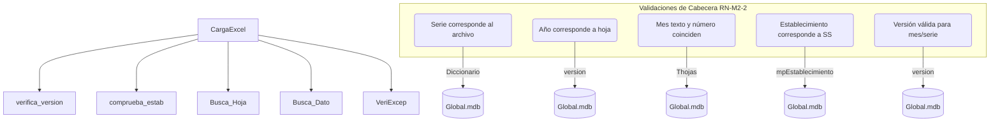
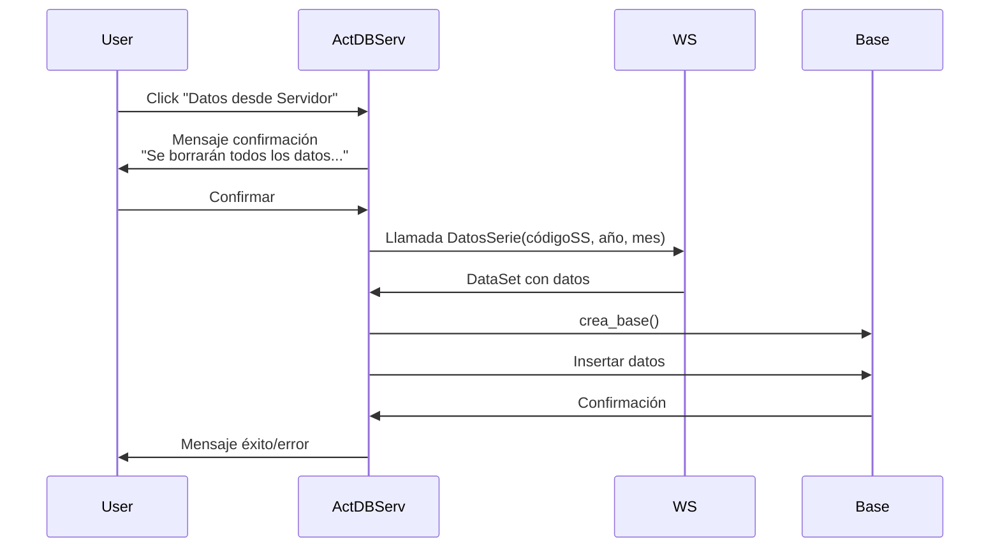
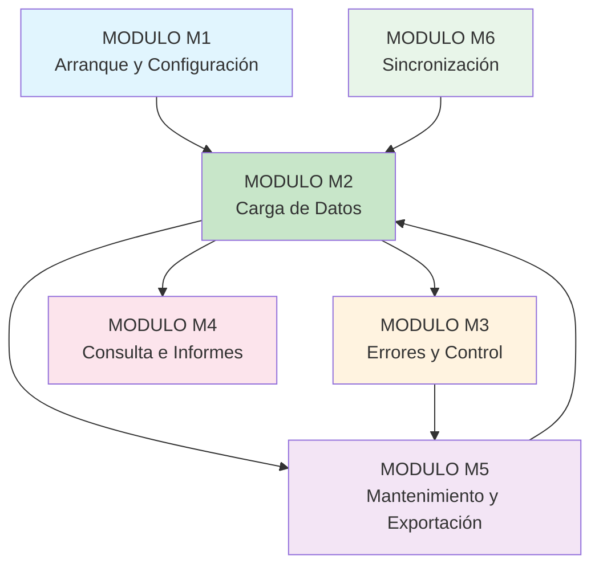

# Flujo de Datos - Módulo de Carga (M2 - CARGA DE DATOS)

## Índice
1. [Arquitectura General del Sistema](#1-arquitectura-general-del-sistema)
2. [Estructura de Datos del Módulo](#2-estructura-de-datos-del-módulo)
3. [Flujo de Entrada](#3-flujo-de-entrada)
4. [Motor de Validación](#4-motor-de-validación)
5. [Flujo de Persistencia](#5-flujo-de-persistencia)
6. [Componentes del Módulo](#6-componentes-del-módulo)
7. [Estructura por Serie](#7-estructura-por-serie)
8. [Flujos Detallados](#8-flujos-detallados)
9. [Reglas de Negocio Clave](#9-reglas-de-negocio-clave)
10. [Volúmenes y Tamaños Típicos](#10-volúmenes-y-tamaños-típticos)
11. [Integración con otros módulos](#11-integración-con-otros-módulos)
12. [Estado de validación pendiente](#12-estado-de-validación-pendiente)

---

## 1. Arquitectura General del Sistema

### Tecnología Base
- **Plataforma:** Windows Forms (.NET Framework 4.8, x86)
- **Base de datos:** Microsoft Access Database (Jet/ACE 32-bit)
- **Archivo Excel:** NPOI 2.3 para .xlsx/.xlsm, ACE OLEDB para .xls
- **Web Services:** SOAP ASMX (System.Web.Services)

### Estructura de Carpetas
```
Instalación/
├── Global.mdb          (422 MB) - Catálogos maestros
├── Trans.mdb           - Histórico, SetServicio, LogError
├── Datos/
│   └── DatosSERIE{serie}{año}.mdb
├── Control/
│   └── ControlSERIE{serie}{año}.mdb
├── Temporal/
│   ├── Temporal.mdb
│   ├── TemporalIncorrectos.mdb
│   ├── TemporalControl.mdb
│   └── TemporalInforme1.mdb
├── MASTER.mdb          - Plantilla MINSAL
└── ValidadorRem.exe    - Aplicación principal
```

---

## 2. Estructura de Datos del Módulo

### Diagrama de Entidad-Relación

```mermaid
erDiagram
    datos {
        LONG ano
        LONG mes
        LONG idservicio
        TEXT idestablecimiento
        TEXT codigoprestacion
        DOUBLE col01
        DOUBLE col02
        ...
        DOUBLE col50
        DATETIME fechacarga
    }
    
    LogError {
        TEXT archivo
        TEXT idestablecimiento
        LONG mes
        LONG ano
        TEXT serie
        LONG linea
        TEXT hoja
        TEXT dato
        MEMO mensaje_error
        DATETIME fecharegistro
    }
    
    INCORRECTO {
        LONG ano
        LONG mes
        LONG idservicio
        TEXT idestablecimiento
        TEXT codigoprestacion
        DOUBLE col01
        ...
        DOUBLE col50
        DATETIME fechacarga
        MEMO motivo_error
    }
    
    HistCarga {
        LONG IdEstablecimiento
        LONG Mes
        LONG Ano
        TEXT Serie
    }
    
    version {
        LONG ano
        LONG mes
        TEXT Serie
        TEXT SerieExcel
        TEXT version
    }
    
    Thojas {
        LONG ano
        LONG mes
        TEXT Serie
        TEXT Hoja
        TEXT Rango
    }
    
    Diccionario {
        TEXT CodigoPrestacion
        TEXT Hoja
        LONG linea
        TEXT Inicio
        TEXT Fin
        LONG Posicion
        TEXT tipoDato
    }
    
    datos ||--o{ LogError : "genera"
    datos ||--o{ INCORRECTO : "puede generar"
    datos ||--o{ HistCarga : "registra"
    version ||--o{ Thojas : "define"
    Diccionario ||--o{ Thojas : "mapea"
```

### Tablas Principales

| Tabla | Ubicación | Propósito | Volumen típico |
|-------|-----------|-----------|----------------|
| `datos` | DatosSERIE{serie}{año}.mdb | Almacena datos validados por establecimiento y prestación | ~15,000 filas/año/serie |
| `LogError` | Trans.mdb | Registra errores con detalle estructurado | Variable (0-N filas) |
| `INCORRECTO` | TemporalIncorrectos.mdb | Almacena registros que fallan validación | Variable |
| `HistCarga` | Trans.mdb | Histórico de cargas completadas | ~4,000 filas |
| `version` | Global.mdb | Define versiones válidas por año/mes/serie | 939 filas |
| `Thojas` | Global.mdb | Define estructura de hojas Excel | 1,129 filas |
| `Diccionario` | Global.mdb | Mapeo de celdas a campos por prestación | 185,526 filas |
| `Excep`/`colexcep` | Global.mdb | Define columnas no aplicables | 5,664 / 2,977 filas |

---

## 3. Flujo de Entrada

### Flujo de Carga Individual (CargaDatos)

```mermaid
flowchart TD
    A[Seleccionar Serie/Año/Mes] --> B{Validar SS?}
    B -- No --> C[Mensaje: "Elegir Servicio de Salud"]
    B -- Sí --> D[Seleccionar archivo Excel]
    D --> E{Extensión válida?}
    E -- No --> F[Mensaje: Extensión no admitida]
    E -- Sí --> G[Leer archivo según extensión]
    G --> H[Verificar versión/cabecera]
```

### Elementos de UI - CargaDatos

| Control | Propósito | Validación |
|---------|-----------|------------|
| `Cb_serie` | Series disponibles: A, BS, BM, D, P, F | Requerido |
| `Cb_ano` | Años disponibles (2009-act) | Requerido |
| `Cb_mes` | Meses: Ene-Dic o 1-12 | Requerido |
| `Btn_buscar` | Selector de archivo Excel | Filtro: *.xls;*.xlsx;*.xlsm |

### Lectura según extensión

| Extensión | Tecnología | Conexión OLEDB |
|-----------|------------|----------------|
| .xls | Microsoft.ACE.OLEDB.12.0 | Excel 8.0;HDR=Yes;IMEX=1 |
| .xlsx | NPOI 2.3 | Método `Carga_NombreNPOI` |
| .xlsm | NPOI 2.3 | Igual que .xlsx |

---

## 4. Motor de Validación

### Flujo de Validación



### Tablas de referencia

| Tabla | Uso | Volumen |
|-------|-----|---------|
| `version` | Valida combos año/mes/serie | 939 filas |
| `Thojas` | Define hojas válidas por periodo | 1,129 filas |
| `Diccionario` | Mapeo de celdas a prestaciones | 185,526 filas |
| `Excep`/`colexcep` | Columnas no aplicables por hoja | 5,664 / 2,977 filas |
| `mpEstablecimiento` | Validación de códigos SS | 3,207 filas |

---

## 5. Flujo de Persistencia

### Diagrama de Persistencia

```mermaid
flowchart TB
    subgraph "Después Validación"
        A[Datos Validados] --> B[Confirmar Sobrescritura RN-M2-5]
        C[Datos Inválidos] --> D[Registrar en LogError]
        
        subgraph "Persistencia de Datos Válidos"
            B --> E[DELETE existentes]
            E --> F[INSERT INTO datos]
            F --> G[Fechacarga = NOW()]
        end
        
        subgraph "Persistencia de Errores"
            D --> H[INSERT INTO LogError<br/>Trans.mdb]
            D --> I[INSERT INTO INCORRECTO<br/>TemporalIncorrectos.mdb]
        end
        
        subgraph "Registro Histórico"
            F --> J[INSERT INTO HistCarga]
        end
    end
```

### Operaciones SQL

#### Inserción de datos válidos
```sql
INSERT INTO datos (ano, mes, idestablecimiento, codigoprestacion, 
                   col01, col02, ..., col50, fechacarga)
VALUES (@ano, @mes, @establecimiento, @prestacion, 
        @val1, @val2, ..., @val50, NOW());
```

#### Registro de errores
```sql
INSERT INTO LogError (archivo, idestablecimiento, mes, ano, serie,
                      linea, hoja, dato, mensaje_error)
VALUES (@archivo, @establecimiento, @mes, @ano, @serie,
        @linea, @hoja, @dato, @mensaje);
```

#### Borrados para sobrescritura RN-M2-5
```sql
DELETE FROM datos WHERE ano = @ano AND mes = @mes 
                      AND idestablecimiento = @establecimiento 
                      AND serie = @serie;

DELETE FROM LogError WHERE ano = @ano AND mes = @mes 
                         AND idestablecimiento = @establecimiento 
                         AND serie = @serie;

DELETE FROM HistCarga WHERE ano = @ano AND mes = @mes 
                          AND IdEstablecimiento = @establecimiento 
                          AND Serie = @serie;
```

---

## 6. Componentes del Módulo

| Componente | Tipo | Acceso | Entradas | Salidas | Estado |
|------------|------|--------|----------|---------|--------|
| **CargaDatos** | Formulario | Usuario | Serie, Año, Mes, Archivo | datos, LogError, HistCarga | ✅ Implementado |
| **CargaDatosMultiple** | Formulario | Usuario | Carpeta con archivos | datos, LogError, HistCarga | ✅ Implementado |
| **ActDBServ** | Formulario | Usuario | Parámetros WS | datos (nuevo) | ✅ Implementado |
| **CargaExcel** | Clase mecánica | Llamado M2 | Archivo Excel, contexto | Resultado validación | ✅ Implementado |
| **bases** | Clase estática | Llamado M2/M5 | Operaciones CRUD | Acceso BD | ✅ Implementado |
| **verifica_version** | Función | CargaExcel | Archivo Excel | Boolean | ✅ Implementado |
| **comprueba_estab** | Función | CargaExcel | Código establecimiento | Boolean | ✅ Implementado |
| **Busca_Hoja** | Función | CargaExcel | Nombre hoja, rango | DataTable | ✅ Implementado |
| **Busca_Dato** | Función | CargaExcel | Celda, tipo dato | Valor validado | ✅ Implementado |
| **VeriExcep** | Función | CargaExcel | Excepciones | Datos normalizados | ✅ Implementado |

---

## 7. Estructura por Serie

### Serie A (Hospitales)
```
Hojas: "Prestaciones", "Resumen"
Uso: Hospitales y establecimientos generales
Columnas: col01-col50 (valores numéricos)
```

### Serie BS (Servicios Especializados)
```
Hojas: "Prestaciones", "Resumen"
Uso: Servicios de salud especializados
Estructura similar, campos diferentes según Diccionario
```

### Serie BM (Balnearios)
```
Hojas: "Prestaciones", "Resumen"
Uso: Balnearios/Salud del ambiente
```

### Serie D (Discapacitados)
```
Hojas: "Prestaciones", "Resumen"
Uso: Registro de discapacitados
```

### Serie P (Particulares)
```
Hojas: "Prestaciones", "Resumen"
Uso: Servicios de salud particulares
```

### Serie F (Fuerzas Armadas)
```
Hojas: "Prestaciones", "Resumen"
Uso: Fuerzas Armadas
```

---

## 8. Flujos Detallados

### F2.1: Carga Múltiple (CargaDatosMultiple)

```mermaid
flowchart LR
    A[Seleccionar carpeta] --> B[Validar carpeta]
    B --> C[Listar archivos .xls/.xlsx/.xlsm]
    C --> D{¿Archivos encontrados?}
    D -- Sí --> E[Para cada archivo: ProcesaArchivo]
    D -- No --> F[Mensaje: "Debe Ingresar Ruta de Archivo"]
    E --> G[ProgressBar: progreso]
    G --> H[Acumular resultados]
    H --> I{¿Todos procesados?}
    I -- No --> E
    I -- Sí --> J[Mostrar resumen<br/>Registros Correctos/Incorrectos]
```

### Elementos de UI - CargaDatosMultiple

| Control | Propósito |
|---------|-----------|
| `txtRuta` | Muestra ruta de carpeta seleccionada |
| `ProgressBar1` | Indica progreso general |
| `lblArchivoActual` | Muestra archivo siendo procesado |
| `lblArchivosProcesados` | Contador de archivos completados |
| `lblTotalArchivos` | Total de archivos a procesar |
| `dgvRegistros` | Tabla con registros correctos/incorrectos |
| `btnMostrarErrores` | Toggle para ver/ocultar errores |

### F2.2: Descarga desde Servidor (ActDBServ)



### Web Services Involucrados

| Web Service | Operación | Parámetros | Uso |
|-------------|-----------|------------|-----|
| `CargaSerieServ` | `DatosSerie` | (string códigoSS, int año, int mes) | Descargar datos por SS |
| `CargaControlServ` | `DatosControl` | (string códigoSS, int año, int mes) | Descargar datos de control |
| `CargaSerie` | `serieA, serieBS...` | (string códigoSS) | Descargar datos por serie |

---

## 9. Reglas de Negocio Clave

| Código | Nombre | Descripción | Estado |
|--------|--------|-------------|--------|
| **RN-M2-1** | Extensiones Admitidas | Solo .xls, .xlsx, .xlsm permitidos | ✅ Implementado |
| **RN-M2-2** | Validación de Cabecera | Verifica: Serie, Año, Mes, Establecimiento, Versión | ✅ Implementado |
| **RN-M2-3** | Versión de Plantilla | Tabla `version` define combos válidos | ✅ Implementado |
| **RN-M2-4** | Estructura por Hoja | Definida en `Diccionario`, `Thojas`, `Excep` | ✅ Implementado |
| **RN-M2-5** | Confirmación de Sobrescritura | Pregunta antes de borrar datos existentes | ✅ Implementado |
| **RN-M2-6** | Carga desde Servidor (Destructiva) | Borra toda base local antes de cargar | ✅ Implementado |
| **RN-M2-7** | Registro de Estado Parcial | Datos válidos/incorrectos en bases separadas | ✅ Implementado |
| **RN-M2-8** | Sin Datos Válidos | Mensaje: "No hay Datos a Ingresar" | ✅ Implementado |
| **RN-M2-9** | Limpieza Excel Processes | `KillAllAddedExcelProcesses()` | ✅ Implementado |
| **RN-M2-10** | Manejo Códigos con Guion | Códigos con `-` listados aparte | ✅ Implementado |

---

## 10. Volúmenes y Tamaños Típicos

```text
┌─────────────────────────────────────────────────────────────────┐
│                    Volúmenes de Datos                            │
├────────────────────┬───────────┬─────────────────────────────────┤
│ Tabla              │ Filas     │ Ubicación                       │
├────────────────────┼───────────┼─────────────────────────────────┤
│ Diccionario        │ 185,526   │ Global.mdb (catálogo master)    │
│ mpEstablecimiento  │ 3,207     │ Global.mdb                        │
│ version            │ 939       │ Global.mdb (por año/mes/serie)  │
│ Thojas             │ 1,129     │ Global.mdb                        │
│ Excep              │ 5,664     │ Global.mdb                        │
│ colexcep           │ 2,977     │ Global.mdb                        │
│ mpServicio         │ 30        │ Global.mdb                        │
│ datos (ej. 2026P)  │ 15,060    │ DatosSERIEP2026.mdb               │
│ HistCarga          │ ~4,000    │ Trans.mdb                         │
│ cargados           │ 602       │ Temporal.mdb                      │
└────────────────────┴───────────┴─────────────────────────────────┘
```

### Tabla de Estado por Serie

| Campo | Tipo | Descripción |
|-------|------|-------------|
| `ano` | Long | Año del registro |
| `mes` | Long | Mes (1-12) |
| `idservicio` | Long | Identificador del servicio |
| `idestablecimiento` | Text(50) | Código del establecimiento |
| `codigoprestacion` | Text(20) | Código de la prestación |
| `col01` - `col50` | Double | Valores numéricos por columna |
| `fechacarga` | DateTime | Timestamp de carga |

---

## 11. Integración con otros módulos



### Dependencias Transversales

| Regla | Descripción | Afecta |
|-------|-------------|--------|
| RN-G1 | SS seleccionado es obligatorio | Todos los módulos M2-M6 |
| RN-G2 | Un solo SS por instalación | M1, Sincronización |
| RN-G3 | Partición por serie y año | Todos los módulos |
| RN-G4 | Sin control de acceso | Todos los módulos |

---

## 12. Estado de validación pendiente

| Elemento | Estado | Comentario |
|----------|--------|------------|
| Cálculo de "puntos" en InformeControl | ❌ Pendiente | Criterio exacto no documentado |
| Límite de tamaño de archivo Excel | ❌ Pendiente | No especificado en documentación |
| Manejo de macros en .xlsm | ❌ Pendiente | Documentación indica que no se ejecutan |
| Concurrencia en archivos .mdb | ❌ Pendiente | Manejo de archivos bloqueados no detallado |
| Formato exacto del archivo MINSAL | ❌ Pendiente | Estructura interna no validada |
| Efecto de `generacion = False` | ❌ Pendiente | Significado exacto no documentado |
| Manejo explícito de códigos HTTP | ❌ Pendiente | No se observó en análisis estático |
| Hosts de prueba disponibles | ❌ Pendiente | Requiere confirmación con TI |
| Roles requeridos en sistema | ❌ Pendiente | Definir con negocio |
| Documentación Serie SAX | ❌ Pendiente | Serie local SS Osorno, documentación aparte |

---

## Anexos

### A. Mensajes de UI principales

| Estado | Mensaje |
|--------|---------|
| Error selección | "Error de Seleccion" |
| Sin datos | "No hay Datos" |
| Confirmación sobrescritura | "ATENCION: Se sobreescribirá la información..." |
| Éxito | "Proceso Finalizado con Éxito" |
| Error | "Ejecutado con error" |
| Cancelado | "Operacion Cancelada" |

### B. Tecnologías utilizadas

- **Runtime:** .NET Framework 4.8, x86
- **UI Framework:** WinForms (System.Windows.Forms)
- **Persistencia:** OleDb (Jet/ACE 32-bit)
- **Excel Reading:** NPOI 2.3, Microsoft.ACE.OLEDB.12.0
- **WebSocket:** System.Web.Services (SOAP ASMX)
- **Export Excel:** Microsoft.Office.Interop.Excel 14.0

### C. Referencias cruzadas

- **Módulo M1 (Arranque):** Verifica versión y establece contexto SS
- **Módulo M3 (Errores):** Recibe errores del motor de validación
- **Módulo M4 (Consultas):** Lee datos persistidos en tabla `datos`
- **Módulo M5 (Mantenimiento):** Opera sobre datos cargados
- **Módulo M6 (Sincronización):** Provee datos para validación

---

**Estado del Documento:** Basado en análisis estático del sistema ValidadorRem versión 3.12.000. Requiere validación con ejecución en entorno de prueba y captura de tráfico SOAP para confirmar flujos exactos.