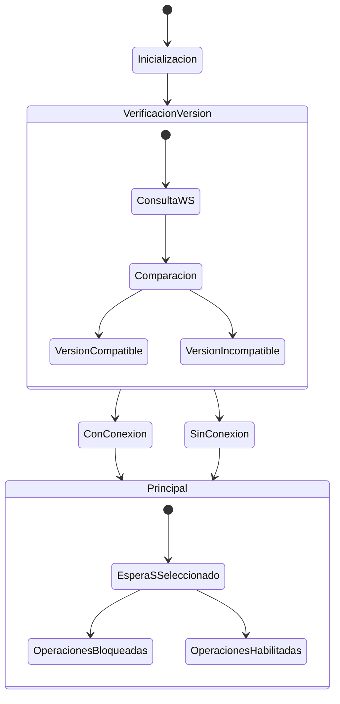
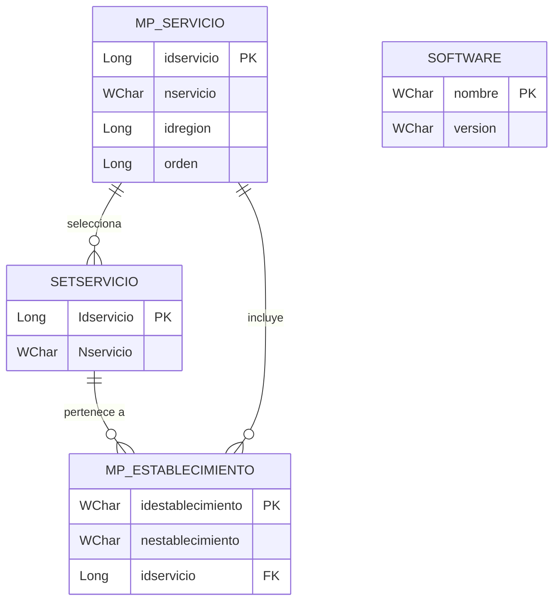
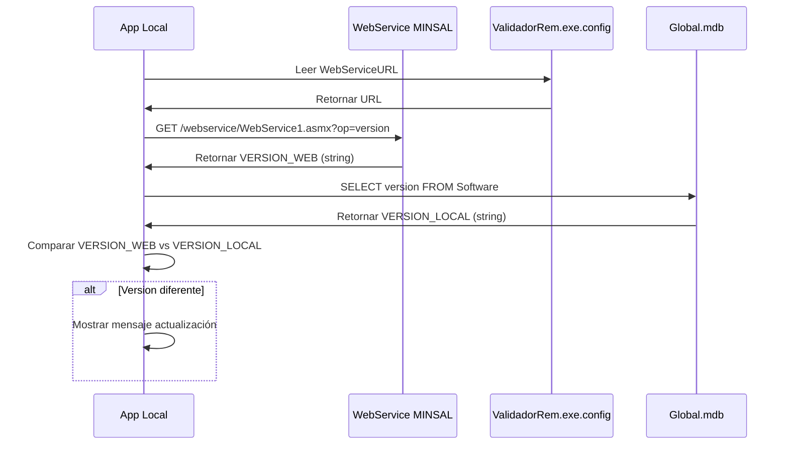

# Módulo M1 Profundizado: Arranque y Configuración

Versión documentada: 1.0 | Estado: ✅ Implementado | Fecha: 2026-11-05

---

## 1. Arquitectura del Módulo

### Componentes Principales

| Componente | Tipo | Propósito | Implementación |
|------------|------|-----------|----------------|
| **Principal** | Formulario | Shell principal con menú (13 botones) | ✅ |
| **primera** | Formulario | Splash de bienvenida primera ejecución | ✅ |
| **Cargando** | Formulario | Indicador de actividad en background | ✅ |
| **Seteo** | Formulario | Diálogo selección Servicio de Salud | ✅ |
| **buscaActualizacion** | Formulario | Splash durante consulta actualizaciones | ✅ |

---

## 2. Flujos Detallados

### F1.1: Flujo de Arranque e Inicialización

```mermaid
flowchart TD
    A[Inicio aplicación<br/>STAThread] --> B[Splash: 'Cargando...']
    B --> C[buscaActualizacion<br/>'Buscando actualizaciones...']
    C --> D[Principal.Form1_Load]
    D --> E{Actualizado.txt existe?}
    E -- Sí --> F[Actualizacion.actualizar<br/>y delete archivo]
    E -- No --> G[Verificar conectividad WS]
    G --> H[WebService1.version()]
    G --> I[VersionEjecutable.VersionEjec()]
    H --> J[Comparar versión WS]
    I --> J
    J --> K{¿Versión diferente?}
    K -- Sí --> L[Mensaje: 'Actualizaciones disponibles']
    K -- No --> M[Mostrar Principal]
    L --> M
    M --> N{¿SS seleccionado?}
    N -- Sí --> O[Operaciones habilitadas]
    N -- No --> P[Operaciones bloqueadas<br/>msg RN-G1]
```

### F1.2: Verificación de Versión en Arranque

**Ubicación:** `Principal.Form1_Load` (método evento)

**Código implementado:**

```csharp
// Paso 1: Verificación de archivo de actualización
if (File.Exists("\\Actualizado.txt"))
{
    Actualizacion.actualizar();
    File.Delete("\\Actualizado.txt");
}

// Paso 2: Consultas WS en paralelo
// - version.WebService1.version() → string
// - VersionEjecutable.VersionEjec() → DataSet

// Paso 3: Comparación de versiones
if (Operators.CompareString(versionWS, versionLocal, false) != 0)
{
    MessageBox.Show("Existen Actualizaciones para la BD del programa...");
}

// Paso 4: Persistencia local
SELECT version FROM software WHERE nombre = 'CargaRem'
```

**Mensajes críticos:**
| Mensaje | Uso |
|---------|-----|
| `"Existen Actualizaciones para la BD del programa, dirijase al modulo de 'Actualizar'"` | Versión incompatible |
| `"Error de conexión"` / `"Error de Conexion"` | Sin conectividad |
| `"Ud.Ya Tiene la Última versión"` | Versión actual |

### F1.3: Selección de Servicio de Salud (SS)

**Ubicación:** Formulario `Seteo`

**Proceso paso a paso:**

```sql
-- Verificación de existencia previa
SELECT COUNT(Nservicio) FROM SetServicio

-- Si resultado > 0:
-- Mensaje: "Disculpe, Ud. ya Selecciono un Servicio de Salud"

-- Carga de lista de servicios
SELECT idservicio & ' - ' & nservicio AS descripcion,
       idservicio, nservicio
FROM mpservicio 
ORDER BY orden

-- Registro de selección
INSERT INTO SetServicio (Idservicio, Nservicio) 
VALUES (@idservicio, @nservicio)
```

**Validaciones aplicadas:**
- Una sola selección permitida por instalación (RN-G2)
- Requerida para operaciones M2-M6 (RN-G1)
- Bloqueo de reemplazo sin eliminación previa de `SetServicio`

---

## 3. Estructuras de Datos

### Tabla SetServicio

| Campo | Tipo | Descripción |
|-------|------|-------------|
| `Idservicio` | Long (3) | Identificador único del Servicio de Salud |
| `Nservicio` | WChar (130) | Nombre descriptivo del Servicio de Salud |

### Tabla Software (Global.mdb)

| Campo | Valor | Uso |
|-------|-------|-----|
| `nombre` | 'CargaRem' | Identificador del software |
| `version` | string | Version actual instalada |

---

## 4. Reglas de Negocio

| Código | Nombre | Condición | Acción | Mensaje | Estado |
|--------|--------|-----------|--------|---------|--------|
| **RN-M1-1** | Actualización Obligatoria | Versión servicio ≠ versión local | Mostrar mensaje | "Existen Actualizaciones..." | ✅ Implementado |
| **RN-M1-2** | Protección SS | Ya existe record en SetServicio | Bloquear selección | "Disculpe, Ud. ya Selecciono..." | ✅ Implementado |

---

## 5. Web Services Involucrados

| Servicio | URL | Operación | Parámetros | Retorno |
|----------|-----|-----------|------------|---------|
| `WebService1` | https://cargasrem.minsal.cl/webservice/ | `version()` | - | string |
| `versionejecutable` | https://cargasrem.minsal.cl/webservice/ | `VersionEjec()` | - | DataSet |

---

## 6. Archivos de Configuración

### ValidadorRem.exe.config

```xml
<configuration>
  <appSettings>
    <!-- Rutas de servicios web -->
    <add key="WebServiceURL" value="https://cargasrem.minsal.cl/webservice/" />
    <add key="PruebaURL" value="http://intradeis.minsal.cl/webservicePrueba/" />
    <add key="generacion" value="False" />
  </appSettings>
</configuration>
```

---

## 7. Diagrama de Estado



---

## 8. Mensajes de UI

| Estado | Mensaje |
|--------|---------|
| Arranque | "Cargando..." |
| Buscando actualización | "Buscando actualizaciones, espere por favor....." |
| Versión incompatible | "Existen Actualizaciones para la BD del programa, dirijase al modulo de 'Actualizar'" |
| Última versión | "Ud.Ya Tiene la Última versión" |
| SS ya seleccionado | "Disculpe, Ud. ya Selecciono un Servicio de Salud" |
| Selección exitosa | "Los Datos Fueron Ingresados Satisfactoriamente" |
| Sin conectividad | "Error de conexión" |
| Excepción | "Ha ocurrido una excepción no controlada" |

---

## 9. Consideraciones Técnicas

### Stack tecnológico
- **Runtime:** .NET Framework 4.8, IL-only, x86
- **UI:** WinForms (System.Windows.Forms)
- **Persistencia:** OleDb (Jet/ACE 32-bit)
- **Web Services:** SOAP ASMX (System.Web.Services)

### Puntos críticos de implementación
1. Hilo principal requiere STAThreadAttribute
2. Consultas paralelas a 2 WebSockets
3. No hay bucle de reintento
4. SS persiste en Trans.mdb

---

## 10. Errores y Manejo

| Escenario | Mensaje | Comportamiento |
|-----------|---------|----------------|
| Timeout/red | "Error de conexión" | Continúa en modo local |
| HTTP 401/403 | No manejado explícitamente | Mensaje genérico |
| HTTP 404/500 | No manejado explícitamente | Mensaje genérico |
| Excepción | "Ha ocurrido una excepción no controlada" | Escrito en DetalleExcepcion.txt |

---

## 11. Estado de Validación Pendiente

| Elemento | Estado | Comentario |
|----------|--------|------------|
| Código exacto de manejo HTTP | ❌ Pendiente | No se observó manejo explícito de códigos |
| Reintentos WS | ❌ Pendiente | No hay bucle de reintento observable |
| Efecto `generacion = False` | ❌ Pendiente | Significado exacto no documentado |
| Manejo de múltiples SS | ❌ Pregunta | Proceso de cambio/exclusión no definido |
| Actualización obligatoria | ❌ Pregunta | ¿Bloqueante o informativo? |

---

## 12. Métricas

- **Líneas IL estimadas:** `Principal.Form1_Load`: ~400-500 líneas
- **Líneas IL Seteo:** ~150-200 líneas
- **Consultas WS:** 2 operaciones (version, VersionEjec)
- **Consultas SQL:** 2 SELECT, 1 INSERT
- **Componentes formularios:** 5

---

**Documento generado:** Basado en análisis estático del binario `ValidadorRem.exe` (PE32 x86, .NET Framework 4.8). Requiere validación con ejecución en entorno de prueba para confirmar flujos exactos.

---

## 14. Flujo de Datos Detallado

### D1.1: Flujo de Dato Arranque → Verificación Versión

```mermaid
flowchart TB
    subgraph "Entrada"
        A1[Archivo ejecutable ValidadorRem.exe]
        A2[Archivo Actualizado.txt (opcional)]
        A3[Archivo: ValidadorRem.exe.config]
        A4[Base Global.mdb]
    end
    
    subgraph "Procesamiento Arranque"
        B1[STAThread entry point]
        B2[Splash: Cargando...]
        B3[buscaActualizacion: Buscando...]
        B4[Principal.Form1_Load]
    end
    
    subgraph "Verificación Versión"
        C1[¿Actualizado.txt existe?]
        C2[WebService1.version() → VERSION_WEB]
        C3[VersionEjecutable.VersionEjec() → VERSION_LOCAL]
        C4[SELECT version FROM Software]
        C5[Comparar VERSION_WEB vs VERSION_LOCAL]
    end
    
    subgraph "Salida"
        D1[Mensaje: Actualizaciones disponibles]
        D2[Mostrar Principal]
        D3[Operaciones habilitadas/bloqueadas]
    end
    
    A1 --> B1
    A2 --> C1
    A3 --> B4
    A4 --> B4
    
    B1 --> B2
    B2 --> B3
    B3 --> B4
    B4 --> C1
    
    C1 -- Sí --> D1
    C1 -- No --> C2 & C3
    C2 --> C5
    C3 --> C5
    C4 --> C5
    C5 --> D2 --> D3
```

### D1.2: Flujo de Dato Selección de Servicio de Salud

```mermaid
flowchart TB
    subgraph "Entrada"
        A1[Usuario selecciona: Servicio de Salud → Seleccionar S.S.]
        A2[Base Global.mdb - tabla mpservicio]
        A3[Base Trans.mdb - tabla SetServicio]
    end
    
    subgraph "Procesamiento selección"
        B1[Seteo constructor]
        B2[SELECT COUNT(Nservicio) FROM SetServicio]
        B3[¿Resultado > 0?]
        B4[SELECT idservicio & ' - ' & nservicio...]
        B5[Mostrar lista de servicios]
        B6[Usuario selecciona servicio]
        B7[INSERT INTO SetServicio]
    end
    
    subgraph "Salida"
        C1[Mensaje: "Disculpe, YaSelecciono..."]
        C2[Mensaje: "Los Datos Fueron Ingresados..."]
        C3[Contexto SS listo para M2-M6]
    end
    
    A1 --> B1
    A2 --> B4
    A3 --> B2
    
    B1 --> B2
    B2 --> B3
    B3 -- Sí --> C1
    B3 -- No --> B4
    B4 --> B5
    B5 --> B6
    B6 --> B7
    B7 --> C2 --> C3
```

### D1.3: Diagrama de datos transversales



### D1.4: Flujo de datos con Web Services



---

## 15. Métricas de Flujo

| Métrica | Valor | Unidad |
|---------|-------|--------|
| Tiempo arranque estimado | 2-5 segundos | - |
| Llamadas WS por arranque | 2 | - |
| Consultas SQL arranque | 3 | - |
| Tamaño configuración | ~200 bytes | - |
| Base Global.mdb | 422 MB | - |
| Tabla mpservicio | ~30 filas | - |

---

**Documento generado:** Basado en análisis estático del binario `ValidadorRem.exe`. Flujos actualizados con diagramas de datos transversales.