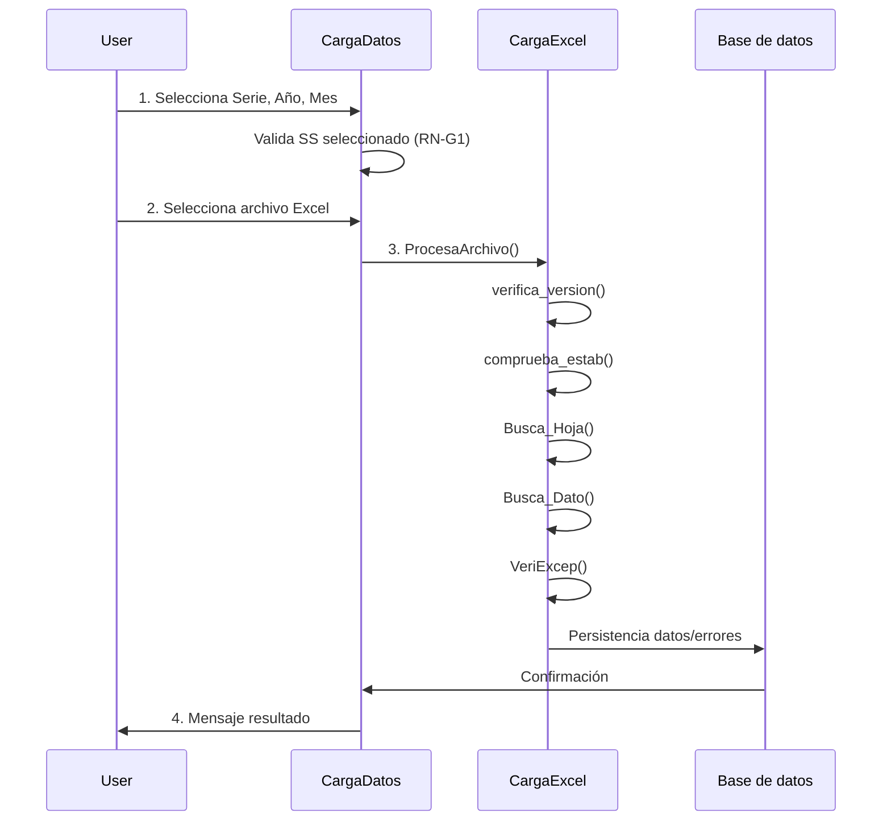
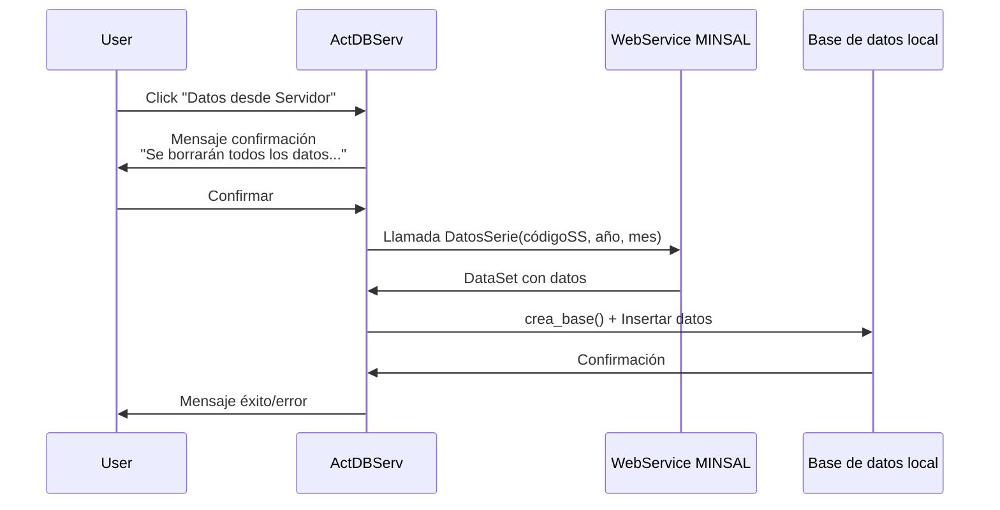
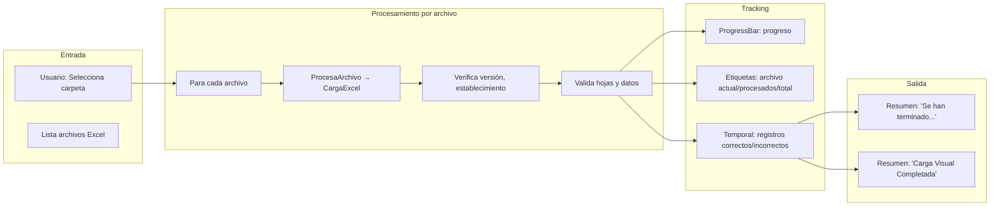

# Módulo M2 Profundizado: Carga de Datos

Versión documentada: 1.0 | Estado: ✅ Implementado | Fecha: 2026-11-05

---

## 1. Arquitectura del Módulo

### Componentes Principales

| Componente | Tipo | Propósito | Implementación |
|------------|------|-----------|----------------|
| **CargaDatos** | Formulario | Wizard de carga individual (1 archivo) | ✅ |
| **CargaDatosMultiple** | Formulario | Procesador por carpeta (múltiples archivos) | ✅ |
| **ActDBServ** | Formulario | Consumidor de WebService (datos servidor) | ✅ |
| **CargaExcel** | Clase mecánica | Motor de validación | ✅ |
| **bases** | Clase estática | Operaciones CRUD | ✅ |

---

## 2. Flujos Detallados

### F2.1: Flujo de Carga Individual (CargaDatos)



### F2.2: Flujo de Carga Múltiple (CargaDatosMultiple)

```mermaid
flowchart LR
    A[Seleccionar carpeta] --> B[Listar archivos Excel]
    B --> C{¿Archivos encontrados?}
    C -- Sí --> D[Para cada archivo: ProcesaArchivo]
    D --> E[ProgressBar: progreso]
    E --> F[Acumular resultados]
    F --> G{¿Todos procesados?}
    G -- No --> D
    G -- Sí --> H[Mostrar resumen]
    C -- No --> I[Mensaje: "Debe Ingresar Ruta"]
```

### F2.3: Flujo de Descarga desde Servidor (ActDBServ)



---

## 3. Reglas de Negocio Detalladas

### RN-M2-1: Extensiones Admitidas

| Extensión | Tecnología | Conexión |
|-----------|------------|----------|
| `.xls` | Microsoft.ACE.OLEDB.12.0 | `Excel 8.0;HDR=Yes;IMEX=1` |
| `.xlsx` | NPOI 2.3 | Método `Carga_NombreNPOI` |
| `.xlsm` | NPOI 2.3 | Igual que .xlsx |

**Validaciones:**
- Filtro: `Archivos Excel|*.xls;*.xlsx;*.xlsm`
- Rechaza automáticamente otros formatos

### RN-M2-2: Validación de Cabecera

| Validación | Mensaje de Error | Ubicación |
|------------|------------------|-----------|
| Serie | "Serie no Corresponde: Por favor verifique la serie del Archivo" | Hoja A1 |
| Año | "Año no Corresponde: Por favor verifique año del Archivo" | Cell específica |
| Mes | "Mes no coincide: Por Favor Verifique que el texto y el número del mes coincidan" | Texto y número |
| Establecimiento | "Establecimiento no Corresponde con Servicio: Por favor verifique código de Establecimiento del Archivo" | Comparación SS |
| Versión | "Versión No Corresponde a Mes: por Favor Verifique la Versión con el Mes de Ingreso de Archivo" | Tabla `version` |

### RN-M2-3: Versión de Plantilla

**Tabla `version` (Global.mdb):**

| Campo | Tipo | Descripción |
|-------|------|-------------|
| `ano` | Long | Año del registro |
| `mes` | Long | Mes (1-12) |
| `Serie` | WChar | Serie (A, BS, BM, D, P, F) |
| `SerieExcel` | WChar | Serie según plantilla |
| `version` | WChar | Versión específica |

**Volumen:** 939 filas

### RN-M2-5: Confirmación de Sobrescritura

**Mensaje:**
```
"ATENCION: Se sobreescribirá la información relacionada a los archivos 
a cargar si es que ya se encuentran en la base de datos. 
¿Desea continuar?"
```

**Operaciones de borrado:**
```sql
DELETE FROM datos WHERE ano = @ano AND mes = @mes 
                      AND idestablecimiento = @establecimiento 
                      AND serie = @serie;

DELETE FROM LogError WHERE ano = @ano AND mes = @mes 
                         AND idestablecimiento = @establecimiento 
                         AND serie = @serie;

DELETE FROM HistCarga WHERE ano = @ano AND mes = @mes 
                          AND IdEstablecimiento = @establecimiento 
                          AND Serie = @serie;
```

---

## 4. Estructuras de Datos

### Tabla `datos`

```sql
CREATE TABLE datos (
    ano LONG,
    mes LONG,
    idservicio LONG,
    idestablecimiento TEXT(50),
    codigoprestacion TEXT(20),
    col01 DOUBLE,
    col02 DOUBLE,
    -- ... col03 a col50
    col50 DOUBLE,
    fechacarga DATETIME
);
```

### Tabla `LogError` (Trans.mdb)

| Campo | Tipo | Descripción |
|-------|------|-------------|
| `archivo` | WChar | Nombre del archivo con error |
| `idestablecimiento` | WChar | Código del establecimiento |
| `mes` | Long | Mes del registro |
| `ano` | Long | Año del registro |
| `serie` | WChar | Serie del archivo |
| `linea` | Long | Línea en Excel |
| `hoja` | WChar | Nombre de hoja |
| `dato` | WChar | Valor del campo con error |
| `mensaje_error` | MEMO | Descripción del error |
| `fecharegistro` | DATETIME | Cuando se registró |

### Tabla `INCORRECTO` (TemporalIncorrectos.mdb)

| Campo | Tipo | Descripción |
|-------|------|-------------|
| `ano` | LONG | Año |
| `mes` | LONG | Mes |
| `idservicio` | LONG | Servicio |
| `idestablecimiento` | TEXT(50) | Establecimiento |
| `codigoprestacion` | TEXT(20) | Prestación |
| `col01` - `col50` | DOUBLE | Valores |
| `fechacarga` | DATETIME | Timestamp |
| `motivo_error` | MEMO | Descripción error |

---

## 5. Componentes del Motor CargaExcel

| Componente | Función | Referencias |
|------------|---------|-------------|
| `verifica_version()` | Valida versión plantilla | Tabla `version` |
| `comprueba_estab()` | Valida código establecimiento | Tabla `mpEstablecimiento` |
| `Busca_Hoja()` | Busca hoja en Excel | Tabla `Thojas` |
| `Busca_Dato()` | Extrae valor de celda | Diccionario + tipoDato |
| `VeriExcep()` | Valida excepciones | Tablas `Excep`, `colexcep` |

---

## 6. Tabla de Referencia de Catálogos

| Tabla | Ubicación | Filas | Uso |
|-------|-----------|-------|-----|
| `Diccionario` | Global.mdb | 185,526 | Mapeo celdas → prestaciones |
| `mpEstablecimiento` | Global.mdb | 3,207 | Validación SS |
| `version` | Global.mdb | 939 | Versiones plantilla |
| `Thojas` | Global.mdb | 1,129 | Estructura hojas |
| `Excep` | Global.mdb | 5,664 | Columnas no aplicables |
| `colexcep` | Global.mdb | 2,977 | Detalle excepciones |
| `mpServicio` | Global.mdb | 30 | Lista servicios |

---

## 7. Estructura por Serie

| Serie | Hojas Excel | Uso |
|-------|-------------|-----|
| **A** | "Prestaciones", "Resumen" | Hospitales generales |
| **BS** | "Prestaciones", "Resumen" | Servicios especializados |
| **BM** | "Prestaciones", "Resumen" | Balnearios/Salud ambiente |
| **D** | "Prestaciones", "Resumen" | Discapacitados |
| **P** | "Prestaciones", "Resumen" | Particulares |
| **F** | "Prestaciones", "Resumen" | Fuerzas Armadas |

---

## 8. Mensajes de UI

| Estado | Mensaje |
|--------|---------|
| Sin SS | "Por favor debe Elegir Servicio de Salud..." |
| Sin selección | "Debe Seleccionar Opciones" |
| Extensión inválida | (rechaza archivo) |
| Error cabecera | Mensaje según RN-M2-2 |
| Sobrescritura | "ATENCION: Se sobreescribirá..." |
| Éxito | "Proceso Finalizado con Éxito" / "Proceso Finalizado con Exito !!" |
| Error | "Ejecutado con error" |
| Cancelado | "Operacion Cancelada" |
| Sin datos | "No hay Datos a Ingresar" |

---

## 9. Web Services Involucrados

| Web Service | Operación | Parámetros | Uso |
|-------------|-----------|------------|-----|
| `CargaSerieServ` | `DatosSerie` | (string códigoSS, int año, int mes) | Descargar datos por SS |
| `CargaControlServ` | `DatosControl` | (string códigoSS, int año, int mes) | Descargar datos control |
| `CargaSerie` | `serieA, serieBS...` | (string códigoSS) | Descargar por serie |

---

## 10. Volúmenes Típicos

| Tabla | Filas año típico | Ubicación |
|-------|------------------|-----------|
| `datos` | 15,000+ | DatosSERIE{serie}{año}.mdb |
| `HistCarga` | ~4,000 | Trans.mdb |
| `cargados` | 602 | Temporal.mdb |

---

## 11. Consideraciones Técnicas

### Tecnologías
- **Excel Reading:** NPOI 2.3, Microsoft.ACE.OLEDB.12.0
- **Persistencia:** OleDb (Jet/ACE 32-bit)
- **Exportes:** Microsoft.Office.Interop.Excel 14.0

### Puntos críticos
1. `KillAllAddedExcelProcesses()` para limpieza procesos Excel
2. Manejo especial códigos con guion (RN-M2-10)
3. Validación estricta de versiones plantilla

---

## 12. Errores Comunes

| Tipo de Error | Ubicación | Acción |
|---------------|-----------|--------|
| Extensión inválida | Antes carga | Rechazar archivo |
| Cabecera incompatible | verifica_version | Registrar LogError |
| Estructura hoja | Busca_Hoja | Continuar hoja siguiente |
| Tipo de dato inválido | Busca_Dato | Registrar error, continuar |

---

## 13. Estado de Validación Pendiente

| Elemento | Estado | Comentario |
|----------|--------|------------|
| Límite tamaño archivo | ❌ Pendiente | No especificado |
| Macro .xlsm | ❌ Pendiente | No se ejecutan |
| Concurrencia .mdb | ❌ Pendiente | Manejo archivos bloqueados |

---

## 14. Flujo de Datos Detallado

### D2.1: Flujo de Dato Carga Individual (CargaDatos)

```mermaid
flowchart TB
    subgraph "Entrada Usuario"
        A1[Usuario: Serie, Año, Mes (comboboxes)]
        A2[Usuario: Archivo Excel (browse)]
        A3[Usuario: Confirmar sobrescritura]
    end
    
    subgraph "Validaciones Pre-carga"
        B1[RN-G1: Verificar SS seleccionado]
        B2[RN-M2-1: Validar extensión (.xls/.xlsx/.xlsm)]
        B3[RN-M2-2: Validar cabecera (serie/año/mes)]
    end
    
    subgraph "Motor CargaExcel"
        C1[verifica_version: Tabla version]
        C2[comprueba_estab: mpEstablecimiento]
        C3[Busca_Hoja: Thojas + Diccionario]
        C4[Busca_Dato: lectura celdas + tipoDato]
        C5[VeriExcep: Excepciones columnas]
    end
    
    subgraph "Persistencia"
        D1[RN-M2-5: DELETE existentes]
        D2[INSERT datos validados]
        D3[INSERT LogError errores]
        D4[INSERT INCORRECTO datos fallidos]
        D5[INSERT HistCarga registro]
    end
    
    subgraph "Salida"
        E1[Mensaje: "Proceso Finalizado con Éxito"]
        E2[Mensaje: "Ejecutado con error"]
        E3[Mensaje: "No hay Datos a Ingresar"]
    end
    
    A1 --> B1
    A2 --> B2
    B1 --> C1 & C2 & C3 & C4 & C5
    C5 --> D1 & D2 & D3 & D4 & D5
    D1 & D2 & D3 & D4 & D5 --> E1 & E2 & E3
```

### D2.2: Flujo de Dato Carga Múltiple



### D2.3: Flujo de Dato desde Servidor (ActDBServ)

```mermaid
flowchart TB
    subgraph "Entrada"
        A1[Usuario: Click "Datos desde Servidor"]
        A2[Usuario: Confirmar borrador datos]
    end
    
    subgraph "Consumo WebService"
        B1[CargaSerieServ.DatosSerie(códigoSS, año, mes)]
        B2[CargaControlServ.DatosControl(...)]
    end
    
    subgraph "Persistencia"
        C1[crea_base() → DatosSERIE.mdb]
        C2[INSERT datos desde DataSet]
    end
    
    subgraph "Salida"
        D1[Mensaje: "Carga desde servidor completada"]
        D2[Mensaje: "Error de conexión"]
    end
    
    A1 --> |"Se borrarán todos los datos...>| A2
    A2 --> B1 & B2
    B1 --> C1
    B2 --> C1
    C1 --> C2
    C2 --> D1
    B1 -.-> D2
```

### D2.4: Diagrama de flujo de datos entre bases

```mermaid
erDiagram
    GLOBAL_MDB {
        Long ano PK,FK
        Long mes PK,FK
        Text Serie PK,FK
        Text SerieExcel
        Text version
    }
    
    THOJAS {
        Long ano PK,FK
        Long mes PK,FK
        Text Serie PK,FK
        Text Hoja
        Text Rango
    }
    
    DICTIONARY {
        Text CodigoPrestacion PK
        Text Hoja PK
        Long linea PK
        Text Inicio
        Text Fin
        Long Posicion
        Text tipoDato
    }
    
    VERSION ||--o{ THOJAS : "define"
    THOJAS ||--o{ DICTIONARY : "mapea"
    
    DATOS_SERIE_MDB {
        Long ano PK
        Long mes PK
        Text idestablecimiento PK
        Text codigoprestacion PK
        Double col01 ... col50
        DateTime fechacarga
    }
    
    TEMPORAL_MDB {
        Text idestablecimiento PK
        Long mes PK
        Boolean tiene_datos
    }
    
    DATASET_EXCEL ||..|| THOJAS : "filtra por"
    THOJAS ||..|| DICTIONARY : "usa para mapear"
    DATOS_SERIE_MDB ||--o{ TEMPORAL_MDB : "genera"
```

### D2.5: Flujo de datos de errores integrado

```mermaid
flowchart TB
    subgraph "Origen error"
        A1[CargaDatos.Button4_Click]
        A2[CargaDatosMultiple]
        A3[ActDBServ]
    end
    
    subgraph "Motor validación"
        B1[CargaExcel]
        B2[verifica_version]
        B3[comprueba_estab]
        B4[Busca_Dato]
        B5[VeriExcep]
    end
    
    subgraph "Registro error"
        C1[LogError (Trans.mdb)]
        C2[INCORRECTO (TemporalIncorrectos.mdb)]
    end
    
    subgraph "Revisión error"
        D1[LogErrorCargados UI]
        D2[LogErrorMultiples UI]
        D3[InformeControl]
    end
    
    A1 --> B1
    A2 --> B1
    B1 --> C1 & C2
    C1 --> D1 & D2 & D3
    C2 --> D3
```

---

## 15. Métricas de Flujo

| Métrica | Valor | Unidad |
|---------|-------|--------|
| Tiempo carga archivo mediano | 10-30 segundos | - |
| Archivos procesados múltiple | 1-encontrados | - |
| Registros por archivo | ~2,500 | - |
| Errores típicos archivo | 5-50 | - |
| Base datos por carga | 1-15 MB | - |
| Consultas SQL por archivo | ~50 | - |

---

**Documento generado:** Basado en análisis estático del binario. Requiere validación con ejecución en entorno de prueba.