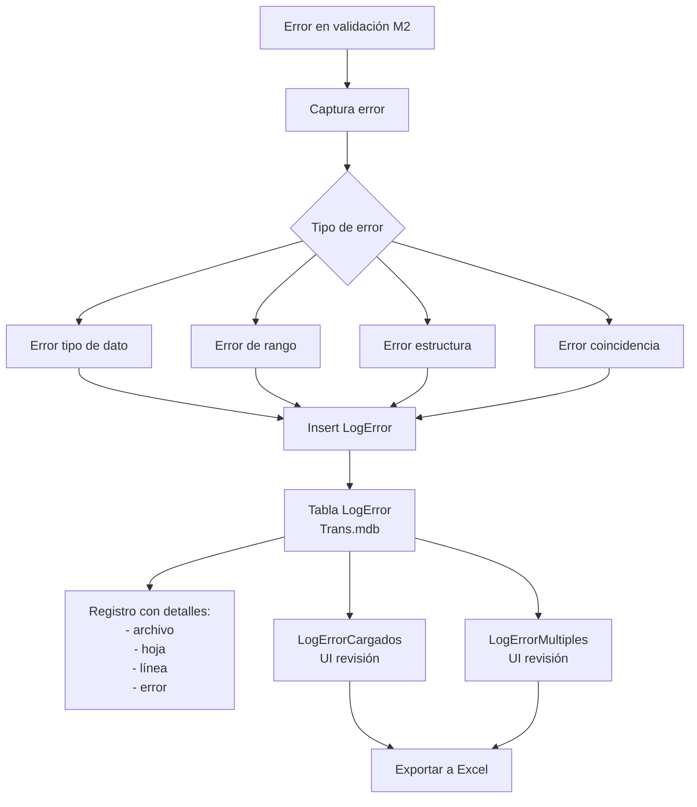
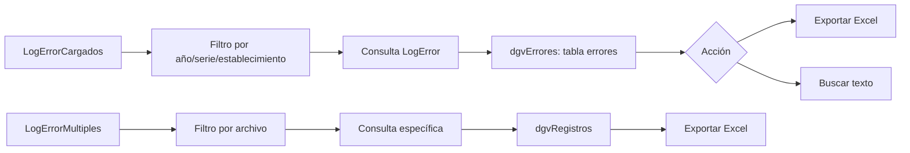
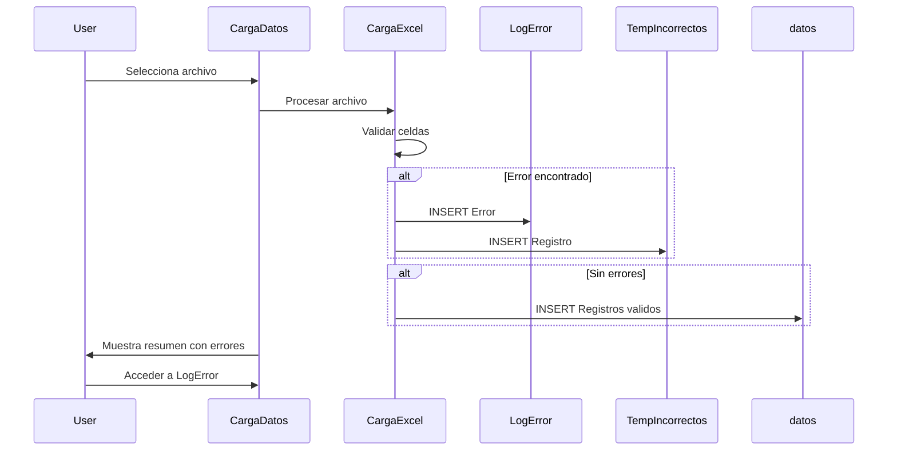
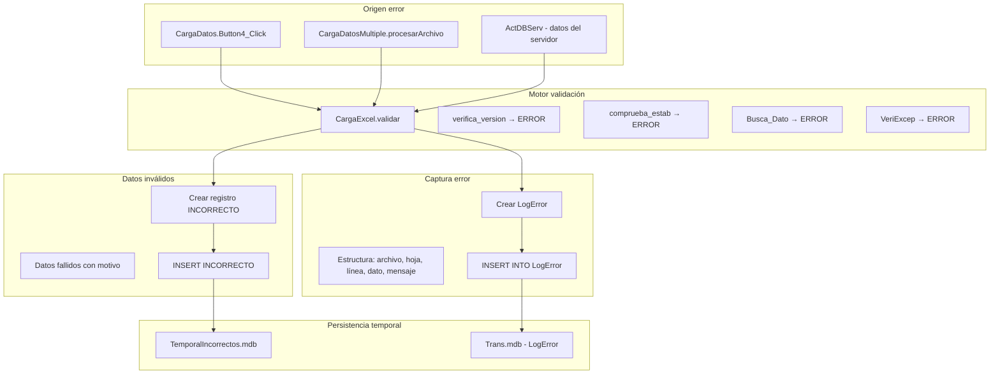
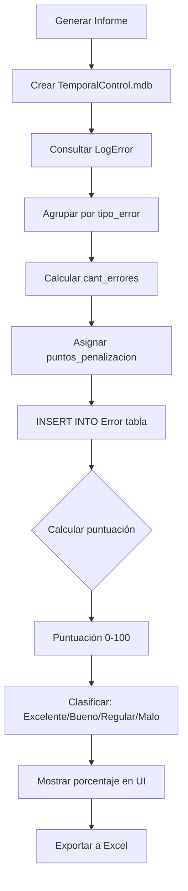
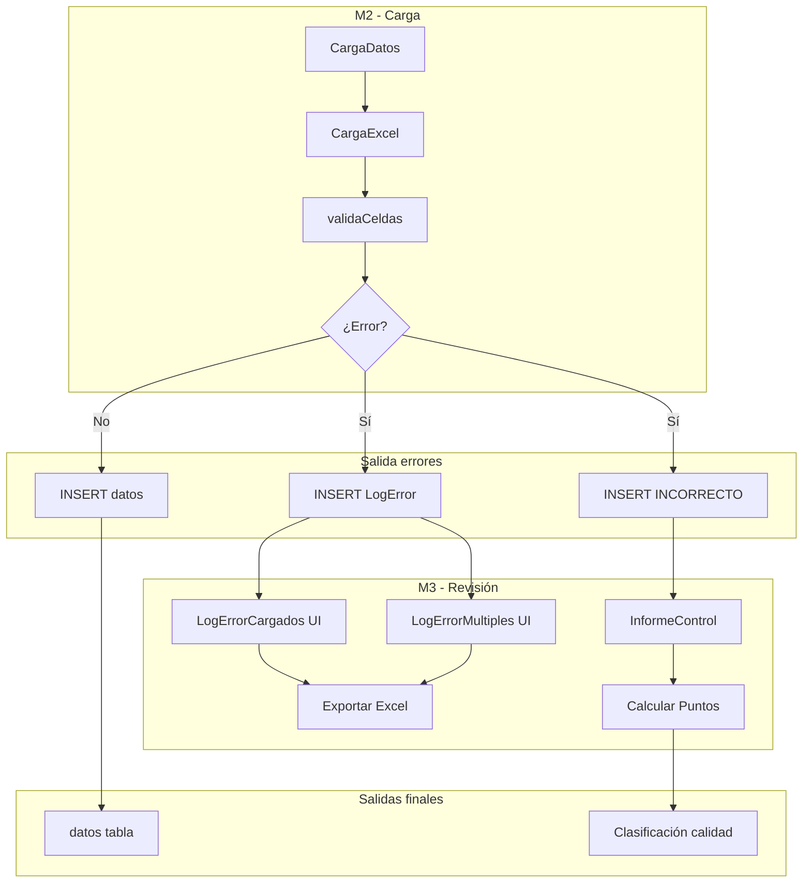

# Módulo M3 Profundizado: Errores y Control de Carga

Versión documentada: 1.0 | Estado: ✅ Implementado | Fecha: 2026-11-05

---

## 1. Arquitectura del Módulo

### Componentes Principales

| Componente | Tipo | Propósito | Implementación |
|------------|------|-----------|----------------|
| **LogErrorCargados** | Formulario | Listado errores por establecimiento/año/mes | ✅ |
| **LogErrorMultiples** | Formulario | Listado errores por archivo múltiple | ✅ |
| **InformeControl** | Formulario | Generador hoja de control con cálculo puntos | ✅ |
| **bases** | Clase estática | Funciones borrado/consulta LogError | ✅ |

---

## 2. Flujos Detallados

### F3.1: Flujo de Registro de Errores



### F3.2: Flujo de Revisión de Errores



---

## 3. Estructura de Datos

### Tabla LogError (Trans.mdb)

```sql
CREATE TABLE LogError (
    archivo TEXT(255),           -- Nombre del archivo con error
    idestablecimiento TEXT(50),  -- Código del establecimiento
    mes LONG,                    -- Mes (1-12)
    ano LONG,                    -- Año del registro
    serie TEXT(10),              -- Serie (A, BS, BM, D, P, F)
    linea LONG,                  -- Línea en el archivo Excel
    hoja TEXT(100),              -- Nombre de hoja Excel
    dato TEXT(255),              -- Valor del campo con error
    mensaje_error MEMO,          -- Descripción del error
    fecharegistro DATETIME       -- Cuando se registró
);
```

### Tabla INCORRECTO (TemporalIncorrectos.mdb)

```sql
CREATE TABLE INCORRECTO (
    ano LONG,
    mes LONG,
    idservicio LONG,
    idestablecimiento TEXT(50),
    codigoprestacion TEXT(20),
    col01 DOUBLE,
    -- ... col02 a col50 (según Diccionario)
    fechacarga DATETIME,
    motivo_error MEMO
);
```

### Tabla Error (TemporalControl.mdb - InformeControl)

```sql
CREATE TABLE Error (
    ano LONG,
    mes LONG,
    serie TEXT(10),
    idestablecimiento TEXT(50),
    tipo_error TEXT(50),
    cant_errores LONG,
    puntos_penalizacion LONG,
    fechareporte DATETIME
);
```

---

## 4. Tipos de Errores Identificados

| Tipo de Error | Descripción | Ejemplo | Acción |
|---------------|-------------|---------|--------|
| **Tipo de dato** | Campo numérico con texto no convertible | `col01 = "ABC123"` | Registrar + continuar |
| **Rango** | Valor fuera de rango esperado | `mes = 13`, código negativo | Registrar + continuar |
| **Estructura** | Hoja/celda faltante | Hoja no existe, celda vacía | Registrar + continuar |
| **Coincidencia** | Serie/año/mes diferente | Archivo "A" con mes "09" | Registrar + continuar |

---

## 5. Elementos de UI

### LogErrorCargados

| Control | Propósito |
|---------|-----------|
| `cbAno` | Filtro por año |
| `cbSerie` | Filtro por serie |
| `cbEstablecimiento` | Filtro por código establecimiento |
| `dgvErrores` | Muestra lista de errores |
| `btnExportarExcel` | Exporta a archivo Excel |
| `txtBuscar` | Búsqueda libre en errores |

### LogErrorMultiples

**Diferencias con LogErrorCargados:**
- ✅ Incluye filtro por archivo específico (`txtArchivo`)
- ✅ Visualización por archivo únicamente
- ✅ Exportación múltiple

### InformeControl

| Control | Propósito |
|---------|-----------|
| `btnGenerar` | Ejecuta cálculo de puntos |
| `dgvPuntos` | Muestra resultados por categoría |
| `porcentajeCalidad` | Muestra porcentaje total |
| `lblResultado` | Mensaje "Excelente", "Bueno", "Regular", "Malo" |

---

## 6. Reglas de Negocio

### RN-M3-1: Purga de Errores

**Condición:** Antes de recarga de datos (integración con RN-M2-5)

```sql
DELETE FROM LogError 
WHERE ano = @ano 
  AND mes = @mes 
  AND idestablecimiento = @establecimiento 
  AND serie = @serie;
```

**Momento:** Automático al iniciar carga cuando se confirma sobrescritura

### RN-M3-2: Registro Estructurado

**Formato de mensaje de error:**
```
"Error en hoja '{hoja}' línea {linea}: {tipo_error} - {detalle}"
```

**Campos obligatorios:**
- `hoja`: Nombre exacto de hoja del Excel
- `linea`: Número de línea donde ocurrió el error
- `dato`: Valor del campo problemático
- `mensaje_error`: Descripción clara del problema

---

## 7. Consultas SQL Comunes

### Consulta de Errores por Establecimiento

```sql
SELECT 
    e.idestablecimiento,
    e.serie,
    COUNT(*) as total_errores,
    MIN(e.fecharegistro) as primer_error,
    MAX(e.fecharegistro) as ultimo_error
FROM LogError e
WHERE e.ano = @ano
GROUP BY e.idestablecimiento, e.serie
ORDER BY total_errores DESC;
```

### Consulta de Errores por Tipo

```sql
SELECT 
    LEFT(mensaje_error, 50) as tipo_error,
    COUNT(*) as frecuencia
FROM LogError
WHERE ano = @ano AND serie = @serie
GROUP BY LEFT(mensaje_error, 50)
ORDER BY frecuencia DESC;
```

### Consulta de Archivos con Más Errores

```sql
SELECT 
    archivo,
    COUNT(*) as errores
FROM LogError
WHERE ano = @ano AND mes = @mes AND serie = @serie
GROUP BY archivo
HAVING COUNT(*) > 0
ORDER BY errores DESC;
```

---

## 8. Mensajes de UI

| Estado | Mensaje |
|--------|---------|
| Sin datos | "No hay Datos" |
| Exportación | "Archivo exportado correctamente" |
| Sin base | "La Base no ha sido creada o no ha sido descargada" |
| Sin selección | "Por Favor Seleccionar Año" / "Debe seleccionar una serie" |

---

## 9. Integración con Módulo M2

### Diagrama de Integración



---

## 10. Consideraciones para Migración Web

### API Endpoints Propuestos

```http
GET /api/errores?ano=2026&serie=A&establecimiento=123456
Authorization: Bearer {token}

Response:
{
  "items": [
    {
      "archivo": "123456A09.xlsx",
      "hoja": "Prestaciones",
      "linea": 45,
      "dato": "ABC123",
      "mensaje_error": "Error de tipo: Campo no numérico"
    }
  ],
  "total": 1,
  "page": 1,
  "pageSize": 50
}
```

---

## 11. React Component (Frontend Web)

```tsx
interface ErrorRecord {
  archivo: string;
  hoja: string;
  linea: number;
  dato: string;
  mensaje_error: string;
}

interface ErrorLogProps {
  ano: number;
  serie: string;
  establecimiento: string;
}

const ErrorLogTable: React.FC<ErrorLogProps> = ({ ano, serie, establecimiento }) => {
  const { data, isLoading, error } = useQuery(
    ['errores', ano, serie, establecimiento],
    () => fetchErrores(ano, serie, establecimiento)
  );

  if (isLoading) return <Spin />;
  if (error) return <Alert message="Error al cargar errores" type="error" />;

  return (
    <Table
      dataSource={data?.items || []}
      columns={[
        { title: 'Archivo', dataIndex: 'archivo' },
        { title: 'Hoja', dataIndex: 'hoja' },
        { title: 'Línea', dataIndex: 'linea' },
        { title: 'Dato', dataIndex: 'dato' },
        { title: 'Error', dataIndex: 'mensaje_error' }
      ]}
      pagination={{ pageSize: 20 }}
    />
  );
};
```

---

## 12. Cálculo de Puntos - InformeControl

**Estado:** ❌ **PENDIENTE DE VALIDACIÓN** - Criterio exacto no documentado

**Estructura tabla `Error`:**

```sql
CREATE TABLE Error (
    ano LONG,
    mes LONG,
    serie TEXT(10),
    idestablecimiento TEXT(50),
    tipo_error TEXT(50),
    cant_errores LONG,
    puntos_penalizacion LONG
);
```

---

## 13. Establecimientos con Guion en Código (RN-M2-10)

**Regla:** Los establecimientos con `IdEstablecimiento` que contiene `-` se listan aparte

```sql
SELECT * FROM LogError 
WHERE idestablecimiento LIKE '%-%' 
  AND ano = @ano AND mes = @mes;
```

---

## 14. Estado de Validación Pendiente

| Elemento | Estado | Comentario |
|----------|--------|------------|
| **Criterio puntos InformeControl** | ❌ Pendiente | No documentado |
| **Errores bloqueantes vs no bloqueantes** | ❌ Pendiente | No definido |
| **Historial múltiples cargas** | ❌ Pregunta | Necesario definir |
| **Reporte consolidado** | ❌ Pregunta | Por periodo/establecimiento |

---

## 15. Métricas Observadas

| Métrica | Valor | Comentario |
|---------|-------|------------|
| Tabla LogError (copia) | 0 filas | Base transaccional vacía |
| Archivo exportación | Excel (.xlsx) | Uso Interop.Excel |
| Tiempo generación | Variable | Depende volumen errores |

---

## 16. Consideraciones Técnicas

### Seguridad
- El acceso a `LogError` no tiene filtros de seguridad
- En web: implementar filtro por establecimiento según rol

### Performance
- Tabla `LogError` puede crecer significativamente
- Considerar archivado de errores meses anteriores

### Persistencia
- Errores se borran automáticamente con carga (RN-M3-1)
- En web: mantener histórico de errores

---

## 17. Métricas del Módulo

- **Componentes:** 4 (3 formularios, 1 clase estática)
- **Consultas SQL:** 3 principales
- **Uso Excel:** Microsoft.Office.Interop.Excel 14.0
- **Tamaño típico LogError:** Variable (0-N filas según cargas)

---

## 18. Flujo de Datos Detallado

### D3.1: Flujo de Registro de Errores



### D3.2: Flujo de Revisión LogErrorCargados

```mermaid
flowchart LR
    subgraph "Entrada UI"
        A1[Usuario: cbAno (año)]
        A2[Usuario: cbSerie (serie)]
        A3[Usuario: cbEstablecimiento (código)]
    end
    
    subgraph "Consulta"
        B1[SELECT archivo, hoja, línea, error...]
        B2[FROM LogError WHERE ano= & serie= & establecimiento=]
        B3[ORDER BY archivo, línea, hoja]
    end
    
    subgraph "Visualización"
        C1[dgvErrores: tabla resultados]
        C2[Columnas: Archivo, Hoja, Línea, Dato, Error]
    end
    
    subgraph "Acciones"
        D1[btnExportarExcel]
        D2[txtBuscar (libre)]
    end
    
    subgraph "Salida"
        E1[Archivo Excel exportado]
        E2["Mensaje: 'No hay Datos'"]
    end
    
    A1 --> B1
    A2 --> B1
    A3 --> B1
    B1 --> B2 --> B3 --> C1
    C1 --> D1 & D2
    D1 --> E1
    C1 -->|Sin resultados| E2
```

### D3.3: Flujo de Hoja de Control (InformeControl)



### D3.4: Diagrama entidad-relación errores

```mermaid
erDiagram
    LOGE {
        Text archivo PK
        Text idestablecimiento PK,FK
        Long mes PK,FK
        Long ano PK,FK
        Text serie PK,FK
        Long linea PK
        Text hoja PK
        Text dato
        MEMO mensaje_error
        DateTime fecharegistro
    }
    
    INCORRECTO {
        Long ano PK,FK
        Long mes PK,FK
        Long idservicio PK,FK
        Text idestablecimiento PK
        Text codigoprestacion PK
        Double col01 ... col50
        DateTime fechacarga
        MEMO motivo_error
    }
    
    ERROR_CONTROL {
        Long ano PK
        Long mes PK
        Text serie PK
        Text idestablecimiento PK
        Text tipo_error
        Long cant_errores
        Long puntos_penalizacion
        DateTime fechareporte
    }
    
    DATOS_SERIE_MDB ||--o{ LOGE : "genera"
    DATOS_SERIE_MDB ||--o{ INCORRECTO : "puede generar"
    LOGE ||--o{ ERROR_CONTROL : "se suma"
```

### D3.5: Flujo de datos con Módulo M2



---

**Documento generado:** Basado en análisis estático del sistema ValidadorRem. Requiere validación del cálculo de puntos y criterios de clasificación de errores.