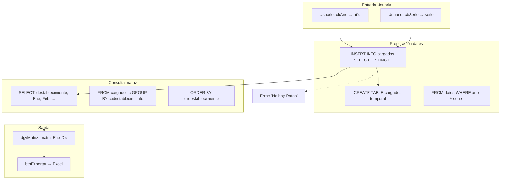
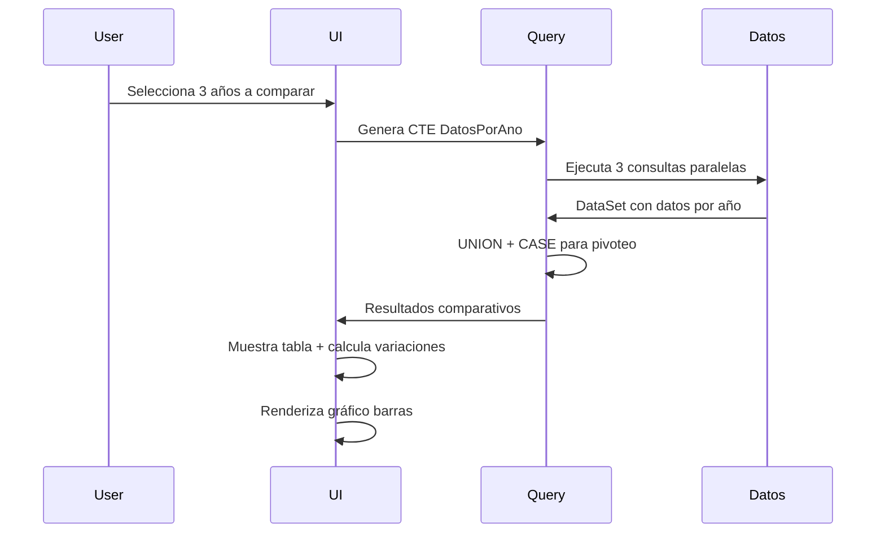

# Módulo M4 Profundizado: Consulta e Informes

Versión documentada: 1.0 | Estado: ✅ Implementado | Fecha: 2026-11-05

---

## 1. Arquitectura del Módulo

### Componentes Principales

| Componente | Tipo | Función Principal | Implementación |
|------------|------|---------------------|----------------|
| **EstabCargados** | Formulario | Matriz mensual de establecimientos | ✅ |
| **Duplicidad** | Formulario | Búsqueda y reporte de registros duplicados | ✅ |
| **Prestacion** | Formulario | Búsqueda específica por código de prestación | ✅ |
| **Decimales** | Formulario | Configuración de decimales (pendiente) | ✅ Parcial |
| **Comparativos** | Formulario | Comparación por año | ✅ |
| **ComparativoMes** | Formulario | Comparación por mes específico | ✅ |
| **Informe1** | Formulario | Generación de reporte INF1 | ✅ |

---

## 2. Flujos de Datos Detallados

### D4.1: Flujo de Datos Matriz de Establecimientos (EstabCargados)



### D4.2: Flujo de Datos Detección Duplicados (Duplicidad)

```mermaid
flowchart LR
    subgraph "Entrada UI"
        A1[Usuario: cbAno → año]
        A2[Usuario: cbSerie → serie]
    end
    
    subgraph "Consulta duplicados"
        B1[SELECT mes, idestablecimiento, codigoprestacion, COUNT(mes) as cantidad]
        B2[FROM datos WHERE ano=@ano AND serie=@serie]
        B3[GROUP BY mes, idestablecimiento, codigoprestacion]
        B4[HAVING COUNT(mes) > 1]
        B5[ORDER BY cantidad DESC]
    end
    
    subgraph "Visualización"
        C1[dgvDuplicados: tabla resultados]
    end
    
    subgraph "Acciones"
        D1[btnExportar → Excel]
    end
    
    subgraph "Salidas"
        E1["Mensaje: 'No se han encontrado...'"]
        E2["Error: 'Base no ha sido creada'..."]
    end
    
    A1 --> B1 & B2
    A2 --> B1 & B2
    B1 --> B2 --> B3 --> B4 --> B5 --> C1
    C1 --> D1
    C1 -->|Sin filas| E1
    B2 -->|Sin base| E2
```

### D4.3: Flujo de Datos Búsqueda Prestaciones (Prestacion)

```mermaid
flowchart TB
    subgraph "Entrada Usuario"
        A1[Usuario: cbCodigoPrestacion]
        A2[Usuario: cbAno]
        A3[Usuario: cbSerie]
    end
    
    subgraph "Consulta base"
        B1[SELECT mes, idestablecimiento, col01...col50, SUM(col01)...]
        B2[FROM datos WHERE ano=@ano AND serie=@serie AND codigoprestacion=@codigo]
        B3[GROUP BY mes, idestablecimiento]
        B4[ORDER BY idestablecimiento, mes]
    end
    
    subgraph "Salida"
        C1[dgvResultados: filas filtradas]
        C2[btnExportarExcel]
    end
    
    subgraph "Referencias"
        D1[LEFT JOIN mpEstablecimiento]
        D2[LEFT JOIN Diccionario]
    end
    
    A1 --> B1
    A2 --> B1
    A3 --> B1
    B1 --> B2 --> B3 --> B4 --> C1
    C1 --> C2
```

### D4.4: Flujo de Datos Comparativos Anuales



### D4.5: Flujo de Datos Comparativo Mensual

```mermaid
flowchart TB
    subgraph "Entrada"
        A1[Usuario: cbAno → año]
        A2[Usuario: cbSerie → serie]
    end
    
    subgraph "Consulta unión meses"
        B1[SELECT d1.mes, d1.col01 as valor_mes1]
        B2[LEFT JOIN datos d2 ON d1.codigoprestacion = d2.codigoprestacion AND d2.mes = d1.mes + 1]
        B3[LEFT JOIN datos d3 ON ... AND d3.mes = d1.mes + 2]
        B4[WHERE d1.ano = @ano AND d1.serie = @serie]
        B5[ORDER BY d1.codigoprestacion, d1.idestablecimiento]
    end
    
    subgraph "Cálculos"
        C1[(d2.col01 - d1.col01) as diferencia_1_2]
        C2[(d3.col01 - d2.col01) as diferencia_2_3]
    end
    
    subgraph "Salida"
        D1[dgvComparativo: tabla por mes]
    end
    
    A1 --> B1
    A2 --> B1
    B1 --> B2 & B3 & C1 & C2 --> B4 --> B5 --> D1
```

### D4.6: Flujo de Datos Generación Informe INF1

```mermaid
flowchart TB
    subgraph "Entrada"
        A1[ Usuario: cbAno]
        A2[ Usuario: cbSerie]
    end
    
    subgraph "Preparación tabla"
        B1[CREATE TABLE INF1 temporal]
        B2[/Meses TEXT, Codigo TEXT, Glosa TEXT, Col01-50 DOUBLE/]
    end
    
    subgraph "Consolidación datos"
        C1[INSERT INTO INF1 SELECT FORMAT(d.mes, '00') as mes...]
        C2[FROM datos d LEFT JOIN glosa g ON d.codigoprestacion = g.codigo]
        C3[WHERE d.ano = @ano AND d.serie = @serie]
        C4[GROUP BY d.codigoprestacion, g.glosa]
    end
    
    subgraph "Salida"
        D1[btnExportar → Excel INF1]
        D2[Mensaje: Éxito/Error]
    end
    
    A1 --> B1
    A2 --> B1
    B1 --> C1
    C1 --> C2 & C3 & C4 --> D1
    D1 --> D2
```

---

## 3. Diagrama ER de Bases de Datos

```mermaid
erDiagram
    DATOS {
        Long ano PK
        Long mes PK
        Text idestablecimiento PK
        Text codigoprestacion PK
        Double col01 ... col50
        DateTime fechacarga
    }
    
    MP_ESTABLECIMIENTO {
        Text idestablecimiento PK
        Text nestablecimiento
        Long idservicio FK
    }
    
    DICCIONARIO {
        Text CodigoPrestacion PK
        Text Hoja
        Long linea
        Text Inicio
        Text Fin
        Long Posicion
        Text tipoDato
    }
    
    TEMPORAL_CARGADOS {
        Text idestablecimiento PK
        Long mes PK
        Boolean tiene_datos
    }
    
    TEMPORAL_INFORME1 {
        Text mes
        Text codigo
        Text glosa
        Double col01 ... col50
        DateTime fecha
    }
    
    DATOS ||--o{ MP_ESTABLECIMIENTO : "referencia"
    DATOS ||--o{ DICCIONARIO : "usa"
    DATOS ||--o{ TEMPORAL_CARGADOS : "genera"
    DATOS ||--o{ TEMPORAL_INFORME1 : "consolida"
```

---

## 4. Tablas SQL Comunes

### Consulta de Datos por Establecimiento

```sql
SELECT 
    d.mes,
    d.idestablecimiento,
    e.nestablecimiento,
    d.codigoprestacion,
    p.textoprestacion,
    d.col01, d.col02, d.col03
FROM datos d
LEFT JOIN mpEstablecimiento e ON d.idestablecimiento = e.idestablecimiento
LEFT JOIN Diccionario p ON d.codigoprestacion = p.CodigoPrestacion
WHERE d.ano = @ano 
  AND d.serie = @serie
  AND d.idestablecimiento = @establecimiento
ORDER BY d.mes, d.codigoprestacion;
```

### Consulta de Totales por Prestación

```sql
SELECT 
    codigoprestacion,
    COUNT(*) as cantidad_registros,
    SUM(col01) as total_col01,
    AVG(col01) as promedio_col01,
    MAX(col01) as maximo_col01,
    MIN(col01) as minimo_col01
FROM datos
WHERE ano = @ano AND serie = @serie
GROUP BY codigoprestacion
HAVING COUNT(*) > 0
ORDER BY total_col01 DESC;
```

### Consulta de Duplicados

```sql
SELECT 
    d1.mes,
    d1.idestablecimiento,
    e.nestablecimiento,
    d1.codigoprestacion,
    p.textoprestacion,
    d1.col01 as valor_1,
    d2.col01 as valor_2,
    (d1.col01 - d2.col01) as diferencia
FROM datos d1
INNER JOIN datos d2 ON d1.mes = d2.mes
                    AND d1.idestablecimiento = d2.idestablecimiento
                    AND d1.codigoprestacion = d2.codigoprestacion
                    AND d1.rowid < d2.rowid
LEFT JOIN mpEstablecimiento e ON d1.idestablecimiento = e.idestablecimiento
LEFT JOIN Diccionario p ON d1.codigoprestacion = p.CodigoPrestacion
WHERE d1.ano = @ano AND d1.serie = @serie
ORDER BY d1.idestablecimiento, d1.codigoprestacion, d1.mes;
```

---

## 5. Estado de Validación Pendiente

| Elemento | Estado | Comentario |
|----------|--------|------------|
| Formato exacto reporte INF1 | ❌ Pendiente | No documentado |
| Glosa de prestaciones | ❌ Pendiente | Cómo se actualiza |
| Decimales visualización | ❌ Pendiente | Precisión por columna |
| Proceso validación informe | ❌ Pregunta | Antes de envío MINSAL |
| Autenticación informe | ❌ Pregunta | Requerida? |

---

## 6. Métricas de Flujo

| Métrica | Valor | Unidad |
|---------|-------|--------|
| Establecimientos por año/serie | ~50-100 | - |
| Registros por consulta | 15,000+ | - |
| Códigos de prestación únicos | ~500 | - |
| Tiempo generación matriz | 1-3 segundos | - |
| Tamaño exportación Excel | 500KB-2MB | - |

---

**Documento generado:** Basado en análisis estático. Requiere validación de formatos específicos y definiciones exactas.