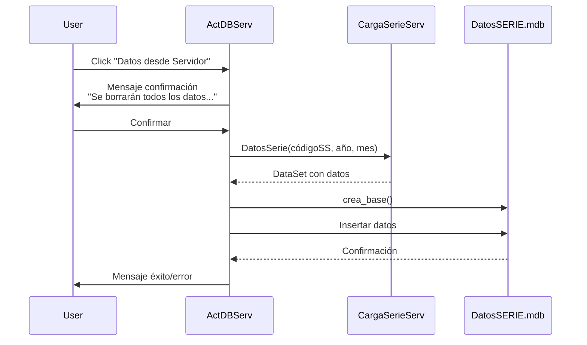
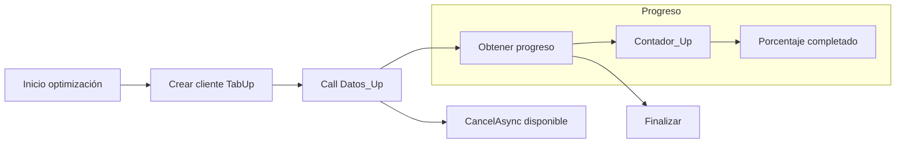
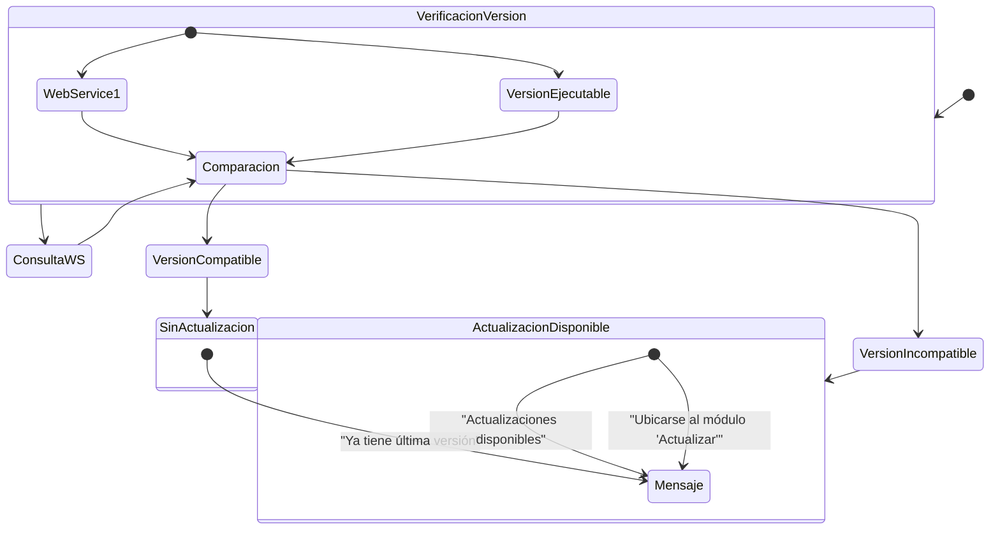

# Módulo M6 Profundizado: Sincronización y Actualización

Versión documentada: 1.0 | Estado: ✅ Implementado | Fecha: 2026-11-05

---

## 1. Arquitectura del Módulo

### Componentes Principales

| Componente | Tipo | Función Principal | Implementación |
|------------|------|---------------------|----------------|
| **Actualizador** | Formulario | Diálogo de actualización de sistema | ✅ |
| **buscaActualizacion** | Formulario | Splash durante búsqueda actualizaciones | ✅ |
| **ExtraeDatos.CargaSerieServ** | Clase/WebService | Descarga datos por SS/año/mes | ✅ |
| **LlenaSerie.WebService3** | Clase/WebService | Operaciones de serie (serieA, serieBS...) | ✅ |
| **DatosSerie.CargaSerie** | Clase/WebService | Carga de datos por serie | ✅ |
| **Datos.WebServiceDB** | Clase/WebService | Acceso a catálogos del servidor | ✅ |
| **ContUp/TabUp** | Clases/WebService | Optimización y contadores remotos | ✅ |
| **ValidaVersionEjec.VersionEjecutable** | WebService | Validación de versión ejecutable | ✅ |
| **version.WebService1** | WebService | Versión del servicio | ✅ |

---

## 2. Flujos de Datos Detallados

### D6.1: Flujo de Actualización de Sistema y Catálogos

```mermaid
flowchart LR
    subgraph "Inicio usuario"
        A1[Click "Actualizar"]
    end
    
    subgraph "Verificación"
        B1[Mensaje: "Buscando..."]
        B2[buscaActualizacion: "Buscando actualizaciones..."]
        B3[Consultar WebService1.version]
    end
    
    subgraph "Decisión"
        C1{¿Versión diferente?}
    end
    
    subgraph "Descarga"
        D1[Mensaje: "Descargando Actualizaciones..."]
        D2[Eliminar contenido Global.mdb]
    end
    
    subgraph "Catálogos descargados"
        E1[Establecimientos (mpestablecimiento)]
        E2[Servicios (mpservicio)]
        E3[Diccionarios (diccionario)]
        E4[Excepciones (Excep)]
        E5[Columnas excepciones (ColExcep)]
        E6[Hojas (thojas)]
        E7[Versiones (version)]
    end
    
    subgraph "Finalización"
        F1[Actualizar Software.Version]
        F2[Mensaje: "Finalizado Con Exito !!"]
    end
    
    A1 --> B1 --> B2 --> B3 --> C1
    C1 -- Sí --> D1 & D2 --> E1 & E2 & E3 & E4 & E5 & E6 & E7 --> F1 --> F2
    C1 -- No --> F2
```

### D6.2: Flujo de Descarga desde Servidor (ActDBServ)



### D6.3: Flujo de Descarga por Serie

```mermaid
flowchart TB
    subgraph "Selección"
        A1[Usuario: Seleccionar Serie y Año]
        A2{Verificar servicio}
    end
    
    subgraph "Sin SS"
        B1[Mensaje RN-G1: "Elegir Servicio..."]
    end
    
    subgraph "Con SS"
        C1[Consumir WebService]
        C2[Obtener DataSet]
        C3[Crear base local]
        C4[Insertar datos]
        C5[Actualizar HistCarga]
    end
    
    subgraph "Salida"
        D1[Mensaje éxito]
        D2[Mensaje error]
    end
    
    A1 --> A2
    A2 -- Sin SS --> B1
    A2 -- Con SS --> C1 --> C2 --> C3 --> C4 --> C5 --> D1
    C1 -.-> D2
```

### D6.4: Flujo de Optimización Remota (ContUp/TabUp)



### D6.5: Diagrama de arquitectura de servicios web

```mermaid
graph TB
    subgraph "Cliente Local"
        A[Actualizador]
        B[CargaDatos]
        C[ActDBServ]
        D[bases]
    end
    
    subgraph "Servicios Web MINSAL"
        E[WebService1.asmx<br/>version()]
        F[versionejecutable.asmx<br/>VersionEjecutable]
        G[webservicedb.asmx<br/>Datos.WebServiceDB]
        H[CargaSerie.asmx<br/>DatosSerie.CargaSerie]
        I[WebService3.asmx<br/>LlenaSerie]
        J[CargaSerieServ.asmx<br/>ExtraeDatos]
        K[Optimiza_Up.asmx<br/>TabUp/ContUp]
    end
    
    subgraph "Bases locales"
        L[Global.mdb]
        M[DatosSERIE.mdb]
        N[Trans.mdb]
    end
    
    A --> E
    A --> F
    A --> G
    B --> J
    C --> J
    D --> L
    G --> L
    H --> M
    I --> L
    J --> M
    K --> L
```

---

## 3. Web Services Detallados

### WebService1.asmx - version()

| Operación | Retorno | Propósito |
|-----------|---------|-----------|
| `version() : string` | Versión del servicio | Verificar versión antes de VersionEjecutable |

**Uso en código:**
```csharp
string versionServicio = webService.version();
```

### versionejecutable.asmx - VersionEjecutable()

| Operación | Firma | Retorno | Propósito |
|-----------|-------|---------|-----------|
| `VersionEjec() : DataSet` | - | DataSet XML | Verificar versión ejecutable |

**Estructura esperada:**
```xml
<DataSet>
  <Schema>...</Schema>
  <Instance>
    <Version>2.0</Version>
    <Fecha>2024-01-15</Fecha>
  </Instance>
</DataSet>
```

### webservicedb.asmx - WebServiceDB

| Operación | Retorno | Uso |
|-----------|---------|-----|
| `datos()` | DataSet | Catálogos |
| `servicio()` | DataSet | Lista servicios |
| `diccionario()` | DataSet | Diccionario |
| `Thoja()` | DataSet | Definición hojas |
| `Version()` | DataSet | Tabla version |
| `Excep()` | DataSet | Columnas excepciones |
| `ColExcep()` | DataSet | Detalle excepciones |

### CargaSerie.asmx / WebService3.asmx

| Operación | Parámetros | Uso |
|-----------|------------|-----|
| `serieA(string)` | códigoSS | Descargar datos Serie A |
| `serieBS(string)` | códigoSS | Descargar datos Serie BS |
| `serieBM(string)` | códigoSS | Descargar datos Serie BM |
| `serieD(string)` | códigoSS | Descargar datos Serie D |
| `serieP(string)` | códigoSS | Descargar datos Serie P |
| `serieF(string)` | códigoSS | Descargar datos Serie F |

### CargaSerieServ.asmx

| Operación | Firma | Uso |
|-----------|-------|-----|
| `DatosSerie` | (string códigoSS, int año, int mes) | Descargar datos por SS/año/mes |
| `DatosControl` | (string códigoSS, int año, int mes) | Descargar datos de control |

### Optimiza_Up.asmx

| Operación | Retorno | Uso |
|-----------|---------|-----|
| `Datos_Up()` | void | Ejecutar optimización en servidor |
| `Contador_Up()` | string | Obtener contadores de uso |

---

## 4. Configuración de URLs

### ValidadorRem.exe.config

```xml
<configuration>
  <appSettings>
    <!-- Producción -->
    <add key="WebServiceURL" 
         value="https://cargasrem.minsal.cl/webservice/" />
    
    <!-- Prueba (riesgo: HTTP sin TLS) -->
    <add key="PruebaURL" 
         value="http://intradeis.minsal.cl/webservicePrueba/" />
    
    <!-- Optimización -->
    <add key="OptimizaURL" 
         value="https://cargasrem.minsal.cl/webservice/Optimiza_Up.asmx" />
    
    <!-- Configuración general -->
    <add key="generacion" value="False" />
  </appSettings>
</configuration>
```

---

## 5. Reglas de Negocio

| Código | Nombre | Condición | Acción | Estado |
|--------|--------|-----------|--------|--------|
| **RN-M6-1** | Almacenamiento Versión | En Global.mdb Software.Version | Actualizar al final descarga | ✅ Implementado |
| **RN-M6-2** | Reemplazo Total Catálogos | Descarga actualización | Borrar y reemplazar tablas | ✅ Implementado |
| **RN-M6-3** | Inconsistencia Versiones | Mensaje "Versión Actual : 2.0..." | [PENDIENTE] Definir fuente verdad | ❌ Pendiente |

---

## 6. Diagrama de Estados de Versión



---

## 7. Errores y Manejo de Conectividad

| Escenario | Mensaje | Comportamiento |
|-----------|---------|----------------|
| Timeout de red | "Error de conexión" | Mostrar mensaje continuar |
| HTTP 401/403 | No manejado explícitamente | Mensaje genérico |
| HTTP 404/500 | No manejado explícitamente | Mensaje genérico |
| Excepción | "Ha ocurrido excepción..." | Escribe en DetalleExcepcion.txt |

---

## 8. Estado de Validación Pendiente

| Elemento | Estado | Comentario |
|----------|--------|------------|
| Payload SOAP exacto | ❌ Pendiente | Captura requerida |
| Estructura DataSet WS | ❌ Pendiente | Confirmar columnas |
| Manejo códigos HTTP | ❌ Pendiente | No implementa retry |
| Reintentos WS | ❌ Pendiente | No hay bucle reintento |
| Hosts de prueba uso | ❌ Pregunta | Confirmar con TI |
| Inconsistencia versiones | ❌ Pregunta | Fuente verdad no definida |
| Formato respuesta DataSet | ❌ Pendiente | Estructura exacta |

---

## 9. Métricas de Flujo

| Métrica | Valor | Comentario |
|---------|-------|------------|
| Llamadas WS por actualización | 7 |WebService1, VersionEjecutable, WSDB, LlenaSerie, CargaSerie, CargaSerieServ, Optimiza_Up |
| Tablas descargadas | 7 |mpestablecimiento, mpservicio, diccionario, Excep, ColExcep, thojas, version|
| Tamaño Global.mdb | 422 MB | Principal archivo |
| Tiempo estimado actualización | 2-10 min | Depende conexión |
| Líneas IL Actualizador | ~500-800 | Estimado |
| Consultas SQL actualización | 7 DELETE + múltiples INSERT |

---

## 10. Consideraciones Técnicas

### Problemas de seguridad identificados

1. **HTTP de prueba**: `http://intradeis.minsal.cl/webservicePrueba/` sin TLS
2. **Autenticación**: No se observó credenciales ni tokens
3. **Concurrencia**: Posible bloqueo de archivos .mdb

### Riesgos para migración web

| Riesgo | Severidad | Mitigación |
|--------|-----------|------------|
| Dependencia SOAP | Alta | Crear BFF REST |
| Sin autenticación | Alta | Implementar JWT/OAuth2 |
| HTTP sin TLS | Media | Usar HTTPS |
| Reemplazo total | Media | Implementar backup previo |

---

**Documento generado:** Basado en análisis estático del sistema ValidadorRem. Requiere validación con captura de tráfico HTTP/SOAP para confirmar firmas exactas y flujos de autenticación.