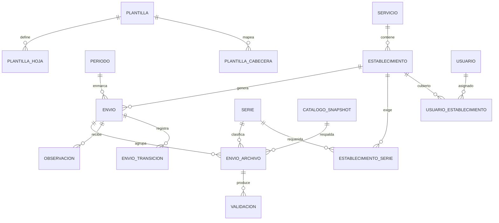
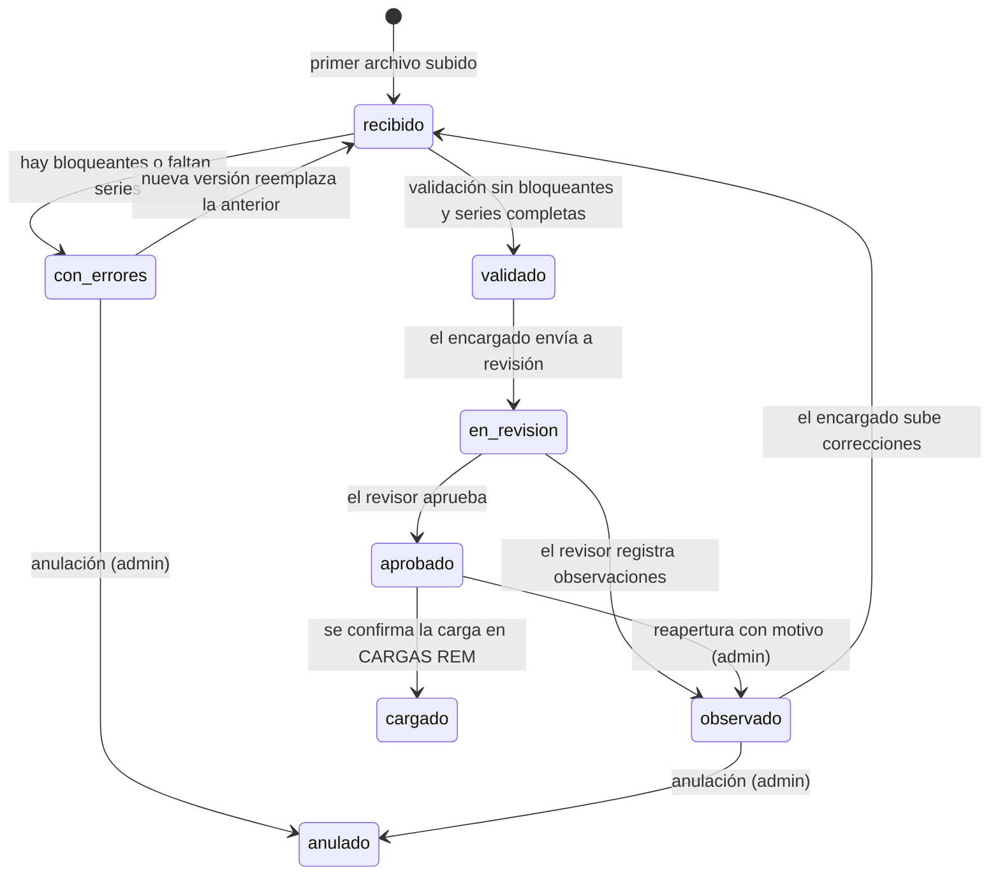
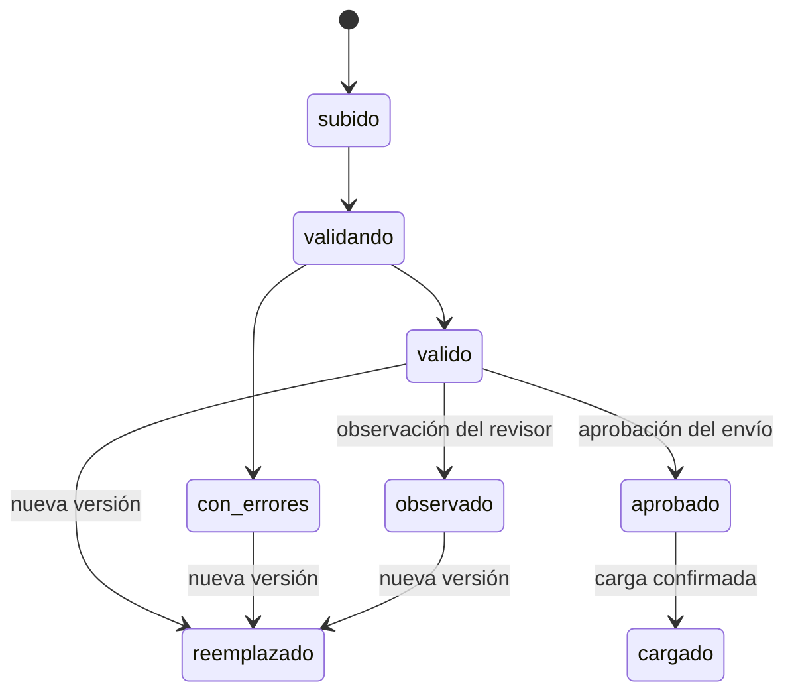
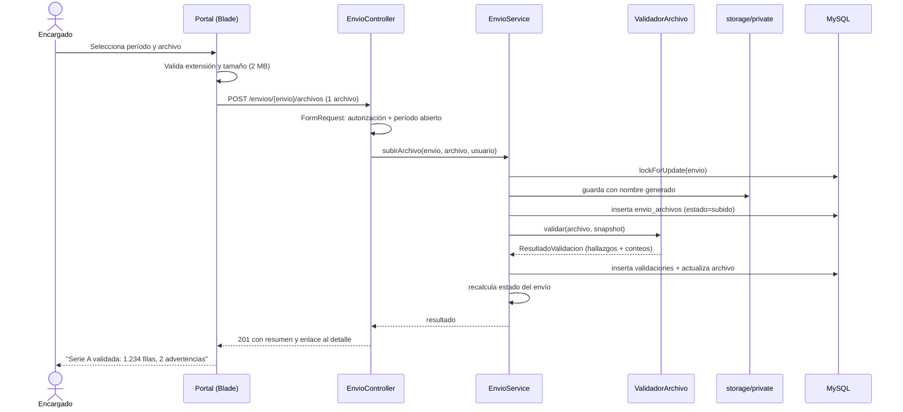
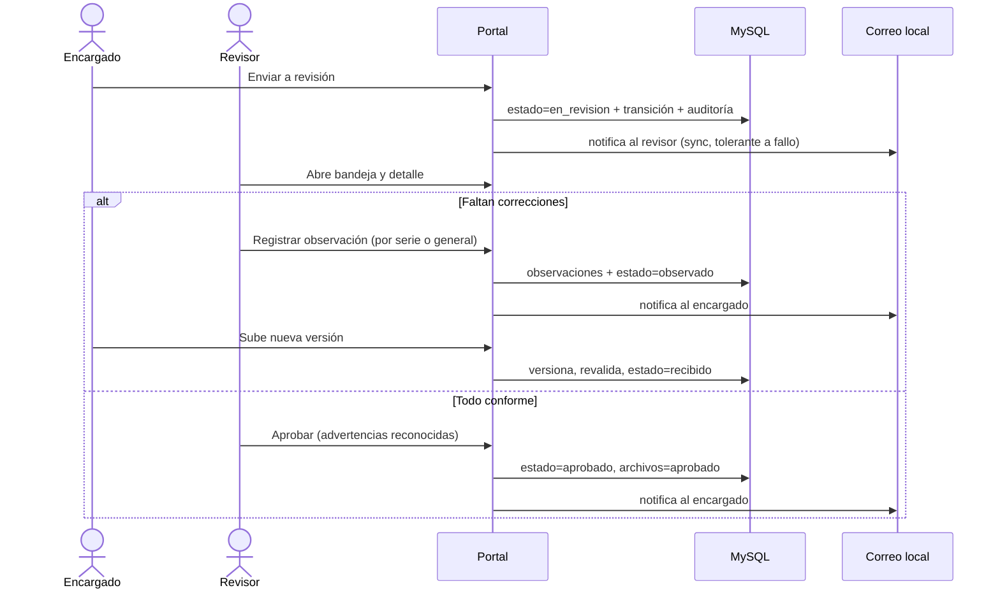
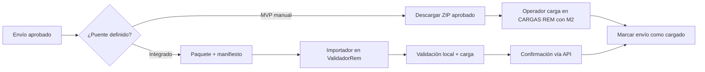
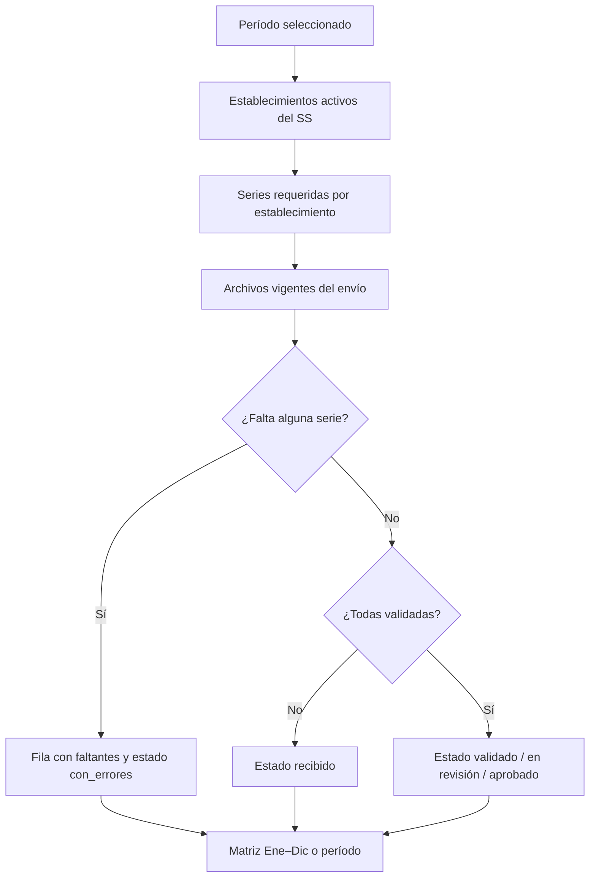

# Módulo M7 Profundizado: Envío de Estadísticas por Establecimiento (Portal)

Versión documentada: 1.0 | Estado: 🟡 Propuesto (sin código) | Fecha: 2026-11-06

> **Ubicación.** Este documento vive en `backup_documentacion/` junto con los módulos M1–M6. Los documentos base (`informe.md`, `stack_modulo_envio.md`, `README.md`) están un nivel arriba, en la raíz del repositorio.

> **Relación con los otros documentos.** Este módulo **no existe** en ValidadorRem: es el módulo nuevo descrito en `../informe.md` §2.10. El stack de destino está en `../stack_modulo_envio.md`. Los módulos M1–M6 (en esta misma carpeta) documentan el sistema de escritorio actual y se citan aquí solo como fuente de reglas y como destino del puente de carga.

**Leyenda:** ✅ confirmado · 🟡 decisión propuesta · ❓ pendiente de validación

---

## Índice

1. [Ficha del módulo](#1-ficha-del-módulo)
2. [Alcance, principios y vocabulario](#2-alcance-principios-y-vocabulario)
3. [Actores, roles y permisos](#3-actores-roles-y-permisos)
4. [Modelo de dominio](#4-modelo-de-dominio)
5. [Ciclo de vida y estados](#5-ciclo-de-vida-y-estados)
6. [Reglas de negocio del módulo](#6-reglas-de-negocio-del-módulo)
7. [Pipeline de validación](#7-pipeline-de-validación)
8. [Flujos detallados](#8-flujos-detallados)
9. [Completitud y cierre mensual](#9-completitud-y-cierre-mensual)
10. [Pantallas y navegación](#10-pantallas-y-navegación)
11. [Arquitectura Laravel 8 (PHP 7.4)](#11-arquitectura-laravel-8-php-74)
12. [Integración con CARGAS REM y catálogos](#12-integración-con-cargas-rem-y-catálogos)
13. [Seguridad y privacidad](#13-seguridad-y-privacidad)
14. [Notificaciones](#14-notificaciones)
15. [Requisitos no funcionales](#15-requisitos-no-funcionales)
16. [Plan de implementación](#16-plan-de-implementación)
17. [Estrategia de pruebas y paridad con el validador actual](#17-estrategia-de-pruebas-y-paridad-con-el-validador-actual)
18. [Decisiones abiertas](#18-decisiones-abiertas)
19. [Riesgos del módulo](#19-riesgos-del-módulo)
20. [Anexos](#20-anexos)

---

## 1. Ficha del módulo

| Aspecto | Definición |
|---|---|
| Nombre funcional | Envío mensual de estadísticas por establecimiento |
| Código | M7 (nuevo) |
| Usuarios | Encargado de estadística del establecimiento, Revisor de la Unidad de Estadísticas del SS, Administrador |
| Problema que resuelve | Reemplaza el envío por correo y la revisión manual: centraliza archivos, valida al subir, ordena el flujo de revisión y deja trazabilidad |
| Entrada | Uno o más Excel REM (`.xls`, `.xlsx`, `.xlsm`) por período (año, mes) y serie |
| Salida | Envío con estado, reporte de validación descargable, observaciones y paquete aprobado para CARGAS REM |
| Fuera de alcance (MVP) | Reemplazar ValidadorRem, generar el archivo MINSAL en el portal, firma electrónica, gestión documental general, envío por correo de los archivos |
| Dependencia crítica | Reproducir las reglas de validación del motor de escritorio (`CargaExcel`); ver §7 y §17 |

### 1.1 Qué agrega esta profundización respecto de `../informe.md` §2.10

1. Modelo de datos relacional completo (MySQL 8) con versionado de archivos y snapshots de catálogo.
2. Máquina de estados formal, con guardas, actor permitido y transiciones prohibidas.
3. Pipeline de validación por etapas (V0–V10), con severidad y catálogo de códigos de error.
4. Separación explícita entre **envío** (período) y **archivo** (serie), que es la clave para reenvíos y observaciones por serie.
5. Reglas de completitud y cierre mensual implementables, incluida la serie local SAX.
6. Pantallas, rutas y permisos concretos para los tres roles.
7. Arquitectura Laravel 8 compatible con PHP 7.4 y con las restricciones reales del servidor (sin SSH, sin colas, `upload_max_filesize=2M`).
8. Estrategia de importación de catálogos desde Access sin driver OLEDB en Linux.
9. Contrato del paquete aprobado y tres opciones de puente con CARGAS REM.
10. Plan por fases, criterios de aceptación y estrategia de paridad con el validador actual.

---

## 2. Alcance, principios y vocabulario

### 2.1 Principios de diseño

| # | Principio | Consecuencia práctica |
|---|---|---|
| P1 | **El servidor es la única autoridad de validación** | El navegador puede validar extensión y tamaño, pero nunca decide si un archivo es válido |
| P2 | **Nada se sobrescribe** | Cada reenvío crea una versión nueva; la anterior queda como `reemplazado`, visible en el historial |
| P3 | **Un archivo por petición HTTP** | `post_max_size=8M` impide un mes completo; la UI sube en secuencia y muestra el progreso |
| P4 | **El estado es explícito y auditado** | Toda transición pasa por un servicio único que escribe `envio_transiciones` y `auditoria` |
| P5 | **Aislamiento por establecimiento en la consulta** | No basta ocultar en la vista: cada consulta aplica el alcance del usuario (RN-ENV-1) |
| P6 | **Validación reproducible** | Cada archivo guarda el snapshot de catálogo usado; se puede revalidar y obtener el mismo resultado |
| P7 | **Sin trabajo asíncrono obligatorio** | La validación ocurre en la petición; si se necesita concurrencia limitada, se usa un lock, no una cola |
| P8 | **Trazabilidad de punta a punta** | Quién subió, validó, observó, aprobó y cargó; con fecha, versión y hash |

### 2.2 Vocabulario (para evitar ambigüedad con M2)

| Término | Significado en M7 | No confundir con |
|---|---|---|
| **Envío** | Unidad mensual de un establecimiento: `(establecimiento, año, mes)` | Una carga de M2, que es un archivo aislado |
| **Archivo** | Un Excel de una serie dentro de un envío | La tabla `datos` de ValidadorRem |
| **Versión** | Número incremental de un archivo de la misma serie | La versión de plantilla Excel |
| **Validación** | Proceso automático que produce hallazgos | La revisión humana del revisor |
| **Observación** | Comentario del revisor que devuelve el envío | Un error automático de validación |
| **Aprobación** | Decisión humana que habilita el paquete de carga | La validación automática correcta |
| **Carga** | Incorporación de lo aprobado a CARGAS REM | La subida del archivo al portal |

### 2.3 Límites del MVP

- **No** genera el archivo MINSAL (formato aún desconocido, P7).
- **No** escribe directamente en las bases Access (incompatible con Linux y riesgoso por bloqueo de archivos).
- **No** reemplaza la revisión de la Unidad de Estadísticas: la ordena y la deja registrada.
- **No** incluye firma electrónica ni expediente documental.
- **Sí** incluye: carga, validación, estados, observaciones, completitud, reporte, auditoría y paquete aprobado.

---

## 3. Actores, roles y permisos

### 3.1 Roles

| Rol (slug) | Alcance | Descripción |
|---|---|---|
| `encargado` | Sus establecimientos | Sube archivos, corrige, envía a revisión y ve sus observaciones |
| `revisor` | Establecimientos de su Servicio de Salud | Revisa la bandeja, observa, aprueba y confirma la carga |
| `admin` | Global | Usuarios, establecimientos, series, períodos, catálogos, auditoría y reaperturas |
| `consulta` (opcional) | Su SS, solo lectura | Dirección o referentes que necesitan ver completitud y estados sin operar |

🟡 Se propone además que un usuario pueda tener más de un establecimiento (pivot `usuario_establecimiento`), porque un encargado puede cubrir un hospital y sus CDT.

### 3.2 Matriz de permisos

| Permiso | encargado | revisor | admin | consulta |
|---|:--:|:--:|:--:|:--:|
| `envios.crear` | ✅ | — | ✅ | — |
| `envios.ver.propio` | ✅ | — | ✅ | — |
| `envios.ver.ss` | — | ✅ | ✅ | ✅ |
| `envios.enviar` | ✅ | — | ✅ | — |
| `envios.observar` | — | ✅ | ✅ | — |
| `envios.aprobar` | — | ✅ | ✅ | — |
| `envios.cargar` | — | ✅ | ✅ | — |
| `envios.reabrir` | — | — | ✅ | — |
| `envios.anular` | — | — | ✅ | — |
| `archivos.descargar` | ✅ | ✅ | ✅ | ✅ |
| `reportes.descargar` | ✅ | ✅ | ✅ | ✅ |
| `completitud.ver` | ✅ | ✅ | ✅ | ✅ |
| `paquetes.generar` | — | ✅ | ✅ | — |
| `catalogos.importar` | — | — | ✅ | — |
| `usuarios.gestionar` | — | — | ✅ | — |
| `periodos.gestionar` | — | — | ✅ | — |
| `auditoria.ver` | — | — | ✅ | — |

### 3.3 Reglas de autorización

- **RN-ENV-1 (aislamiento).** Un encargado solo ve y envía archivos de sus establecimientos. La comprobación se hace en la *policy* y en la consulta, no en la vista.
- **RN-ENV-6 (unicidad).** Existe un solo envío por `(establecimiento, año, mes)`. Los reenvíos agregan versiones de archivo, no envíos nuevos.
- **RN-ENV-7 (segregación).** El revisor no puede aprobar un envío de un establecimiento al que está asignado como encargado. 🟡 Evita la autoaprobación.
- **RN-ENV-8 (inmutabilidad).** Un archivo `aprobado` o `cargado` no se edita ni se borra; solo se reemplaza por una versión nueva o se reabre el envío con motivo (admin).
- **RN-ENV-9 (defensa en profundidad).** Las rutas de descarga verifican la policy en cada petición; el almacenamiento está fuera de `public/` y los archivos se sirven con `Content-Disposition: attachment`.

---

## 4. Modelo de dominio

### 4.1 Entidades y relaciones



### 4.2 Decisiones de modelado

| Decisión | Razón |
|---|---|
| `envios` único por establecimiento y período | Un mes se trabaja una vez; los reenvíos son versiones de archivo |
| `envio_archivos` con `version` y `es_vigente` | Permite historial completo sin sobrescribir y deja una sola versión activa por serie |
| Hallazgos en tabla `validaciones` | El reporte se regenera sin volver a leer el Excel; se puede filtrar y auditar |
| Snapshot de catálogo por archivo | Si el MINSAL actualiza `Diccionario` o `version`, se puede revalidar con el catálogo original |
| Observaciones a nivel de envío y de archivo | Permite "corrige la serie BS" sin ambigüedad |
| Bitácora de transiciones separada de auditoría | La primera es de negocio; la segunda es de seguridad y incluye accesos |
| Catálogos espejo en MySQL | El portal no puede leer `.mdb` en Ubuntu; además las consultas de validación deben ser rápidas |

### 4.3 DDL propuesto (MySQL 8, `utf8mb4`, InnoDB)

> 🟡 Ajustar nombres y longitudes al importar los catálogos reales. Las claves se declaran desde el inicio para que la importación detecte duplicados.

```sql
-- Catálogos base ------------------------------------------------------------
CREATE TABLE servicios (
  id            BIGINT UNSIGNED AUTO_INCREMENT PRIMARY KEY,
  codigo        VARCHAR(10)  NOT NULL,
  nombre        VARCHAR(150) NOT NULL,
  region        VARCHAR(80)  NULL,
  activo        TINYINT(1)   NOT NULL DEFAULT 1,
  created_at    TIMESTAMP NULL,
  updated_at    TIMESTAMP NULL,
  UNIQUE KEY uq_servicios_codigo (codigo)
) ENGINE=InnoDB DEFAULT CHARSET=utf8mb4 COLLATE=utf8mb4_unicode_ci;

CREATE TABLE establecimientos (
  id            BIGINT UNSIGNED AUTO_INCREMENT PRIMARY KEY,
  codigo        VARCHAR(20)  NOT NULL,           -- puede contener '-' (RN-M2-10)
  nombre        VARCHAR(200) NOT NULL,
  servicio_id   BIGINT UNSIGNED NOT NULL,
  comuna        VARCHAR(100) NULL,
  dependencia   VARCHAR(100) NULL,
  tipo          VARCHAR(20)  NULL,
  activo        TINYINT(1)   NOT NULL DEFAULT 1,
  created_at    TIMESTAMP NULL,
  updated_at    TIMESTAMP NULL,
  UNIQUE KEY uq_establecimientos_codigo (codigo),
  KEY ix_establecimientos_servicio (servicio_id),
  CONSTRAINT fk_establecimientos_servicio
    FOREIGN KEY (servicio_id) REFERENCES servicios(id)
) ENGINE=InnoDB DEFAULT CHARSET=utf8mb4 COLLATE=utf8mb4_unicode_ci;

CREATE TABLE series (
  id            BIGINT UNSIGNED AUTO_INCREMENT PRIMARY KEY,
  codigo        VARCHAR(5)   NOT NULL,           -- A, BS, BM, D, P, F, SAX
  nombre        VARCHAR(100) NOT NULL,
  orden         SMALLINT     NOT NULL DEFAULT 0,
  activo        TINYINT(1)   NOT NULL DEFAULT 1,
  UNIQUE KEY uq_series_codigo (codigo)
) ENGINE=InnoDB DEFAULT CHARSET=utf8mb4 COLLATE=utf8mb4_unicode_ci;

-- Usuarios y alcance --------------------------------------------------------
-- users: tabla estándar de Laravel + activo, ultimo_acceso, two_factor_* (si aplica)
CREATE TABLE usuario_establecimiento (
  usuario_id        BIGINT UNSIGNED NOT NULL,
  establecimiento_id BIGINT UNSIGNED NOT NULL,
  created_at        TIMESTAMP NULL,
  PRIMARY KEY (usuario_id, establecimiento_id),
  CONSTRAINT fk_ue_usuario FOREIGN KEY (usuario_id) REFERENCES users(id) ON DELETE CASCADE,
  CONSTRAINT fk_ue_establecimiento FOREIGN KEY (establecimiento_id) REFERENCES establecimientos(id) ON DELETE CASCADE
) ENGINE=InnoDB DEFAULT CHARSET=utf8mb4 COLLATE=utf8mb4_unicode_ci;

-- Períodos y completitud ----------------------------------------------------
CREATE TABLE periodos (
  id                BIGINT UNSIGNED AUTO_INCREMENT PRIMARY KEY,
  anio              SMALLINT NOT NULL,
  mes               TINYINT  NOT NULL,
  fecha_limite      DATE     NULL,
  estado            VARCHAR(20) NOT NULL DEFAULT 'abierto', -- abierto | en_revision | cerrado
  created_at        TIMESTAMP NULL,
  updated_at        TIMESTAMP NULL,
  UNIQUE KEY uq_periodos (anio, mes)
) ENGINE=InnoDB DEFAULT CHARSET=utf8mb4 COLLATE=utf8mb4_unicode_ci;

CREATE TABLE establecimiento_serie (
  id                 BIGINT UNSIGNED AUTO_INCREMENT PRIMARY KEY,
  establecimiento_id BIGINT UNSIGNED NOT NULL,
  serie_id           BIGINT UNSIGNED NOT NULL,
  obligatoria        TINYINT(1) NOT NULL DEFAULT 1,
  vigente_desde      DATE NULL,
  vigente_hasta      DATE NULL,
  KEY ix_es_establecimiento (establecimiento_id, serie_id),
  CONSTRAINT fk_es_establecimiento FOREIGN KEY (establecimiento_id) REFERENCES establecimientos(id) ON DELETE CASCADE,
  CONSTRAINT fk_es_serie FOREIGN KEY (serie_id) REFERENCES series(id)
) ENGINE=InnoDB DEFAULT CHARSET=utf8mb4 COLLATE=utf8mb4_unicode_ci;

-- Snapshots de catálogo -----------------------------------------------------
CREATE TABLE catalogo_snapshots (
  id            BIGINT UNSIGNED AUTO_INCREMENT PRIMARY KEY,
  origen        VARCHAR(100) NOT NULL,           -- p.ej. Global.mdb 2026-10
  hash_paquete  CHAR(64)     NULL,
  filas_diccionario INT UNSIGNED NULL,
  filas_establecimientos INT UNSIGNED NULL,
  activo        TINYINT(1)   NOT NULL DEFAULT 0,
  importado_por BIGINT UNSIGNED NULL,
  created_at    TIMESTAMP NULL,
  CONSTRAINT fk_snapshot_usuario FOREIGN KEY (importado_por) REFERENCES users(id)
) ENGINE=InnoDB DEFAULT CHARSET=utf8mb4 COLLATE=utf8mb4_unicode_ci;

-- Plantillas y mapeo de celdas ---------------------------------------------
CREATE TABLE plantillas (
  id            BIGINT UNSIGNED AUTO_INCREMENT PRIMARY KEY,
  anio          SMALLINT NOT NULL,
  mes           TINYINT  NOT NULL,
  serie_id      BIGINT UNSIGNED NOT NULL,
  serie_excel   VARCHAR(10) NOT NULL,
  version       VARCHAR(20) NOT NULL,
  snapshot_id   BIGINT UNSIGNED NULL,
  UNIQUE KEY uq_plantillas (anio, mes, serie_id, version),
  KEY ix_plantillas_periodo (anio, mes, serie_id),
  CONSTRAINT fk_plantillas_serie FOREIGN KEY (serie_id) REFERENCES series(id),
  CONSTRAINT fk_plantillas_snapshot FOREIGN KEY (snapshot_id) REFERENCES catalogo_snapshots(id)
) ENGINE=InnoDB DEFAULT CHARSET=utf8mb4 COLLATE=utf8mb4_unicode_ci;

CREATE TABLE plantilla_hojas (
  id            BIGINT UNSIGNED AUTO_INCREMENT PRIMARY KEY,
  plantilla_id  BIGINT UNSIGNED NOT NULL,
  hoja          VARCHAR(100) NOT NULL,
  rango         VARCHAR(50)  NULL,               -- rango declarado en Thojas
  obligatoria   TINYINT(1)   NOT NULL DEFAULT 1,
  KEY ix_ph_plantilla (plantilla_id),
  CONSTRAINT fk_ph_plantilla FOREIGN KEY (plantilla_id) REFERENCES plantillas(id) ON DELETE CASCADE
) ENGINE=InnoDB DEFAULT CHARSET=utf8mb4 COLLATE=utf8mb4_unicode_ci;

CREATE TABLE plantilla_cabecera (
  id            BIGINT UNSIGNED AUTO_INCREMENT PRIMARY KEY,
  plantilla_id  BIGINT UNSIGNED NOT NULL,
  campo         VARCHAR(30)  NOT NULL,           -- serie | anio | mes | version | establecimiento
  hoja          VARCHAR(100) NULL,
  celda         VARCHAR(10)  NULL,               -- p.ej. B3; NULL = detección por etiqueta
  etiqueta      VARCHAR(100) NULL,               -- p.ej. "SERIE"
  obligatorio   TINYINT(1)   NOT NULL DEFAULT 1,
  KEY ix_pc_plantilla (plantilla_id),
  CONSTRAINT fk_pc_plantilla FOREIGN KEY (plantilla_id) REFERENCES plantillas(id) ON DELETE CASCADE
) ENGINE=InnoDB DEFAULT CHARSET=utf8mb4 COLLATE=utf8mb4_unicode_ci;

-- Espejo del Diccionario (185.526 filas en el origen) -----------------------
CREATE TABLE diccionario (
  id                BIGINT UNSIGNED AUTO_INCREMENT PRIMARY KEY,
  snapshot_id       BIGINT UNSIGNED NOT NULL,
  anio              SMALLINT NOT NULL,
  mes               TINYINT  NULL,
  serie             VARCHAR(5) NOT NULL,
  hoja              VARCHAR(100) NOT NULL,
  codigo_prestacion VARCHAR(20) NOT NULL,
  texto_prestacion  VARCHAR(254) NULL,
  linea             INT NOT NULL,
  inicio            VARCHAR(10) NULL,
  fin               VARCHAR(10) NULL,
  posicion          SMALLINT NULL,
  tipo_dato         VARCHAR(20) NULL,
  KEY ix_dicc_busqueda (snapshot_id, anio, serie, hoja, linea),
  KEY ix_dicc_prestacion (snapshot_id, codigo_prestacion)
) ENGINE=InnoDB DEFAULT CHARSET=utf8mb4 COLLATE=utf8mb4_unicode_ci;

-- Estructura a confirmar (P6): Excep / colexcep -----------------------------
CREATE TABLE excepciones (
  id                BIGINT UNSIGNED AUTO_INCREMENT PRIMARY KEY,
  snapshot_id       BIGINT UNSIGNED NOT NULL,
  anio              SMALLINT NOT NULL,
  mes               TINYINT  NULL,
  serie             VARCHAR(5) NOT NULL,
  hoja              VARCHAR(100) NOT NULL,
  codigo_prestacion VARCHAR(20) NULL,
  columna           VARCHAR(10) NULL,
  motivo            VARCHAR(200) NULL,
  payload           JSON NULL,                   -- respaldo hasta mapear el esquema real
  KEY ix_excep_busqueda (snapshot_id, anio, serie, hoja)
) ENGINE=InnoDB DEFAULT CHARSET=utf8mb4 COLLATE=utf8mb4_unicode_ci;
```

```sql
-- Núcleo transaccional -------------------------------------------------------
CREATE TABLE envios (
  id                 BIGINT UNSIGNED AUTO_INCREMENT PRIMARY KEY,
  establecimiento_id BIGINT UNSIGNED NOT NULL,
  anio               SMALLINT NOT NULL,
  mes                TINYINT  NOT NULL,
  estado             VARCHAR(20) NOT NULL DEFAULT 'recibido',
  enviado_por        BIGINT UNSIGNED NULL,
  revisor_id         BIGINT UNSIGNED NULL,
  observacion_general VARCHAR(1000) NULL,
  fecha_envio        DATETIME NULL,
  fecha_revision     DATETIME NULL,
  fecha_aprobacion   DATETIME NULL,
  fecha_carga        DATETIME NULL,
  created_at         TIMESTAMP NULL,
  updated_at         TIMESTAMP NULL,
  UNIQUE KEY uq_envios_periodo (establecimiento_id, anio, mes),
  KEY ix_envios_estado (estado),
  KEY ix_envios_periodo (anio, mes),
  CONSTRAINT fk_envios_establecimiento FOREIGN KEY (establecimiento_id) REFERENCES establecimientos(id),
  CONSTRAINT fk_envios_enviado_por FOREIGN KEY (enviado_por) REFERENCES users(id),
  CONSTRAINT fk_envios_revisor FOREIGN KEY (revisor_id) REFERENCES users(id)
) ENGINE=InnoDB DEFAULT CHARSET=utf8mb4 COLLATE=utf8mb4_unicode_ci;

CREATE TABLE envio_archivos (
  id                    BIGINT UNSIGNED AUTO_INCREMENT PRIMARY KEY,
  envio_id              BIGINT UNSIGNED NOT NULL,
  serie_id              BIGINT UNSIGNED NOT NULL,
  version               SMALLINT UNSIGNED NOT NULL DEFAULT 1,
  es_vigente            TINYINT(1) NOT NULL DEFAULT 1,
  nombre_original       VARCHAR(255) NOT NULL,
  ruta                  VARCHAR(500) NOT NULL,
  disco                 VARCHAR(30)  NOT NULL DEFAULT 'local',
  sha256                CHAR(64) NOT NULL,
  tamano_bytes          INT UNSIGNED NOT NULL,
  mime                  VARCHAR(100) NULL,
  estado                VARCHAR(20) NOT NULL DEFAULT 'subido',
  plantilla_id          BIGINT UNSIGNED NULL,
  snapshot_id           BIGINT UNSIGNED NOT NULL,
  filas_leidas          INT UNSIGNED NULL,
  filas_validas         INT UNSIGNED NULL,
  filas_error           INT UNSIGNED NULL,
  validado_en           DATETIME NULL,
  subido_por            BIGINT UNSIGNED NOT NULL,
  created_at            TIMESTAMP NULL,
  updated_at            TIMESTAMP NULL,
  UNIQUE KEY uq_archivo_version (envio_id, serie_id, version),
  KEY ix_archivo_vigente (envio_id, serie_id, es_vigente),
  KEY ix_archivo_hash (sha256),
  CONSTRAINT fk_archivo_envio FOREIGN KEY (envio_id) REFERENCES envios(id) ON DELETE CASCADE,
  CONSTRAINT fk_archivo_serie FOREIGN KEY (serie_id) REFERENCES series(id),
  CONSTRAINT fk_archivo_plantilla FOREIGN KEY (plantilla_id) REFERENCES plantillas(id),
  CONSTRAINT fk_archivo_snapshot FOREIGN KEY (snapshot_id) REFERENCES catalogo_snapshots(id),
  CONSTRAINT fk_archivo_usuario FOREIGN KEY (subido_por) REFERENCES users(id)
) ENGINE=InnoDB DEFAULT CHARSET=utf8mb4 COLLATE=utf8mb4_unicode_ci;

CREATE TABLE validaciones (
  id                BIGINT UNSIGNED AUTO_INCREMENT PRIMARY KEY,
  envio_archivo_id  BIGINT UNSIGNED NOT NULL,
  etapa             VARCHAR(5)  NOT NULL,          -- V0 … V10
  codigo            VARCHAR(20) NOT NULL,          -- ENV-001 …
  severidad         VARCHAR(15) NOT NULL,          -- bloqueante | advertencia | info
  regla             VARCHAR(60) NULL,              -- RN-M2-2, RN-M2-3, …
  mensaje           VARCHAR(500) NOT NULL,
  hoja              VARCHAR(100) NULL,
  celda             VARCHAR(20) NULL,
  valor             VARCHAR(255) NULL,
  created_at        TIMESTAMP NULL,
  KEY ix_val_archivo (envio_archivo_id, severidad),
  CONSTRAINT fk_val_archivo FOREIGN KEY (envio_archivo_id) REFERENCES envio_archivos(id) ON DELETE CASCADE
) ENGINE=InnoDB DEFAULT CHARSET=utf8mb4 COLLATE=utf8mb4_unicode_ci;

CREATE TABLE observaciones (
  id                BIGINT UNSIGNED AUTO_INCREMENT PRIMARY KEY,
  envio_id          BIGINT UNSIGNED NOT NULL,
  envio_archivo_id  BIGINT UNSIGNED NULL,
  autor_id          BIGINT UNSIGNED NOT NULL,
  texto             VARCHAR(2000) NOT NULL,
  resuelta         TINYINT(1) NOT NULL DEFAULT 0,
  resuelta_en       DATETIME NULL,
  created_at        TIMESTAMP NULL,
  updated_at        TIMESTAMP NULL,
  KEY ix_obs_envio (envio_id, resuelta),
  CONSTRAINT fk_obs_envio FOREIGN KEY (envio_id) REFERENCES envios(id) ON DELETE CASCADE,
  CONSTRAINT fk_obs_archivo FOREIGN KEY (envio_archivo_id) REFERENCES envio_archivos(id) ON DELETE SET NULL,
  CONSTRAINT fk_obs_autor FOREIGN KEY (autor_id) REFERENCES users(id)
) ENGINE=InnoDB DEFAULT CHARSET=utf8mb4 COLLATE=utf8mb4_unicode_ci;

CREATE TABLE envio_transiciones (
  id              BIGINT UNSIGNED AUTO_INCREMENT PRIMARY KEY,
  envio_id        BIGINT UNSIGNED NOT NULL,
  estado_anterior VARCHAR(20) NULL,
  estado_nuevo    VARCHAR(20) NOT NULL,
  actor_id        BIGINT UNSIGNED NOT NULL,
  motivo          VARCHAR(500) NULL,
  created_at      TIMESTAMP NULL,
  KEY ix_trans_envio (envio_id, created_at),
  CONSTRAINT fk_trans_envio FOREIGN KEY (envio_id) REFERENCES envios(id) ON DELETE CASCADE,
  CONSTRAINT fk_trans_actor FOREIGN KEY (actor_id) REFERENCES users(id)
) ENGINE=InnoDB DEFAULT CHARSET=utf8mb4 COLLATE=utf8mb4_unicode_ci;

CREATE TABLE auditoria (
  id          BIGINT UNSIGNED AUTO_INCREMENT PRIMARY KEY,
  usuario_id  BIGINT UNSIGNED NULL,
  evento      VARCHAR(60) NOT NULL,        -- login, upload, download, observar, aprobar, cargar…
  entidad     VARCHAR(60) NULL,
  entidad_id  BIGINT UNSIGNED NULL,
  datos       JSON NULL,
  ip          VARCHAR(45) NULL,
  user_agent  VARCHAR(255) NULL,
  created_at  TIMESTAMP NULL,
  KEY ix_auditoria_entidad (entidad, entidad_id),
  KEY ix_auditoria_fecha (created_at),
  KEY ix_auditoria_usuario (usuario_id),
  CONSTRAINT fk_auditoria_usuario FOREIGN KEY (usuario_id) REFERENCES users(id) ON DELETE SET NULL
) ENGINE=InnoDB DEFAULT CHARSET=utf8mb4 COLLATE=utf8mb4_unicode_ci;
```

### 4.4 Reglas de integridad que no puede imponer MySQL

| Regla | Implementación |
|---|---|
| Una sola versión vigente por `(envio, serie)` | Transacción: `UPDATE ... SET es_vigente=0` y `INSERT` de la nueva, con `lockForUpdate()` sobre el envío |
| Hash duplicado dentro del mismo envío | Rechazo con `ENV-029`: evita reenviar el mismo archivo por error |
| `version` consecutiva | Se calcula con `MAX(version)+1` dentro de la misma transacción |
| Envío aprobado no editable | Guarda en `EnvioService` + policy; no se confía en la UI |
| Una observación resuelta requiere nueva versión | Se marca como resuelta al subir la versión siguiente de esa serie |

### 4.5 Ruta de almacenamiento

```text
storage/app/private/envios/{anio}/{mes}/{codigo_establecimiento}/{envio_id}/v{version}/{serie}.{ext}
```

- Nombre de archivo generado por el sistema; el original se guarda en `nombre_original`.
- Sin enlaces simbólicos (no se puede ejecutar `storage:link` sin SSH).
- Descarga solo mediante controlador autenticado y autorizado.

---

## 5. Ciclo de vida y estados

### 5.1 Estados del envío



| Estado | Significado | Quién lo ve como "pendiente" |
|---|---|---|
| `recibido` | Hay archivos, validación en curso o incompleta | Encargado |
| `validado` | Sin errores bloqueantes y completitud OK; listo para enviar | Encargado |
| `con_errores` | Errores bloqueantes o series faltantes | Encargado |
| `en_revision` | Enviado; esperando revisión humana | Revisor |
| `observado` | Devuelto con observaciones | Encargado |
| `aprobado` | Aprobado; listo para cargar | Revisor |
| `cargado` | Cargado en CARGAS REM; fin del ciclo | — |
| `anulado` | Descartado con motivo; no se usa | — |

### 5.2 Estados del archivo



> El estado del **envío** se deriva de los archivos vigentes y de la completitud, pero se persiste para que la bandeja del revisor consulte rápido. Un servicio único (`EstadoEnvioService`) recalcula y valida la coherencia.

### 5.3 Matriz de transiciones

| Transición | Actor | Guarda | Efecto |
|---|---|---|---|
| `— → recibido` | encargado | período abierto, establecimiento autorizado | crea envío si no existe |
| `recibido → validado` | sistema | 0 bloqueantes y completitud OK | habilita "Enviar a revisión" |
| `recibido → con_errores` | sistema | ≥1 bloqueante o faltan series | muestra qué corregir |
| `con_errores → recibido` | encargado | nueva versión válida subida | revalida |
| `validado → en_revision` | encargado | confirmación explícita | notifica al revisor |
| `en_revision → observado` | revisor | ≥1 observación escrita | notifica al encargado |
| `en_revision → aprobado` | revisor | 0 bloqueantes; advertencias reconocidas | congela archivos vigentes |
| `observado → recibido` | encargado | nueva versión de al menos una serie observada | revalida |
| `aprobado → cargado` | revisor/admin | paquete generado y carga confirmada | cierra el período del establecimiento |
| `aprobado → observado` | admin | motivo obligatorio | reabre; audita |
| `* → anulado` | admin | motivo obligatorio | excluye de completitud |

### 5.4 Transiciones prohibidas (explícitas)

- `con_errores → en_revision`: no se puede enviar a revisión con bloqueantes.
- `observado → aprobado`: el encargado debe corregir y reenviar; no salta la revisión.
- `aprobado → recibido`: solo mediante reapertura a `observado`.
- `cargado → *`: solo admin con reapertura excepcional y auditoría.
- Cualquier acción del encargado sobre un envío `en_revision`, `aprobado` o `cargado`.

---

## 6. Reglas de negocio del módulo

### 6.1 Reglas heredadas de §2.10 (ampliadas)

| Código | Regla | Implementación | Estado |
|---|---|---|---|
| **RN-ENV-1** | Un encargado solo ve y envía archivos de su establecimiento | Policy + consulta con `whereIn(establecimiento_id, …)` | 🟡 |
| **RN-ENV-2** | Un archivo con errores bloqueantes no pasa a revisión; las advertencias se registran | Guarda de transición + resumen en UI | 🟡 |
| **RN-ENV-3** | Todo cambio de estado queda en auditoría | `envio_transiciones` + `auditoria` en la misma transacción | 🟡 |
| **RN-ENV-4** | Reglas de corrección tras aprobado y plazos de cierre | Reapertura solo admin con motivo; plazo en `periodos.fecha_limite` | ❓ negocio |
| **RN-ENV-5** | Series obligatorias por mes y establecimiento | Tabla `establecimiento_serie`, derivada del histórico + override | ❓ negocio |

### 6.2 Reglas nuevas

| Código | Regla | Consecuencia |
|---|---|---|
| **RN-ENV-6** | Un envío por `(establecimiento, año, mes)` | Restricción única; el reenvío versiona archivos |
| **RN-ENV-7** | Una versión vigente por `(envío, serie)` | Se desmarca la anterior en la misma transacción |
| **RN-ENV-8** | Aprobado/cargado es inmutable | No se edita ni borra; se reabre o se versiona |
| **RN-ENV-9** | No se envía a revisión sin completitud | Faltantes calculados contra `establecimiento_serie` |
| **RN-ENV-10** | Período cerrado bloquea cargas | Guarda por `periodos.estado`; admin puede reabrir con motivo |
| **RN-ENV-11** | La validación usa el snapshot activo al momento de subir | `envio_archivos.snapshot_id`; revalidar es explícito |
| **RN-ENV-12** | El nombre del archivo es una validación, no la fuente de verdad | Si el nombre no calza con el formulario → bloqueante (evita cruces) |
| **RN-ENV-13** | Un archivo con el mismo SHA-256 en el mismo envío se rechaza | Evita duplicados accidentales |
| **RN-ENV-14** | El revisor no aprueba envíos de establecimientos donde es encargado | Segregación de funciones |
| **RN-ENV-15** | Las observaciones deben resolverse con una nueva versión de la serie observada | Se marcan resueltas al subir la versión |
| **RN-ENV-16** | El paquete aprobado es inmutable y se genera bajo demanda | Hash del ZIP registrado en auditoría |
| **RN-ENV-17** | Los archivos originales se conservan completos | No se reescriben ni se "limpian"; se guarda evidencia |

### 6.3 Convención de nombre

Formato observado: `{código de establecimiento}{serie}{mes}` — por ejemplo `123100A09`, `123100BS09`, `123100SAX09`.

```text
^(\d{4,10})([A-Z]{1,3})(\d{2})(?:[ _.-].*)?\.(xls|xlsx|xlsm)$    (sin distinguir mayúsculas)
```

Validaciones:

1. El código debe existir en `establecimientos` y estar dentro del alcance del usuario.
2. La serie debe existir en `series` (incluye `SAX` cuando se documente).
3. El mes debe coincidir con el período del envío.
4. El año **no** viene en el nombre: se toma del formulario y se contrasta con la cabecera del archivo.
5. Si el nombre no cumple, se rechaza con `ENV-005`; no se "adivina" la serie por el contenido.

> 🟡 Se propone aceptar sufijos (`123100A09 (1).xlsm`, `123100A09_corregido.xlsm`) y validar solo el prefijo, porque es lo que ocurre en la práctica cuando el establecimiento descarga y vuelve a guardar.

---

## 7. Pipeline de validación

### 7.1 Etapas

| Etapa | Qué valida | Fuente | Si falla |
|---|---|---|---|
| **V0** | Existencia, tamaño, extensión, tipo real, archivo no corrupto ni cifrado | Sistema de archivos, `finfo`, firma ZIP/OLE2 | Bloqueante |
| **V1** | Nombre: código, serie, mes | Regex + catálogos | Bloqueante |
| **V2** | Cabecera: serie, año, mes, versión, código de establecimiento | `plantilla_cabecera` o detección por etiqueta | Bloqueante |
| **V3** | Versión de plantilla contra `plantillas(anio, mes, serie)` | Catálogo espejo | Bloqueante |
| **V4** | Pertenencia del establecimiento al SS y al usuario | `establecimientos` + pivot | Bloqueante |
| **V5** | Hojas obligatorias y rangos | `plantilla_hojas` (Thojas) | Bloqueante / advertencia |
| **V6** | Mapeo de celdas y lectura por prestación | `diccionario` (Diccionario) | Bloqueante si no se puede leer |
| **V7** | Tipo de dato y decimales | `diccionario.tipo_dato` + configuración | Advertencia |
| **V8** | Columnas no aplicables | `excepciones` (Excep/colexcep) | Advertencia |
| **V9** | Duplicados internos de prestación | Mismo archivo | Advertencia |
| **V10** | Al menos un registro válido | Resultado acumulado | Bloqueante |
| **V11** | Completitud de series del envío | `establecimiento_serie` | Bloqueante para pasar a revisión |

> V11 no es una regla por archivo: se evalúa a nivel de **envío**, después de cada subida y antes de habilitar "Enviar a revisión". Las etapas V0–V10 sí se ejecutan por archivo.

### 7.2 Correspondencia con las reglas del sistema actual

| Regla actual | Etapa M7 | Nota |
|---|---|---|
| RN-M2-1 extensiones | V0 | Igual, más validación de tipo real |
| RN-M2-2 cabecera | V1, V2 | Se separa nombre de archivo y cabecera interna |
| RN-M2-3 versión de plantilla | V3 | Requiere espejo de `version` |
| RN-M2-4 estructura por hoja | V5, V6 | Requiere `Thojas` y `Diccionario` |
| RN-M2-7 aceptación parcial | V6–V10 | En el portal no se persiste el registro inválido: se informa |
| RN-M2-10 códigos con guion | V1, V4 | Se admiten tal cual |
| RN-M2-5 sobrescritura | RN-ENV-7/8 | Se reemplaza por versionado, no por `DELETE` |

> **Diferencia conceptual importante.** ValidadorRem **escribe lo válido y sigue**; el portal **no carga datos en el MVP**: valida, informa y deja el archivo listo. La decisión de cargar o no es humana (aprobación) y ocurre en CARGAS REM o en el puente definido en §12.

### 7.3 Detección de cabecera sin coordenadas rígidas

Las celdas exactas no están confirmadas (P3/P6) y cambian con la versión de plantilla. En vez de codificar `B3`, `D5`, etc., se propone:

1. Recorrer las primeras 25 filas × 15 columnas de la primera hoja.
2. Normalizar texto (mayúsculas, sin tildes, espacios colapsados).
3. Buscar etiquetas: `SERIE`, `ANO`/`AÑO`, `MES`, `VERSION`/`VERSIÓN`, `ESTABLECIMIENTO`/`CODIGO`/`CÓDIGO`.
4. Tomar el valor de la celda contigua a la derecha o abajo (primer valor no vacío).
5. Si un campo obligatorio no aparece, `ENV-009` con las etiquetas buscadas.

`plantilla_cabecera` permite fijar coordenadas cuando la detección por etiqueta no sea suficiente; se llena en la fase F0 con archivos reales.

### 7.4 Lectura de datos (propuesta a validar)

El `Diccionario` define, por prestación y hoja: `linea`, `inicio`, `fin`, `posicion` y `tipo_dato`. La interpretación propuesta es:

```text
para cada hoja de la plantilla:
  para cada fila del diccionario ordenada por linea:
    leer el rango de columnas [inicio … fin] en la fila `linea`
    normalizar cada valor según tipo_dato
    asignar los valores a las columnas de destino desde `posicion`
    emitir un registro {codigo_prestacion, linea, valores[]}
```

> ❓ **Riesgo alto:** la semántica exacta de `inicio`, `fin` y `posicion` no está confirmada. Puede significar "rango de origen → columna destino", "columnas fijas por prestación" o "desplazamiento". **No se debe implementar por intuición.** La fase F0 debe producir un *golden output* del validador actual para un conjunto de archivos y ajustar el lector hasta que coincida (ver §17).

### 7.5 Severidad

| Severidad | Efecto | Ejemplos |
|---|---|---|
| **Bloqueante** | Impide `validado` y `en_revision` | Extensión, nombre, serie/año/mes, establecimiento, versión de plantilla, hoja obligatoria faltante, archivo ilegible, sin registros |
| **Advertencia** | No impide avanzar, pero el revisor debe verla | Hoja extra, prestación vacía, decimales, columna no aplicable con valor, duplicado interno, macros presentes |
| **Informativa** | Solo para el reporte | Filas leídas, duración, plantilla detectada, snapshot usado |

🟡 **Política propuesta:** el revisor debe marcar "advertencias revisadas" antes de aprobar. Así la advertencia no bloquea al encargado, pero no se ignora en silencio.

### 7.6 Concurrencia y presupuesto de ejecución

Con `mod_php` y `memory_limit=1024M`, varias validaciones simultáneas pueden agotar la RAM del servidor. Sin colas, se propone:

| Medida | Implementación |
|---|---|
| Límite de validaciones concurrentes | `Cache::lock('validacion', N)` con N=2; si no se obtiene en 10 s, mensaje "El servidor está procesando otros archivos, reintente en unos segundos" |
| Lectura eficiente | PhpSpreadsheet con `setReadDataOnly(true)`, hoja por hoja, sin estilos ni imágenes |
| Presupuesto | p95 < 90 s y < 512 MB por archivo de ~1,6 MB; medir en F0 |
| Sin reintento automático | Si falla por timeout, el usuario reintenta; el archivo queda `con_errores` con `ENV-030` |
| Idempotencia | Revalidar borra los hallazgos anteriores del archivo y los regenera |

### 7.7 Reporte de validación

- Se genera en Excel (`.xlsx`) desde `validaciones`, con hojas "Resumen", "Bloqueantes", "Advertencias" e "Información".
- Incluye: establecimiento, período, serie, versión del archivo, snapshot de catálogo, fecha, usuario y hash.
- Se descarga con nombre `Validacion_{codigo}_{serie}_{anio}{mes}_v{version}.xlsx`.
- 🟡 También se ofrece CSV para quienes no usan Excel.

---

## 8. Flujos detallados

### 8.1 Subida y validación inmediata



### 8.2 Revisión, observación y aprobación



### 8.3 Generación del paquete y carga



### 8.4 Completitud mensual



---

## 9. Completitud y cierre mensual

### 9.1 Series requeridas

No todos los establecimientos envían todas las series. Se propone:

1. **Derivar del histórico** de CARGAS REM: por establecimiento, series con al menos un mes cargado en los últimos 12 meses.
2. **Permitir override** en `establecimiento_serie` (agregar o quitar, con vigencia).
3. **Incluir SAX** cuando se documente (P12); hasta entonces, se puede marcar como requerida solo para los establecimientos que la usan.
4. **Versionar el cambio**: si cambia la exigencia, no se reinterpretan meses pasados.

### 9.2 Consulta de completitud (ejemplo)

```sql
SELECT e.codigo,
       e.nombre,
       s.codigo AS serie,
       ea.estado AS estado_archivo,
       ea.version,
       COALESCE(v.bloqueantes, 0) AS bloqueantes,
       COALESCE(v.advertencias, 0) AS advertencias
FROM establecimientos e
JOIN establecimiento_serie es
  ON es.establecimiento_id = e.id AND es.obligatoria = 1
JOIN series s ON s.id = es.serie_id
LEFT JOIN envios en
  ON en.establecimiento_id = e.id AND en.anio = ? AND en.mes = ?
LEFT JOIN envio_archivos ea
  ON ea.envio_id = en.id AND ea.serie_id = s.id AND ea.es_vigente = 1
LEFT JOIN (
  SELECT envio_archivo_id,
         SUM(severidad = 'bloqueante') AS bloqueantes,
         SUM(severidad = 'advertencia') AS advertencias
  FROM validaciones GROUP BY envio_archivo_id
) v ON v.envio_archivo_id = ea.id
WHERE e.servicio_id = ? AND e.activo = 1
ORDER BY e.nombre, s.orden;
```

### 9.3 Cierre del período

| Estado del período | Efecto |
|---|---|
| `abierto` | Cargas y reenvíos permitidos |
| `en_revision` | Solo reenvíos de envíos observados; nuevos envíos requieren admin |
| `cerrado` | Nadie carga; solo admin reabre con motivo |

🟡 **Propuesta de plazo:** día 10 del mes siguiente. Se configura por período, no en código, porque el MINSAL puede mover la fecha. ❓ Confirmar con negocio.

### 9.4 Tablero de completitud

- Matriz establecimientos × series para el período (semáforo: verde aprobado/cargado, amarillo en revisión, rojo faltante o con bloqueantes, gris no requerida).
- Totales: establecimientos con envío completo, con observaciones, sin envío.
- Exportación CSV/Excel.
- Drill-down al envío del establecimiento.

---

## 10. Pantallas y navegación

### 10.1 Rutas (Laravel)

| Método | Ruta | Nombre | Rol | Descripción |
|---|---|---|---|---|
| GET | `/login` | `login` | público | Acceso |
| POST | `/login` | `login.store` | público | Autenticación con rate limit |
| POST | `/logout` | `logout` | autenticado | Cierre de sesión |
| GET | `/panel` | `panel` | todos | Tarjetas y pendientes según rol |
| GET | `/envios` | `envios.index` | encargado/revisor | Listado filtrado por alcance |
| GET | `/envios/{envio}` | `envios.show` | según policy | Detalle, series, historial, observaciones |
| POST | `/envios` | `envios.store` | encargado | Crea el envío del período |
| POST | `/envios/{envio}/archivos` | `envios.archivos.store` | encargado | Sube **un** archivo |
| DELETE | `/envios/{envio}/archivos/{archivo}` | `envios.archivos.destroy` | encargado | Solo si aún no se envió a revisión |
| POST | `/envios/{envio}/enviar` | `envios.enviar` | encargado | Pasa a `en_revision` |
| GET | `/archivos/{archivo}/descargar` | `archivos.descargar` | según policy | Descarga autenticada |
| GET | `/archivos/{archivo}/reporte` | `archivos.reporte` | según policy | Reporte de validación |
| GET | `/completitud` | `completitud.index` | todos | Matriz del período |
| GET | `/revision` | `revision.index` | revisor | Bandeja |
| POST | `/revision/{envio}/observar` | `revision.observar` | revisor | Observaciones |
| POST | `/revision/{envio}/aprobar` | `revision.aprobar` | revisor | Aprobación |
| POST | `/revision/{envio}/cargar` | `revision.cargar` | revisor | Marca cargado |
| POST | `/revision/{envio}/reabrir` | `revision.reabrir` | admin | Reapertura con motivo |
| GET | `/admin/usuarios` | `admin.usuarios.*` | admin | CRUD y asignación de establecimientos |
| GET | `/admin/establecimientos` | `admin.establecimientos.*` | admin | Catálogo local |
| GET | `/admin/series` | `admin.series.*` | admin | Series y requisitos |
| GET | `/admin/periodos` | `admin.periodos.*` | admin | Plazos y cierre |
| GET | `/admin/catalogos` | `admin.catalogos.*` | admin | Snapshots e importación |
| GET | `/admin/auditoria` | `admin.auditoria.index` | admin | Consulta de auditoría |

### 10.2 API para el puente (Sanctum, Laravel 8)

| Método | Ruta | Habilidad | Uso |
|---|---|---|---|
| GET | `/api/v1/envios?estado=aprobado&desde=…` | `paquetes:leer` | Lista de paquetes disponibles |
| GET | `/api/v1/envios/{id}/manifiesto` | `paquetes:leer` | Metadatos y hashes |
| GET | `/api/v1/envios/{id}/paquete` | `paquetes:leer` | ZIP firmado |
| POST | `/api/v1/envios/{id}/confirmar-carga` | `paquetes:confirmar` | El importador confirma la carga |

> 🟡 La API es opcional para el MVP manual, pero deja preparado el puente integrado. Los tokens se gestionan en `/admin/usuarios` con abilities mínimas y expiración.

### 10.3 Especificación de pantallas clave

| Pantalla | Contenido | Estados vacíos / errores |
|---|---|---|
| **Panel del encargado** | Período actual, series entregadas (x/7), observaciones abiertas, último envío, botón "Subir archivos" | "Aún no hay envío para este período" |
| **Subir archivo** | Selector de período, drag & drop, detección de serie/mes por nombre, progreso, resultado inmediato | "El archivo supera 2 MB", "Extensión no permitida", "El nombre no corresponde" |
| **Detalle del envío** | Cabecera con estado y período; grilla de series (estado, versión, filas, bloqueantes, advertencias); historial; observaciones | "Sin archivos aún" |
| **Resultado de validación** | Resumen, filtros por severidad, tabla hoja/celda/mensaje, descarga de reporte | "Sin hallazgos" |
| **Bandeja del revisor** | Filtros por SS, establecimiento, período, estado y antigüedad; contador por estado | "No hay envíos pendientes" |
| **Aprobar** | Resumen de archivos, bloqueantes (debe ser 0), advertencias con check "revisadas", comentario | "No se puede aprobar con bloqueantes" |
| **Observar** | Checklist por serie + texto obligatorio | "Escriba al menos una observación" |
| **Completitud** | Matriz y totales, exportación | "No hay establecimientos activos" |
| **Catálogos** | Snapshot activo, conteos, importar ZIP/CSV, historial | "El archivo no tiene el formato esperado" |
| **Auditoría** | Filtros por usuario, evento, entidad, fecha | "Sin registros" |

### 10.4 Criterios de UX

- Todo en español chileno, sin jerga técnica en los mensajes al encargado.
- El estado siempre visible con el mismo color y nombre en todas las pantallas.
- Nunca un "error 500" pelado: mensaje accionable + código de referencia.
- Confirmación explícita para aprobar y para reabrir.
- Accesibilidad básica: foco visible, etiquetas asociadas, contraste, navegación por teclado en formularios.
- Sin `target="_blank"` en descargas; el navegador decide.

---

## 11. Arquitectura Laravel 8 (PHP 7.4)

### 11.1 Capas

```text
Ruta → Middleware (auth, throttle, 2FA) → FormRequest (validación + autorización)
     → Controller (orquesta) → Service (reglas de negocio)
     → Validadores (cadena de reglas) / Repositorios (Eloquent)
     → MySQL + storage privado
```

| Componente | Responsabilidad | No debe hacer |
|---|---|---|
| Controller | Traducir HTTP a llamadas de servicio; devolver vista/JSON | Reglas de negocio ni SQL complejo |
| FormRequest | Formato de entrada, autorización y mensajes | Validar contenido del Excel |
| `EnvioService` | Crear envío, subir versión, transiciones, completitud | Leer celdas |
| `ValidadorArchivo` | Ejecutar la cadena V0–V10 | Cambiar estados |
| `LectorPlantilla` | Abrir Excel y extraer valores según catálogo | Decidir severidad |
| `EstadoEnvioService` | Recalcular estado y guardas de transición | Escribir archivos |
| `PaqueteService` | Generar manifiesto y ZIP | Aprobar |
| Policy | Responder "¿puede este usuario hacer esto sobre este envío?" | Filtrar listados |
| Query scope | Filtrar listados por alcance | Reemplazar la policy |

### 11.2 Estructura de carpetas propuesta

```text
app/
├── Modules/
│   ├── Catalogos/
│   │   ├── Importadores/{ImportadorCsv.php, ImportadorSnapshot.php}
│   │   └── Models/{Servicio.php, Establecimiento.php, Serie.php, Plantilla.php, Diccionario.php}
│   ├── Envios/
│   │   ├── Http/Controllers/{EnvioController.php, ArchivoController.php, RevisionController.php, CompletitudController.php}
│   │   ├── Http/Requests/{CrearEnvioRequest.php, SubirArchivoRequest.php, ObservarRequest.php, AprobarRequest.php}
│   │   ├── Models/{Envio.php, EnvioArchivo.php, Validacion.php, Observacion.php, EnvioTransicion.php}
│   │   ├── Policies/{EnvioPolicy.php, ArchivoPolicy.php}
│   │   ├── Services/{EnvioService.php, EstadoEnvioService.php, CompletitudService.php, PaqueteService.php}
│   │   └── Services/Validacion/
│   │       ├── ValidadorArchivo.php
│   │       ├── ContextoValidacion.php
│   │       ├── ResultadoValidacion.php
│   │       ├── ReglaValidacion.php
│   │       └── Reglas/{V0Archivo.php, V1Nombre.php, V2Cabecera.php, ...}
│   ├── Auditoria/{AuditoriaService.php, Models/Auditoria.php}
│   └── Notificaciones/{NotificadorEnvios.php}
├── Providers/
└── ...
database/migrations/
resources/views/{layouts, envios, revision, completitud, admin, correo}/
routes/{web.php, api.php}
```

### 11.3 Contratos internos (PHP 7.4, sin promoted properties)

```php
<?php
declare(strict_types=1);

namespace App\Modules\Envios\Services\Validacion;

interface ReglaValidacion
{
    /** Código de etapa: V0 … V11 */
    public function etapa(): string;

    public function aplicar(ContextoValidacion $ctx, ResultadoValidacion $resultado): void;
}
```

```php
<?php
declare(strict_types=1);

namespace App\Modules\Envios\Services\Validacion;

final class ValidadorArchivo
{
    /** @var ReglaValidacion[] */
    private $reglas;

    /** @param ReglaValidacion[] $reglas */
    public function __construct(array $reglas)
    {
        $this->reglas = $reglas;
    }

    public function validar(ContextoValidacion $ctx): ResultadoValidacion
    {
        $resultado = new ResultadoValidacion();

        foreach ($this->reglas as $regla) {
            // Las etapas bloqueantes detienen la cadena: no tiene sentido
            // seguir leyendo hojas si el archivo no es un Excel válido.
            if ($resultado->tieneBloqueantes() && $regla->etapa() !== 'V11') {
                break;
            }
            $regla->aplicar($ctx, $resultado);
        }

        return $resultado;
    }
}
```

```php
<?php
declare(strict_types=1);

namespace App\Modules\Envios\Services;

final class EnvioService
{
    public function subirVersion(int $envioId, UploadedFile $archivo, int $usuarioId): EnvioArchivo
    {
        return DB::transaction(function () use ($envioId, $archivo, $usuarioId) {
            $envio = Envio::whereKey($envioId)->lockForUpdate()->firstOrFail();
            // 1. guardas de período y estado
            // 2. calcular versión y desmarcar la vigente
            // 3. guardar archivo con nombre generado
            // 4. validar y persistir hallazgos
            // 5. recalcular estado del envío
            // 6. auditar
            return $archivoModel;
        });
    }
}
```

### 11.4 Configuración del módulo

```php
// config/rem.php
return [
    'archivos' => [
        'extensiones' => ['xls', 'xlsx', 'xlsm'],
        'max_kb' => 2048,                    // coherente con upload_max_filesize=2M
        'discos' => 'local',
        'ruta_base' => 'envios',
    ],
    'validacion' => [
        'concurrencia' => 2,
        'timeout_lock' => 10,
        'max_filas' => 50000,
        'fallar_si_macros' => false,
    ],
    'series' => [
        'codigos' => ['A', 'BS', 'BM', 'D', 'P', 'F', 'SAX'],
        'locales' => ['SAX'],
    ],
    'paquete' => [
        'version_contrato' => '1.0',
        'hmac' => true,
    ],
];
```

### 11.5 Restricciones del servidor y cómo las resuelve el diseño

| Restricción | Impacto | Solución |
|---|---|---|
| Sin SSH | No `artisan`, no `composer`, no `migrate` | Build local con `"platform": {"php": "7.4.3"}`, migraciones exportadas a SQL e importadas por phpMyAdmin; `.env` subido por FTP |
| Sin colas | No workers ni reintentos | Validación síncrona + lock de concurrencia + botón "revalidar" |
| `upload_max_filesize=2M` | Un archivo por petición | Subida secuencial; validación de tamaño en cliente y servidor |
| `post_max_size=8M` | No se puede mandar el mes completo | Igual que arriba |
| Sin `storage:link` | No hay URL pública para archivos | Descarga mediante controlador |
| PHP 7.4 | Sin enums, atributos, promoted properties | Código compatible; `config` y `casts` en su lugar |
| Apache prefork + `mod_php` | Memoria por proceso | Límite de validaciones concurrentes; `memory_limit` del proceso acotado |
| Sin cron confirmado | Sin backups ni limpiezas automáticas | Backup manual/phpMyAdmin; limpieza de temporales al final de cada request |
| FTP sin atomicidad | Riesgo de despliegue a medias | Subir a carpeta versionada y cambiar `index.php` en una sola operación; ventana de mantenimiento |

### 11.6 `index.php` en `/html`

```php
<?php
// /var/www/html/index.php
require __DIR__ . '/../estadisticas/vendor/autoload.php';
$app = require_once __DIR__ . '/../estadisticas/bootstrap/app.php';

// El código vive fuera del document root; el público es /html.
// public_path() resuelve el binding 'path.public', no la carpeta /public del proyecto.
$app->instance('path.public', __DIR__);

$kernel = $app->make(Illuminate\Contracts\Http\Kernel::class);
$response = $kernel->handle(
    $request = Illuminate\Http\Request::capture()
)->send();

$kernel->terminate($request, $response);
```

> En Laravel 8, `Application::publicPath()` no tiene setter público; `public_path()` usa el binding `path.public`, por lo que `instance('path.public', __DIR__)` es la forma compatible de apuntar al document root real. Configurar `ASSET_URL=https://estadisticas.ssosorno.cl` para que los assets no dependan de la ruta interna.

### 11.7 Dependencias y versiones

| Paquete | Versión | Nota |
|---|---|---|
| `laravel/framework` | `^8.83` | Última 8.x; fijar en `composer.lock` |
| `laravel/breeze` o `laravel/fortify` | compatible 8.x | Breeze para Blade simple; Fortify si se exige 2FA |
| `spatie/laravel-permission` | `^5.11` | Roles y permisos |
| `phpoffice/phpspreadsheet` | `^1.29` | Lee `.xls`, `.xlsx`, `.xlsm`; compatible PHP 7.4 |
| `yajra/laravel-datatables-oracle` | `^9.21` | Tablas server-side (o implementación propia) |
| `laravel/sanctum` | `^2.15` | Tokens de API para el puente |
| `adminlte` (assets) | 3.2 | Se compila localmente y se suben los assets |

> No se requieren drivers de Access en el servidor. La importación de catálogos se hace por CSV/Excel (§12.2).

---

## 12. Integración con CARGAS REM y catálogos

### 12.1 El problema del puente

El portal valida y aprueba, pero los datos deben llegar a CARGAS REM. Hay tres caminos:

| Opción | Cómo funciona | Ventajas | Desventajas | Recomendación |
|---|---|---|---|---|
| **A. Descarga manual** | El revisor descarga los archivos aprobados y los carga con M2 en el escritorio | Cero cambios en el escritorio; disponible ya | Doble trabajo; depende de la disciplina; no hay confirmación automática | **MVP** |
| **B. Paquete + importador** | El portal genera un ZIP con manifiesto; ValidadorRem agrega "Importar paquete aprobado" | Trazabilidad; una sola carga; reutiliza el motor actual | Requiere desarrollo en WinForms y distribución ClickOnce | Siguiente fase |
| **C. Reemplazo del escritorio** | El portal carga a MySQL y genera el archivo MINSAL en el servidor | Elimina Access y el escritorio | Requiere reimplementar M5 y descubrir el formato MINSAL (P7); proyecto mayor | Estratégico |

🟡 **Recomendación:** A para el primer mes en producción, B cuando el flujo esté estabilizado, C solo con un proyecto formal y el formato MINSAL documentado.

### 12.2 Importación de catálogos desde Access

En Ubuntu no hay `Microsoft.ACE.OLEDB` ni, probablemente, `mdbtools`. El portal **no lee `.mdb`**. Ruta propuesta:

1. En un equipo Windows con Access (o con ValidadorRem), exportar a CSV UTF-8: `mpServicio`, `mpEstablecimiento`, `version`, `Thojas`, `Diccionario`, `Excep`, `colexcep`.
2. Comprimir en un ZIP y subirlo en `/admin/catalogos`.
3. El importador valida: columnas esperadas, codificación, conteos de referencia (30, 3.207, 939, 1.129, 185.526, 5.664, 2.977) y ausencia de duplicados.
4. Carga en tablas espejo dentro de una transacción y crea un `catalogo_snapshot` inactivo.
5. El admin revisa el diff (altas/bajas/cambios) y **activa** el snapshot.
6. Los envíos nuevos usan el snapshot activo; los existentes conservan el suyo.

> ✅ Esto también resuelve la trazabilidad: si una validación se discute, se sabe exactamente con qué catálogo se hizo.

### 12.3 Contrato del paquete aprobado (versión 1.0)

```text
paquete_{codigo}_{anio}{mes}.zip
├── manifiesto.json
├── archivos/
│   ├── A.xlsm
│   ├── BS.xlsx
│   └── SAX.xlsm
└── validacion/
    ├── A.xlsx
    └── BS.xlsx
```

```json
{
  "version_contrato": "1.0",
  "envio_id": 1842,
  "establecimiento": { "codigo": "123100", "nombre": "Hospital Base Osorno" },
  "servicio": { "codigo": "12", "nombre": "Servicio de Salud Osorno" },
  "periodo": { "anio": 2026, "mes": 9 },
  "aprobado_por": "revisor@ssosorno.cl",
  "aprobado_en": "2026-10-08T15:04:05-03:00",
  "snapshot_catalogo": 7,
  "archivos": [
    {
      "serie": "A",
      "nombre_original": "123100A09.xlsm",
      "ruta": "archivos/A.xlsm",
      "sha256": "…",
      "filas_validas": 1234,
      "plantilla": "2026-09-A-v3"
    }
  ],
  "hash_paquete": "…",
  "hmac": "…"
}
```

Reglas del contrato:

- `hash_paquete` = SHA-256 de la concatenación ordenada de los SHA-256 de los archivos y del manifiesto sin el campo `hmac`.
- `hmac` = HMAC-SHA256 con clave compartida en `.env` (`PAQUETE_HMAC_KEY`), para que el importador verifique origen e integridad.
- El ZIP no incluye datos de pacientes (son agregados por establecimiento/mes), pero sí información institucional: se trata como confidencial.
- El importador debe rechazar: versión de contrato desconocida, hash inválido, archivo faltante, serie duplicada.

### 12.4 Confirmación de carga

| Modo | Confirmación |
|---|---|
| A (manual) | El revisor marca "Cargado" en el portal con fecha y observación |
| B (importador) | `POST /api/v1/envios/{id}/confirmar-carga` con token; el portal valida hash y estado |
| C (futuro) | El portal carga y genera; la confirmación es interna |

---

## 13. Seguridad y privacidad

### 13.1 Autenticación y sesión

- Login con email institucional o cuenta local (❓ D1); contraseña mínimo 12 caracteres, sin reutilización.
- Bloqueo temporal tras 5 intentos fallidos; `throttle:5,1` en login y `throttle:10,60` en subida.
- 2FA obligatorio para `revisor` y `admin` (🟡); opcional para encargados.
- Sesión: `SESSION_SECURE_COOKIE=true`, `SESSION_SAME_SITE=lax`, expiración 8 h, regeneración de ID al autenticar.
- Recuperación de contraseña por correo; tokens de un uso y expiración corta.

### 13.2 Archivos

| Control | Implementación |
|---|---|
| Extensión y tipo real | Whitelist + `finfo` + firma ZIP/OLE2 |
| Tamaño | `max_kb=2048` y validación en `php.ini` |
| ZIP bomb | Ratio de compresión y número de entradas máximo para `.xlsx/.xlsm` |
| Macros | Nunca se ejecutan; se registra su presencia como advertencia |
| Fórmulas | Se leen valores; si el archivo no trae valor calculado, advertencia `ENV-031` |
| Almacenamiento | Fuera de `public/`, nombre generado, permisos 640 |
| Descarga | Controlador autenticado + policy + `X-Content-Type-Options: nosniff` |
| Antivirus | ❓ ClamAV no confirmado; si TI lo provee, escanear antes de validar |
| Retención | Originales completos; ❓ plazo legal (propuesta: 5 años) |

### 13.3 Aplicación

- CSRF en todos los formularios; `@csrf` en Blade y verificación en POST.
- Escape automático de Blade; prohibido `{!! !!}` con datos de usuario.
- Consultas con Eloquent/Query Builder y *bindings*; nada de SQL concatenado.
- `APP_DEBUG=false`, `APP_ENV=production`; sin `info.php`, `phpinfo` ni páginas de diagnóstico.
- Cabeceras: `X-Frame-Options: DENY`, `X-Content-Type-Options: nosniff`, `Referrer-Policy: strict-origin-when-cross-origin`, CSP básica si el hosting lo permite.
- Cookies `HttpOnly`, `Secure`.
- Rate limit global moderado y específico en login/subida/descarga.
- Logs sin datos sensibles: no registrar contenido de celdas ni observaciones completas; sí IDs y códigos.

### 13.4 Autorización y auditoría

- Policies para cada acción; *query scopes* para listados.
- Verificación de que el establecimiento del envío está en el alcance del usuario **en cada request**, no solo al crear.
- Auditoría de: login/logout/fallo, subida, descarga, validación, observación, aprobación, reapertura, carga, importación de catálogo, cambio de permisos.
- La auditoría es *append-only*; sin edición ni borrado desde la UI.
- Retención de auditoría: ❓ al menos 5 años (propuesta).

### 13.5 Privacidad (Ley 21.719 y normativa sanitaria)

- Los archivos REM son agregados estadísticos, pero contienen información institucional y de prestaciones: tratar como confidencial.
- Minimizar datos personales: los usuarios solo aportan nombre, email y establecimiento; nada de RUT salvo que sea la fuente de identidad (❓ D1).
- Aviso de privacidad y base de licitud en el login.
- Acceso público a internet: revisar con juríco antes de producción; registrar evaluación de impacto si corresponde.
- ❓ Confirmar si los archivos contienen datos personales de funcionarios o usuarios del sistema de salud; si sí, aplicar medidas adicionales.

---

## 14. Notificaciones

| Evento | Destinatario | Canal | Momento |
|---|---|---|---|
| Envío a revisión | Revisor del SS | Portal + correo | Al confirmar la transición |
| Observación registrada | Encargado del establecimiento | Portal + correo | Al guardar la observación |
| Envío aprobado | Encargado | Portal + correo | Al aprobar |
| Envío cargado | Encargado | Portal | Al confirmar carga |
| Recordatorio de completitud | Encargados con faltantes | Correo | ❓ programado o manual (sin cron confirmado) |
| Cambio de catálogo | Revisores y admins | Portal | Al activar snapshot |

Implementación sin colas:

- Notificación en base de datos (`notifications`) siempre; es la fuente de verdad visible en el portal.
- Correo síncrono después del commit (`DB::afterCommit` o `Event::listen`), con timeout de 5 s y `try/catch`: si falla el correo, la operación no se revierte.
- Plantillas Blade de correo con el estado y un enlace directo.
- Sin reintentos automáticos: el portal muestra "No se pudo enviar el correo" y permite reenviar manualmente (admin).
- ❓ Sin cron: los recordatorios de completitud se envían manualmente desde `/completitud` o se coordinan con TI para un cron mínimo.

---

## 15. Requisitos no funcionales

### 15.1 Rendimiento y capacidad

| Métrica | Objetivo | Comentario |
|---|---|---|
| Subida de un archivo (1,6 MB) | p95 < 5 s en red interna | Depende de la red del establecimiento |
| Validación de un archivo | p95 < 90 s, < 512 MB | Medir con archivos reales en F0 |
| Detalle de envío | p95 < 1,5 s | Consultas indexadas |
| Bandeja de revisor (100 envíos) | p95 < 2 s | Paginación server-side |
| Completitud de un SS (30 establecimientos × 7 series) | p95 < 2 s | Índices por período |
| Validaciones concurrentes | 2 por defecto | Lock; ampliable si el servidor tiene RAM |
| Almacenamiento | ~330 MB/mes para 30 establecimientos | 4 GB/año; planificar respaldo |
| Crecimiento de BD | < 1 GB/año estimado | Diccionario es el mayor; snapshots históricos |
| Disponibilidad | Horario laboral | Sin SLA formal; monitoreo básico |

### 15.2 Usabilidad

- Mensajes en español, con código de error y acción sugerida.
- No perder el trabajo si falla una subida: cada archivo es independiente.
- Mostrar siempre el período y el establecimiento activos.
- Confirmaciones solo en acciones irreversibles (aprobar, reabrir, anular).
- Tiempo de aprendizaje objetivo: un encargado nuevo completa un envío con la guía en < 15 minutos.

### 15.3 Mantenibilidad

- Reglas de validación como clases independientes y testeables.
- Catálogos desacoplados del código (nada de listas de series hardcodeadas salvo el catálogo).
- Migraciones versionadas y exportadas a SQL para el despliegue por FTP.
- Logs estructurados por canal (`validacion`, `seguridad`, `correo`).

### 15.4 Operación

- Health check interno (autenticado o por token) que verifique BD y escritura en `storage`.
- Backup: ❓ `mysqldump` programado por TI; si no, exportación semanal por phpMyAdmin y copia de `storage/`.
- Restauración documentada y probada al menos una vez.
- Rotación de logs diaria y retención de 90 días.
- Zona horaria `America/Santiago`; períodos y fechas en hora local.

---

## 16. Plan de implementación

> Estimaciones gruesas para **un desarrollador** con disponibilidad parcial del referente de negocio. No incluyen la migración histórica ni el reemplazo de CARGAS REM.

| Fase | Alcance | Entregables | Estimación |
|---|---|---|---|
| **F0. Descubrimiento y paridad** | Archivos reales anonimizados; mapa de cabecera; semántica de `Diccionario`, `Excep`, `colexcep`; formato MINSAL; política de severidad; series requeridas | Documento de paridad, *golden outputs*, mapa de cabecera, matriz de series | 2–3 semanas |
| **F1. Base** | Laravel 8 desplegado por FTP, auth, roles, catálogos espejo, establecimientos, períodos, auditoría | Login, admin de catálogos, períodos, estructura de datos | 2–3 semanas |
| **F2. Carga y validación estructural** | Subida, versionado, V0–V5, reporte, estados iniciales | Envío con archivos validados y reporte descargable | 2–3 semanas |
| **F3. Validación de datos y flujo de revisión** | V6–V11, observaciones, aprobación, bandeja, notificaciones | Ciclo completo encargado–revisor | 3–4 semanas |
| **F4. Completitud y tablero** | Matriz, totales, exportación, panel por rol | Tablero de completitud | 1–2 semanas |
| **F5. Puente** | Paquete + manifiesto + API; opción A y, si se aprueba, B | ZIP verificable y confirmación de carga | 1–2 semanas |
| **F6. Endurecimiento y salida** | Seguridad, pruebas de carga, UAT, manuales, respaldo/restauración | Informe de pruebas, manual de usuario y de operación | 2 semanas |

**Total:** ~13–19 semanas. La fase F0 es la que más riesgo reduce y no debería recortarse.

### 16.1 Criterios de aceptación por fase

| Fase | Se acepta cuando… |
|---|---|
| F0 | El lector reproduce el 100 % de los registros y errores de los *golden files*; el negocio firma la política de severidad |
| F1 | Un admin importa un snapshot, crea usuarios y asigna establecimientos; auditoría registra todo |
| F2 | Un encargado sube 7 archivos, ve el resultado por serie y descarga el reporte; los reenvíos versionan |
| F3 | Un revisor observa y aprueba; el encargado corrige y reenvía; no se puede aprobar con bloqueantes |
| F4 | La matriz muestra faltantes y estados del período; exporta correctamente |
| F5 | El ZIP se verifica (hash/HMAC) y el importador/marcado confirma la carga |
| F6 | Pruebas de autorización, carga y UAT aprobadas; backup/restauración probados |

### 16.2 Fuera del plan (explícito)

- Migración de datos históricos de Access a MySQL (proyecto aparte, R7).
- Generación del archivo MINSAL en el portal (P7).
- Firma electrónica avanzada.
- Portal para pacientes o público general.
- Aplicación móvil.

---

## 17. Estrategia de pruebas y paridad con el validador actual

### 17.1 El problema de la paridad

El portal no puede "inventar" la validación. La única forma de garantizar que acepta y rechaza lo mismo que ValidadorRem es comparar resultados sobre los mismos archivos.

### 17.2 Conjunto de pruebas dorado

1. Seleccionar 12–20 archivos reales anonimizados: por serie, por mes, con y sin errores, `.xls`, `.xlsx`, `.xlsm`, y un caso SAX cuando exista.
2. Ejecutar ValidadorRem en un entorno de prueba con una copia de `Global.mdb` y una base vacía.
3. Exportar `datos` y `LogError` resultantes.
4. Guardar el par (archivo de entrada → salida esperada) como *fixture*.
5. El test del portal compara: cantidad de registros, claves, valores por columna (tolerancia 0 en numéricos) y hallazgos bloqueantes.
6. Cualquier diferencia se documenta y se decide: ¿bug del portal o regla no documentada?

### 17.3 Niveles de prueba

| Nivel | Qué cubre | Herramienta |
|---|---|---|
| Unitario | Cada regla V0–V11 con contexto simulado | PHPUnit |
| Integración | Subida real, validación, persistencia, estados | PHPUnit + base de prueba |
| Paridad | *Golden files* contra salida del escritorio | Script de comparación |
| Autorización | Encargado A no ve ni descarga envíos de B; revisor no aprueba su establecimiento | PHPUnit + factories |
| Máquina de estados | Todas las transiciones válidas e inválidas | PHPUnit |
| Seguridad | Tipo real, doble extensión, ZIP bomb, path traversal, CSRF, XSS | Pruebas dirigidas + revisión |
| Carga | 2 validaciones simultáneas, 100 envíos en bandeja, archivo de 2 MB | JMeter/k6 o script |
| UAT | 3 encargados y 2 revisores reales durante un mes | Guion de tareas |

### 17.4 Matriz mínima de *fixtures*

| Caso | Esperado |
|---|---|
| Archivo válido serie A | `validado`, 0 bloqueantes |
| Mes distinto al período | `ENV-012` bloqueante |
| Serie del nombre distinta a la cabecera | `ENV-010` bloqueante |
| Versión de plantilla antigua | `ENV-014` bloqueante |
| Hoja obligatoria faltante | `ENV-016` bloqueante |
| Archivo `.xls` legado | Validación correcta |
| `.xlsm` con macros | Válido + advertencia `ENV-028` |
| Archivo corrupto | `ENV-004` bloqueante |
| Nombre sin convención | `ENV-005` bloqueante |
| Prestación duplicada | `ENV-023` advertencia |
| Establecimiento de otro SS | `ENV-015` bloqueante |
| Reenvío de la misma serie | Nueva versión, anterior `reemplazado` |
| Mismo SHA-256 | `ENV-029` bloqueante |

---

## 18. Decisiones abiertas

| ID | Decisión | Opciones | Recomendación | Si no se cierra |
|---|---|---|---|---|
| **D1** | Fuente de identidad | Cuentas locales / correo institucional / directorio SS | Correo institucional con cuentas locales de respaldo | No se puede dar de alta a los encargados |
| **D2** | Unidad de aprobación | Por envío / por archivo | Por envío, con observaciones por archivo | Flujo confuso y aprobaciones parciales |
| **D3** | Corrección tras aprobado | Bloqueada / reapertura admin / nueva versión automática | Reapertura admin con motivo | Riesgo de datos aprobados inconsistentes |
| **D4** | Plazo mensual | Día 5 / 10 / 15 / variable | Día 10, configurable por período | No se puede bloquear ni recordar |
| **D5** | Series obligatorias | Todas / por tipo de establecimiento / histórico | Histórico + override manual | Completitud incorrecta |
| **D6** | SAX | Serie normal / tratamiento especial | Serie normal con plantilla propia | Faltantes falsos o validación incompleta |
| **D7** | Puente con CARGAS REM | A / B / C | A en MVP, B después | Trabajo manual sin trazabilidad |
| **D8** | Notificaciones | Solo portal / portal + correo | Portal + correo | Encargados no se enteran |
| **D9** | Retención de archivos | 1 / 3 / 5 años / indefinido | 5 años, revisar con jurídico | Riesgo legal y de almacenamiento |
| **D10** | 2FA | Nadie / admins / revisores+admins / todos | Revisores y admins | Riesgo de acceso no autorizado |
| **D11** | PHP/Laravel | Quedarse en 7.4/8 / actualizar | Plan de actualización con TI; mientras tanto WAF | Deuda de seguridad |
| **D12** | Antivirus | Sin / ClamAV / servicio de TI | ClamAV si TI lo provee | Riesgo de archivo malicioso |
| **D13** | Backups | TI / manual / sin respaldo | `mysqldump` programado + copia de `storage/` | Pérdida de datos |
| **D14** | Migración histórica | No / parcial / total | Proyecto aparte, priorizado tras el MVP | Reportes históricos incompletos |

> Las decisiones D1–D7 bloquean el diseño detallado. D8–D14 pueden resolverse durante F1–F2.

---

## 19. Riesgos del módulo

| # | Riesgo | Prob. | Impacto | Mitigación |
|---|---|---|---|---|
| R10 | **Paridad de validación incompleta** | Alta | Alto | F0 con *golden files*; no avanzar a F3 sin paridad firmada |
| R11 | Catálogos no importables en Linux | Media | Alto | Exportación CSV desde Windows + importador con validación de conteos |
| R12 | Archivo cerca del límite de 2 MB | Media | Medio | Medir con SAX y series grandes; solicitar `.htaccess` con `php_value`; rechazo claro |
| R13 | Sin colas ni cron | Alta | Medio | Validación síncrona, lock de concurrencia, recordatorios manuales |
| R14 | Memoria de `mod_php` con validaciones simultáneas | Media | Alto | Límite N=2, lectura eficiente, monitoreo |
| R15 | Despliegue FTP no atómico | Media | Medio | Carpeta versionada + cambio de `index.php`; ventana de mantenimiento |
| R16 | PHP 7.4 y Laravel 8 sin soporte | Alta | Alto | Plan de actualización; WAF; minimizar exposición |
| R17 | Diferencias de fórmulas/fechas en Excel | Media | Medio | Advertencia por fórmula sin valor; pruebas con archivos reales |
| R18 | Doble carga (portal y correo) | Media | Medio | Comunicación del corte; el portal es la fuente oficial |
| R19 | Usuarios comparten credenciales | Media | Medio | 2FA, auditoría, política de contraseñas, capacitación |
| R20 | Datos institucionales expuestos | Baja | Alto | HTTPS, auth, almacenamiento privado, revisión legal |
| R21 | El revisor "aprueba por aprobar" | Media | Alto | Advertencias con confirmación explícita; muestreo posterior; auditoría |
| R22 | Período cerrado y envío tardío | Media | Medio | Reapertura admin con motivo; registro de excepción |

---

## 20. Anexos

### 20.1 Catálogo de códigos de error

| Código | Etapa | Severidad | Mensaje al usuario |
|---|---|---|---|
| `ENV-001` | V0 | Bloqueante | El archivo supera el tamaño máximo permitido (2 MB). |
| `ENV-002` | V0 | Bloqueante | Extensión no permitida. Use .xls, .xlsx o .xlsm. |
| `ENV-003` | V0 | Bloqueante | El contenido no corresponde a un archivo Excel válido. |
| `ENV-004` | V0 | Bloqueante | El archivo está dañado o protegido con contraseña. |
| `ENV-005` | V1 | Bloqueante | El nombre no sigue el formato código–serie–mes. |
| `ENV-006` | V1 | Bloqueante | La serie del nombre no existe en el catálogo. |
| `ENV-007` | V1 | Bloqueante | El mes del nombre no coincide con el período del envío. |
| `ENV-008` | V1 | Bloqueante | El código del nombre no corresponde al establecimiento del envío. |
| `ENV-009` | V2 | Bloqueante | No se pudo identificar la cabecera del archivo. |
| `ENV-010` | V2 | Bloqueante | La serie declarada en el archivo no coincide. |
| `ENV-011` | V2 | Bloqueante | El año del archivo no coincide con el período. |
| `ENV-012` | V2 | Bloqueante | El mes del archivo no coincide con el período. |
| `ENV-013` | V2 | Bloqueante | El código de establecimiento del archivo no corresponde. |
| `ENV-014` | V3 | Bloqueante | La versión de plantilla no corresponde al período. |
| `ENV-015` | V4 | Bloqueante | El establecimiento no pertenece al Servicio de Salud. |
| `ENV-016` | V5 | Bloqueante | Falta la hoja obligatoria «{hoja}». |
| `ENV-017` | V5 | Advertencia | Hoja no prevista en la plantilla: «{hoja}». |
| `ENV-018` | V6 | Advertencia | Prestación sin datos en la hoja «{hoja}». |
| `ENV-019` | V6 | Bloqueante | No se pudo leer el rango {rango} de la hoja «{hoja}». |
| `ENV-020` | V7 | Advertencia | Valor no numérico en {celda}; se registrará vacío. |
| `ENV-021` | V7 | Advertencia | Valor con más decimales de los permitidos en {celda}. |
| `ENV-022` | V8 | Advertencia | Columna no aplicable con valor en {celda}. |
| `ENV-023` | V9 | Advertencia | Prestación duplicada en el archivo: {codigo}. |
| `ENV-024` | V10 | Bloqueante | El archivo no contiene registros válidos. |
| `ENV-025` | V11 | Bloqueante | Faltan series obligatorias: {lista}. |
| `ENV-026` | Aprobación | Bloqueante | Ya existe una carga aprobada para el período. |
| `ENV-027` | V0 | Bloqueante | El archivo contiene estructuras no permitidas. |
| `ENV-028` | V0 | Advertencia | El archivo contiene macros; no se ejecutarán. |
| `ENV-029` | Carga | Bloqueante | Este archivo ya fue subido en este envío (mismo hash). |
| `ENV-030` | Validación | Bloqueante | La validación excedió el tiempo disponible; reintente. |
| `ENV-031` | V7 | Advertencia | La celda {celda} contiene una fórmula sin valor calculado. |
| `ENV-032` | Seguridad | Bloqueante | El archivo no pudo ser verificado por el antivirus. |

> Los códigos `ENV-025` a `ENV-032` son de proceso, no de lectura de archivo. Se muestran igual en el reporte para que el usuario tenga una referencia única.

### 20.2 Glosario

| Término | Definición |
|---|---|
| **REM** | Registro Estadístico Mensual del MINSAL: prestaciones por establecimiento, mes y serie |
| **SS** | Servicio de Salud |
| **Serie** | Conjunto de prestaciones con una plantilla Excel propia (A, BS, BM, D, P, F, SAX) |
| **Período** | Combinación año–mes a la que pertenece un envío |
| **Envío** | Unidad de trabajo mensual de un establecimiento |
| **Snapshot** | Copia congelada de los catálogos usada para validar |
| **Golden file** | Par archivo de entrada / salida esperada del validador actual, usado para pruebas de paridad |
| **Paquete** | ZIP con archivos aprobados, manifiesto y reportes, para el puente con CARGAS REM |

### 20.3 Checklist de cierre antes de construir

- [ ] D1–D7 resueltas por negocio.
- [ ] Archivos reales anonimizados disponibles (mínimo 2 por serie).
- [ ] Mapa de cabecera validado contra todas las plantillas vigentes.
- [ ] Semántica de `Diccionario`, `Excep` y `colexcep` confirmada.
- [ ] Política de severidad firmada por la Unidad de Estadísticas.
- [ ] Matriz de series obligatorias por establecimiento.
- [ ] Documentación de SAX recibida.
- [ ] Formato MINSAL documentado o decisión explícita de posponerlo.
- [ ] Revisión legal de privacidad y retención.
- [ ] Aprobación de TI para el despliegue por FTP, backups y 2FA.
- [ ] Presupuesto de tiempo y responsable de UAT.

### 20.4 Trazabilidad con los documentos fuente

| Fuente | Sección | Uso en este documento |
|---|---|---|
| `../informe.md` §2.10 | F-ENV-1…9, estados, roles, RN-ENV-1…5 | Base del módulo; ampliada en §6 y §5 |
| `../informe.md` §2 M2 | RN-M2-1…10 | Pipeline V0–V10 |
| `../informe.md` §5.3 | Volúmenes y tipos | Modelo de datos y capacidad |
| `../informe.md` §5.4 | P1–P13 | Decisiones abiertas y plan F0 |
| `../stack_modulo_envio.md` §1 | Restricciones del servidor | §11.5 |
| `../stack_modulo_envio.md` §5 | Riesgos R1–R9 | Ampliados en §19 |
| `MODULO_M2_PROFUNDIZADO.md` | Motor `CargaExcel` | §7.2 y §17 |

---

**Documento generado:** 2026-11-06. Basado en `../informe.md`, `../stack_modulo_envio.md` y la documentación M1–M6. Las decisiones marcadas 🟡 son propuestas y requieren validación con negocio y TI antes de implementar.


