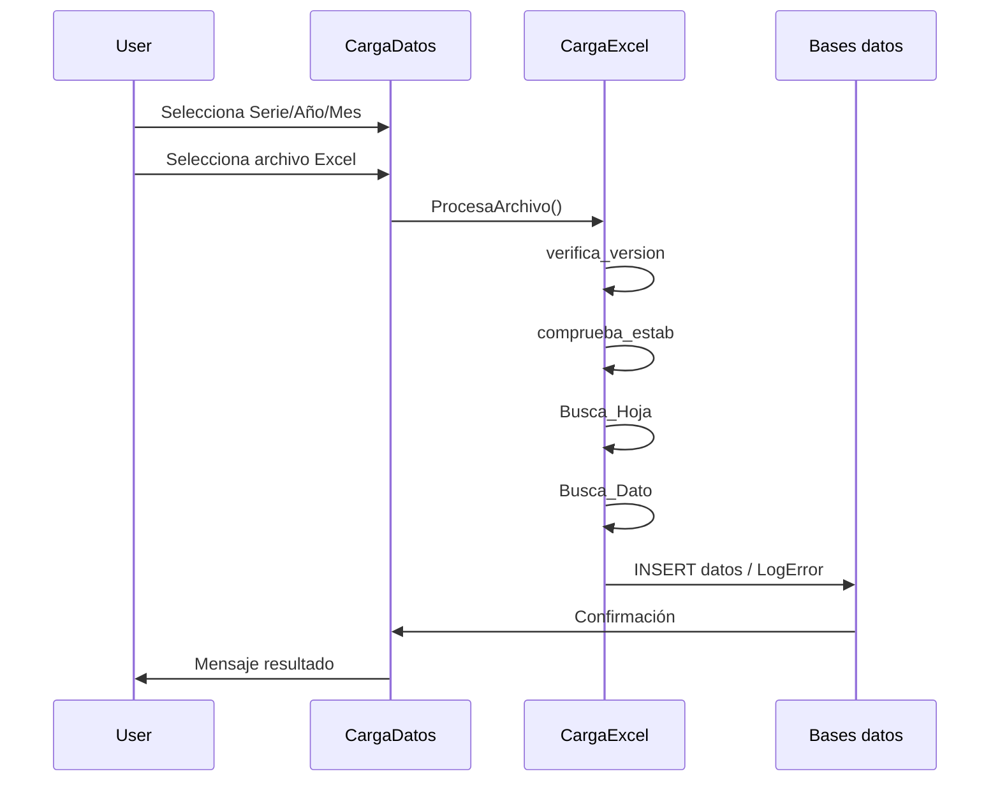
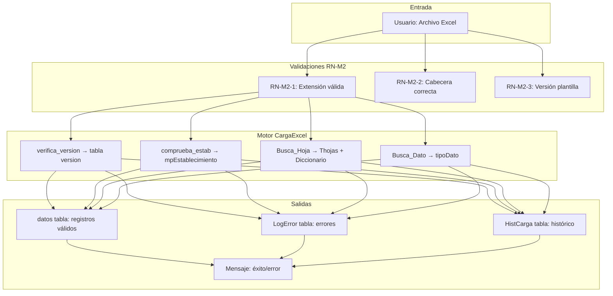
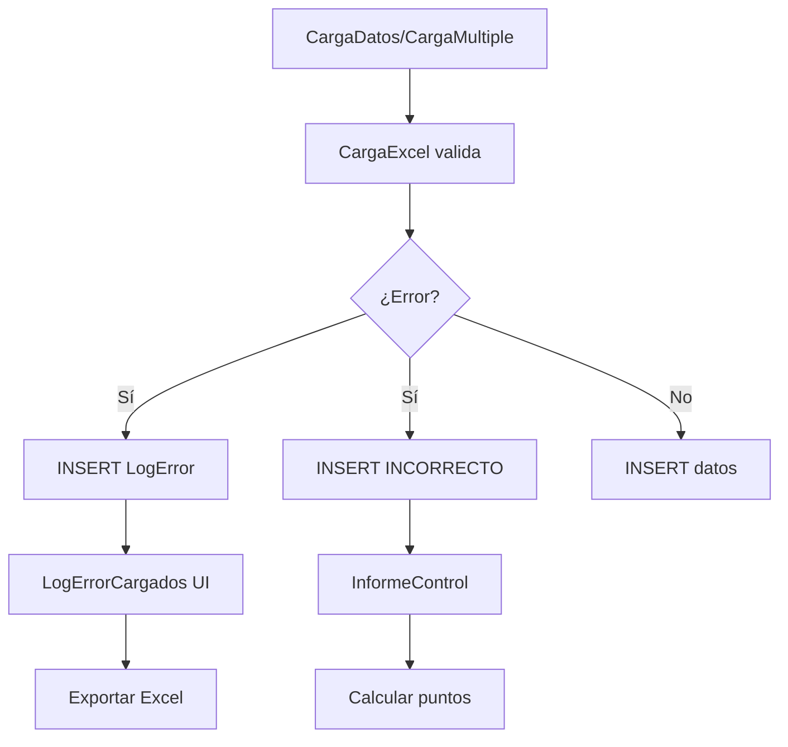
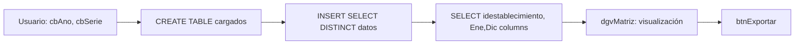
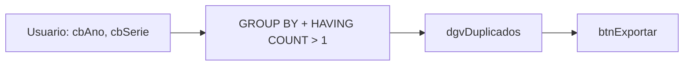
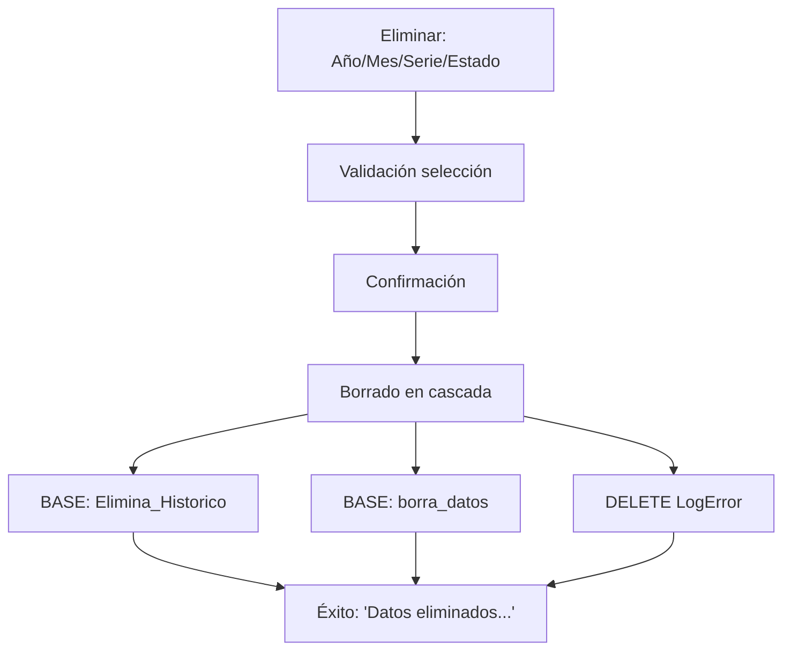
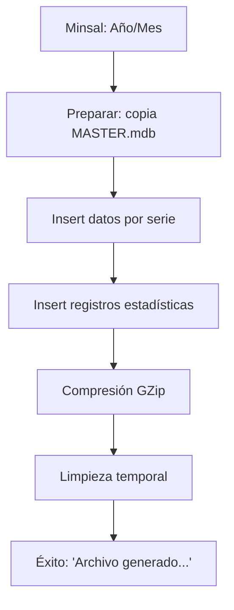
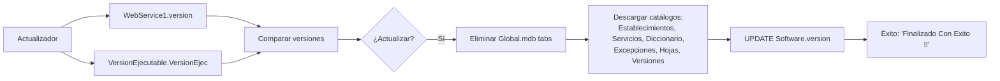
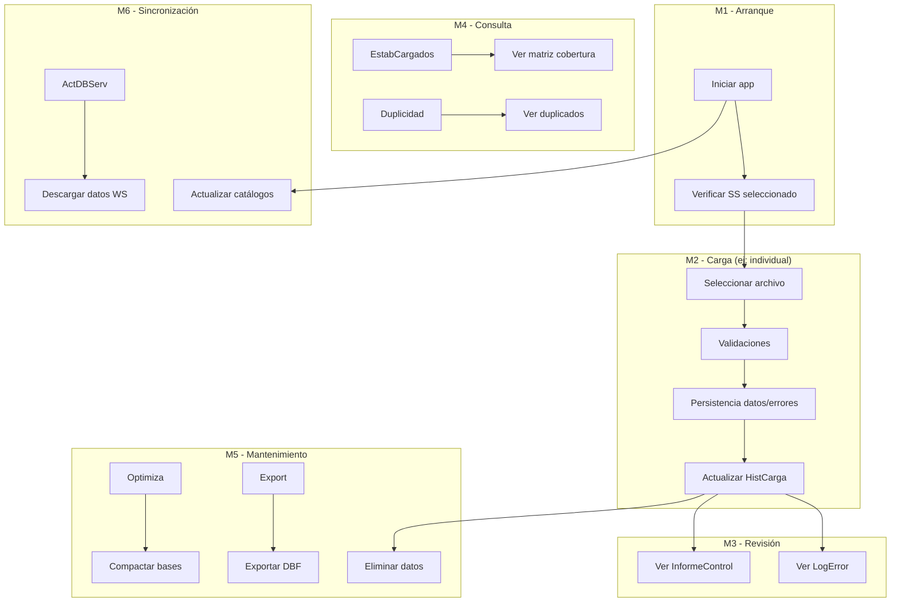

# Flujo de Datos Integral - Sistema ValidadorRem

Versión: 1.0 | Fecha: 2026-11-05 | Estado: ✅ Completo

---

## 📑 ÍNDICE

1. [Arquitectura General](#1-arquitectura-general)
2. [Módulo M1 - Arranque y Configuración](#2-módulo-m1-arranque-y-configuración)
3. [Módulo M2 - Carga de Datos](#3-módulo-m2-carga-de-datos)
4. [Módulo M3 - Errores y Control](#4-módulo-m3-errores-y-control)
5. [Módulo M4 - Consulta e Informes](#5-módulo-m4-consulta-e-informes)
6. [Módulo M5 - Mantenimiento y Exportación](#6-módulo-m5-mantenimiento-y-exportación)
7. [Módulo M6 - Sincronización](#7-módulo-m6-sincronización)
8. [Flujos Integrados](#8-flujos-integrados)
9. [Diagramas ER Principales](#9-diagramas-er-principales)
10. [API Endpoints Propuestos](#10-api-endpoints-propuestos)

---

## 1. Arquitectura General

### Tecnología Base
- **Plataforma:** Windows Forms (.NET Framework 4.8, x86)
- **Base de datos:** Microsoft Access (Jet/ACE 32-bit)
- **Excel Reading:** NPOI 2.3 + Microsoft.ACE.OLEDB.12.0
- **Web Services:** SOAP ASMX
- **Exportación:** Microsoft.Office.Interop.Excel 14.0

### Estructura de Carpetas
```
Instalación/
├── Global.mdb          (422 MB) - Catálogos maestros
├── Trans.mdb           - Histórico, SetServicio
├── Datos/              - Por serie y año
│   └── DatosSERIE{serie}{año}.mdb
├── Control/            - Control por serie
│   └── ControlSERIE{serie}{año}.mdb
├── Temporal/           - Tablas temporales
├── MASTER.mdb          - Plantilla MINSAL
└── ValidadorRem.exe    - Aplicación principal
```

---

## 2. Módulo M1 - Arranque y Configuración

### Componentes
- **Principal:** Shell principal con menú (13 botones)
- **Seteo:** Selección de Servicio de Salud
- **buscaActualizacion:** Splash actualizaciones

### Flujo de Arranque

```mermaid
flowchart TD
    A[Inicio STAThread] --> B[Splash: Cargando...]
    B --> C[Verificar Actualizado.txt]
    C --> D{Archivo existe?}
    D -- Sí --> E[Actualizacion.actualizar]
    D -- No --> F[Verificar conectividad WS]
    F --> G[WebService1.version()]
    F --> H[VersionEjecutable.VersionEjec()]
    G --> I[Comparar versiones]
    H --> I
    I --> J{¿Diferente?}
    J -- Sí --> K[Mensaje: Actualizaciones]
    J -- No --> L[Mostrar Principal]
    K --> L
    L --> M{¿SS seleccionado?}
    M -- Sí --> N[Operaciones habilitadas]
    M -- No --> O[Operaciones bloqueadas RN-G1]
```

### Flujo Selección SS

```mermaid
flowchart TB
    A[Seteo: Menú → Seleccionar S.S.] --> B[SELECT COUNT FROM SetServicio]
    B --> C{Ya existe?}
    C -- Sí --> D[Mensaje: "Ya seleccionó SS"]
    C -- No --> E[SELECT FROM mpservicio]
    E --> F[Usuario elige]
    F --> G[INSERT INTO SetServicio]
    G --> H["Éxito: 'Datos ingresados...'"]
```

---

## 3. Módulo M2 - Carga de Datos

### Componentes
- **CargaDatos:** Carga individual
- **CargaDatosMultiple:** Carga por carpeta
- **ActDBServ:** Descarga servidor
- **CargaExcel:** Motor de validación

### Flujo Carga Individual



### Flujo Integrado



---

## 4. Módulo M3 - Errores y Control

### Flujo de Registro de Errores



### Estructura LogError

```sql
CREATE TABLE LogError (
    archivo TEXT(255),
    idestablecimiento TEXT(50),
    mes LONG, ano LONG, serie TEXT(10),
    linea LONG, hoja TEXT(100),
    dato TEXT(255), mensaje_error MEMO,
    fecharegistro DATETIME
);
```

---

## 5. Módulo M4 - Consulta e Informes

### Flujo Matriz Establecimientos



### Flujo Detección Duplicados



---

## 6. Módulo M5 - Mantenimiento y Exportación

### Flujo Borrado Datos



### Flujo Generación MINSAL



---

## 7. Módulo M6 - Sincronización

### Flujo Actualización Catálogos



### Web Services Involucrados

| Servicio | Operación | Uso |
|----------|-----------|-----|
| WebService1 | `version()` | Versión servicio |
| versionejecutable | `VersionEjec()` | Versión ejecutable |
| webservicedb | `datos()`, `diccionario()` | Catálogos |
| CargaSerie | `serieA()` | Descarga por serie |
| CargaSerieServ | `DatosSerie()` | Datos por SS/año/mes |
| Optimiza_Up | `Datos_Up()` | Optimización remota |

---

## 8. Flujos Integrados

### Flujo Completo Carga datos



---

## 9. Diagramas ER Principales

### Entidad-Dato Principal

```mermaid
erDiagram
    DATOS {
        Long ano PK
        Long mes PK
        Text idestablecimiento PK
        Text codigoprestacion PK
        Double col01 ... col50
        DateTime fechacarga
    }
    
    LOGErr {
        Text archivo
        Text idestablecimiento
        Long mes, ano, serie
        Long linea
        Text hoja
        Text dato
        MEMO mensaje_error
    }
    
    HISTCARGA {
        Text IdEstablecimiento
        Long Mes, Ano
        Text Serie
    }
    
    DATOS ||--o{ LOGErr : "genera"
    DATOS ||--o{ HISTCARGA : "registra"
```

---

## 10. API Endpoints Propuestos

### Módulo M1 - Configuración

```http
GET /api/servicio/seleccionado
GET /api/servicio/disponibles
POST /api/servicio/seleccionar
```

### Módulo M2 - Carga

```http
POST /api/carga/individual
POST /api/carga/multiple
POST /api/carga/servidor
```

### Módulo M3 - Errores

```http
GET /api/errores
GET /api/errores/{archivo}
GET /api/control/puntos
POST /api/errores/exportar
```

### Módulo M4 - Consultas

```http
GET /api/establecimientos/cargados
GET /api/duplicidad
GET /api/prestaciones
POST /api/informes
```

### Módulo M5 - Mantenimiento

```http
DELETE /api/datos
POST /api/mantenimiento/optimizar
POST /api/exportar/dbf
POST /api/exportar/minsal
```

### Módulo M6 - Sincronización

```http
GET /api/version/servicio
GET /api/version/ejecutable
POST /api/sincronizacion
POST /api/sincronizacion/categorias
```

---

## 📝 Notas importantes

### Archivos de referencia originales (conservar)
- MODULO_M1_ARRANQUE_CONFIGURACION.md
- MODULO_M2_CARGA_DATOS.md
- MODULO_M3_ERRORES_CONTROL.md
- MODULO_M4_CONSULTA_INFORMES.md
- MODULO_M5_MANTENIMIENTO_EXPORTACION.md
- MODULO_M6_SYNCHRONIZATION.md

### Archivos descartables (pueden borrarse)
- MODULO_M1_PROFUNDIZADO.md
- MODULO_M2_PROFUNDIZADO.md
- MODULO_M3_PROFUNDIZADO.md
- MODULO_M4_PROFUNDIZADO.md
- MODULO_M5_PROFUNDIZADO.md
- MODULO_M6_PROFUNDIZADO.md
- FLUJO_DATOS_MODULO_CARGA.md

---

**Documento generado:** Basado en análisis estático del sistema ValidadorRem. Para migración web, requiere captura de tráfico SOAP y validación de formatos específicos.