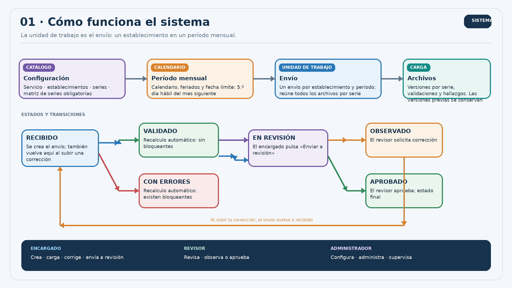

# Manuales del Portal REM

> Conjunto de documentos para **usar** el portal, no para programarlo.
> Si lo que buscas es cómo está hecho, eso está en `02-DOCS/` y en el código.

---

## Por dónde empezar

| Si eres… | Lee esto | Tiempo |
|---|---|---|
| **Cualquiera que va a abrir el portal** | [Levantar el servidor](levantar-el-servidor.md) | 5 min |
| **Encargado de establecimiento** | [Manual del encargado](guia-encargado-establecimiento.md) | 15 min |
| **Equipo REM** | [Guía del Equipo REM](guia-revisor-servicio-salud.md) | 15 min |
| **Administrador** | [Manual del administrador](guia-administrador.md) | 20 min |
| **Quien va a explicar el sistema** | [Cómo funciona el sistema](00-como-funciona-el-sistema.md) | 20 min |

---

## Los tres roles de un vistazo

| Rol | Quién es | Qué hace | Qué no puede hacer |
|---|---|---|---|
| **Encargado** | Quien carga en un hospital o posta | Crea el envío, sube las series, envía a revisión, pide apertura de plazo | Ver otros establecimientos, aprobar |
| **Equipo REM** | La Unidad de Estadísticas (cuatro personas) | Observa, aprueba, reabre y pide nueva subida en sus establecimientos asignados | Cargar archivos, editar catálogos, aprobar aperturas de plazo |
| **Administrador** | Mantiene el sistema | Catálogo, calendario, usuarios; y todo lo anterior | Nada del flujo le está vedado |

Los tres roles trabajan sobre **la misma unidad**: el envío de un establecimiento en un mes.



---

## Cómo se conectan los documentos

```text
levantar-el-servidor.md     ← cómo dejar el portal funcionando
        │
        ├── guia-encargado-establecimiento.md
        ├── guia-revisor-servicio-salud.md
        └── guia-administrador.md
                    │
                    └── 00-como-funciona-el-sistema.md   ← el mapa de los módulos
                                │
                                └── analisis-simplificacion.md  ← qué se puede mejorar
```

---

## Documentos complementarios

| Documento | Para qué |
|---|---|
| [`manual-usuario.md`](manual-usuario.md) | Manual general del portal, escrito antes del rediseño |
| [`manual-operacion.md`](manual-operacion.md) | Operación del sistema: respaldos, catálogos, puesta en marcha |
| [`analisis-simplificacion.md`](analisis-simplificacion.md) | Dónde el flujo se traba y qué módulos se pueden simplificar |
| [`../operacion/como-probar.md`](../operacion/como-probar.md) | Instalación desde cero, validación de archivos REM y problemas conocidos |

---

## Una nota sobre las capturas

Los diagramas de flujo por rol (`img/02`, `img/03`, `img/04`) muestran qué puede hacer
cada rol y en qué orden. Las pantallas cambian con el tiempo; los diagramas y los textos
son la referencia estable.
