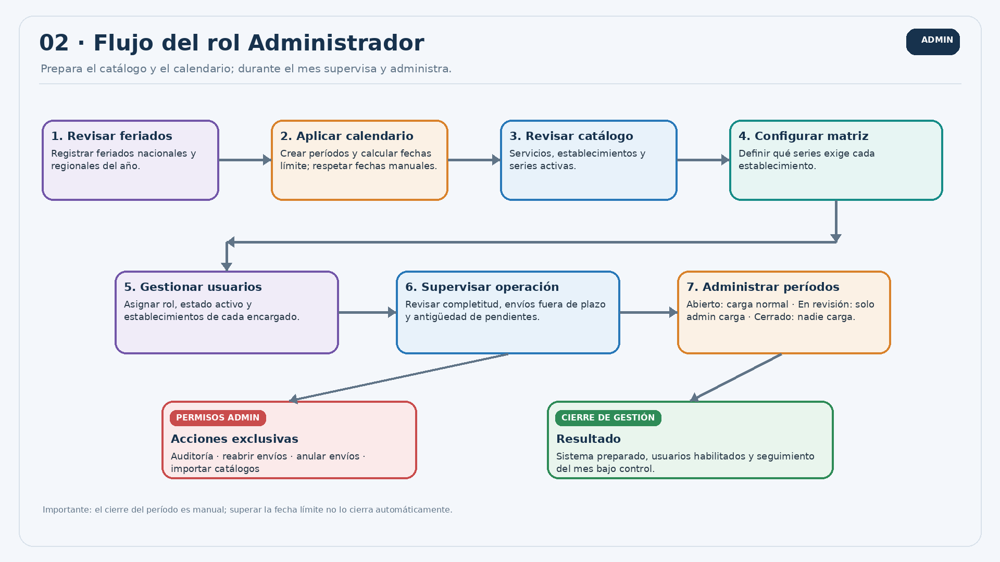

# Manual del administrador

> Para quien mantiene el catálogo, el calendario y los usuarios.
> Usuario de la demo: `admin@ssosorno.cl`, clave `Portal2026!`.
>
> Antes de empezar: si el portal no te abre, mira
> [`levantar-el-servidor.md`](levantar-el-servidor.md).



---

## 0. Tu trabajo en una frase

**Que el mes esté listo antes de que los establecimientos empiecen a cargar.**

El catálogo, el calendario y los usuarios son tuyos. Si están bien, el resto del sistema
funciona solo.

---

## 1. Lo que ves al entrar

Tu menú es el más largo. Tres secciones:

| Sección | Pantalla | Qué controla |
|---|---|---|
| General | Panel | Punto de partida |
| Operación | Envíos · Revisión · Completitud | Las tres, porque tienes todos los permisos |
| **Administración** | Servicios, Establecimientos, Series, Matriz de series, Períodos, Calendario de plazos, Feriados, Plantillas | El catálogo |
| **Usuarios** | Usuarios | Quién entra y qué puede hacer |

**El orden importa.** El catálogo se arma de arriba abajo: primero el Servicio, después sus
establecimientos, después las series, y al final la matriz que los cruza.

---

## 2. Antes del mes: la preparación

Esta es la secuencia que deja el mes listo para que los encargados trabajen.

### Paso 1 — Verificar los feriados del año

Menú **Feriados**.

Los feriados son lo que hace que el plazo sea correcto. Sin ellos, el sistema cuenta solo
sábados y domingos, y **el plazo queda uno o dos días más largo**.

| Campo | Qué poner |
|---|---|
| Fecha | La del feriado |
| Nombre | El oficial |
| Ámbito | Nacional o Regional |
| Región | Solo si es regional (la nuestra es la 10) |

> **Revisa el año siguiente antes de diciembre.** La pantalla de calendario avisa si falta.

### Paso 2 — Aplicar el calendario del año

Menú **Calendario de plazos**.

Elige el año y pulsa **Aplicar calendario**. Con eso:

- Se **crean** los 12 períodos que faltaban, en estado `abierto`.
- Se **actualiza** la fecha límite de los que existen, salvo los que tengan fecha manual.
- **No cambia el estado** de ningún período existente. Eso es a propósito.

La tabla del año muestra, mes por mes, la fecha calculada y si el período ya existe.

**Cómo se calcula la fecha límite**

> Fin del **quinto día hábil del mes siguiente**.

Ejemplo real: el período **10/2026** vence el **06-11-2026**. Noviembre de 2026 empieza
domingo; los días hábiles son 2, 3, 4, 5 y 6. El quinto es el 6.

**Excepción manual:** si un mes necesita otra fecha, ve a **Períodos**, edita ese registro y
marca «Fecha límite manual». Desde ahí el sistema **no vuelve a calcularla**, aunque apliques
el calendario otra vez. Es la válvula de escape y conviene usarla poco.

### Paso 3 — Revisar la matriz de series

Menú **Matriz de series**.

Es la pantalla más importante del catálogo. Define **qué series le exige el Servicio a cada
establecimiento**. Una fila mal puesta aquí no se queda quieta: cambia el desplegable de
subida, la validación de completitud, el estado del envío y la guarda de aprobación.

**Esta pantalla es la que hay que revisar cada vez que una serie cambia de estado.**

### Paso 4 — Revisar los usuarios y repartir los establecimientos

Menú **Usuarios**.

Cada persona necesita:

| Campo | Importa porque |
|---|---|
| Nombre y correo | Identidad. El correo no se cambia desde el perfil |
| **Rol** | Decide qué pantallas ve |
| **Activo** | Un usuario inactivo no recibe avisos |
| Contraseña | Al crear; después la cambia la persona |
| **Establecimientos** | Define su alcance: sin asignación no ve ningún dato |

> **El reparto se hace en dos lugares y es la misma decisión:** en el formulario del
> usuario y en **Usuarios → Asignaciones**. Un establecimiento puede tener varios
> integrantes del Equipo REM.

**Roles.** El que revisa se muestra como **Equipo REM**; su clave interna sigue
siendo `revisor`. Los cuatro integrantes se crean con `php artisan db:seed
--class=EquipoRemSeeder` en local, o desde esta pantalla en producción.

> **Sin asignación, la bandeja del revisor y la del encargado aparecen vacías** y a ti te
> llega un aviso. Es el síntoma correcto: falta repartir, no es un fallo del sistema.

---

## 3. Durante el mes

### Los estados del período

| Estado | Qué permite |
|---|---|
| **Abierto** | Los encargados cargan y envían a revisión. Es el estado normal |
| **En revisión** | Solo el admin puede cargar. Se usa cuando el Servicio toma el control del mes |
| **Cerrado** | Nadie carga. El mes quedó firme |

Se cambia en **Períodos → Editar → Estado**.

> **No hay cierre automático.** El sistema **no** cambia el período a `en_revision` ni a
> `cerrado` cuando pasa la fecha límite. Ese cambio lo hace una persona. Si nadie lo hace, un
> encargado puede cargar el mes 10 en enero.

### Qué vigilar

1. **Completitud**: el porcentaje del Servicio. Si no sube, hay establecimientos que no
   entregaron.
2. **Revisión → filtro «Fuera de plazo»**: quién llegó tarde. Queda marcado en el envío y en
   la matriz.
3. **Revisión → filtro «Antigüedad»**: envíos que llevan días sin resolverse.

---

## 4. Los catálogos, uno por uno

Servicios, Establecimientos, Series, Períodos y Feriados comparten la misma pantalla:
listado, **Nuevo**, y edición por fila. Todos tienen **Guardar** y **Cancelar**.

### Series

| Campo | Nota |
|---|---|
| Código | Hasta 5 caracteres. Único |
| Nombre | |
| Orden | El orden en que aparecen en la matriz |
| **Activa** | Si la desmarcas, deja de ofrecerse al subir |

> **Qué pasa al desactivar una serie.** Deja de ofrecerse al subir y deja de exigirse, aunque
> la matriz conserve su fila. Los envíos en curso **no se bloquean**. Al volver a marcarla,
> la configuración de la matriz sigue intacta y la serie se exige otra vez. Es reversible en
> los dos sentidos, y por eso es seguro probarlo.

### Períodos

| Campo | Nota |
|---|---|
| Año y mes | Únicos en combinación |
| Fecha límite manual | La excepción. Si está marcada, manda la fecha escrita |
| Fecha límite | Si no es manual, se calcula sola |
| Estado | Abierto, en revisión o cerrado |

### Plantillas

No es un catálogo más: guarda **la versión de plantilla que se espera** por año, mes y serie.
La validación compara el archivo contra eso. Si se sube la plantilla equivocada, los envíos
correctos empiezan a fallar.

---

## 5. Lo que solo puedes hacer tú

| Acción | Permiso |
|---|---|
| Gestionar catálogos | `catalogos.gestionar` |
| Importar catálogos | `catalogos.importar` |
| Gestionar usuarios y **repartir establecimientos** | `usuarios.gestionar` |
| Gestionar períodos | `periodos.gestionar` |
| Ver la auditoría | `auditoria.ver` |
| **Aprobar, rechazar o abrir** una apertura de plazo | `aperturas.resolver` |
| **Anular** un envío | `envios.anular` |
| Ver el **registro de uso del Validador** | `validador.estadisticas` |

**Reabrir** ya no es exclusivo tuyo: el Equipo REM también puede, con motivo. Es la
contrapartida de que un envío aprobado no sea irreversible.

---

## 5 bis. Aperturas de plazo y Validador

### Aperturas de plazo

Menú **Aperturas de plazo**. Ahí llegan las solicitudes del equipo y las que
abriste tú.

| Acción | Cómo |
|---|---|
| **Aprobar** una solicitud | Botón **Resolver** → motivo + fecha de término |
| **Rechazar** | Botón **Resolver** → motivo del rechazo |
| **Abrir por tu cuenta** | Formulario de arriba, con establecimiento (o «todos»), período, motivo y fecha |
| **Anular** una ventana vigente | Botón **Anular**, con motivo |

Mientras la ventana está vigente, ese establecimiento puede cargar el período
aunque esté cerrado. **Los demás siguen cerrados.** Vencida la fecha, el bloqueo
vuelve solo.

### Validador

**Validador → Registro de uso** (solo tú lo ves): revisiones por mes y por
usuario, con hallazgos y bloqueantes. Sirve para saber si la herramienta se usa.

El Validador **no interviene en el flujo**: revisa un Excel suelto. Si encuentras
algo, se corrige con una observación o una nueva subida, no desde ahí.

### Comandos nuevos

```bat
php artisan rem:periodos:generar 2027      Crea los períodos del año
php artisan rem:periodos:generar --siguiente
php artisan rem:calendario 2026 --verificar   Falla si el calendario se desfasó
php artisan rem:feriados:cargar 2027       Carga los feriados verificados
php artisan rem:aperturas:cerrar           Marca las ventanas vencidas
php artisan rem:validador:limpiar          Borra archivos con más de 90 días
```

**Ninguno es obligatorio para que el portal funcione.** El calendario se genera
al pedir un período que no existe, y las ventanas se controlan por fecha.

---

## 6. Lo que conviene saber antes de la demostración

1. **La campana es el único aviso.** No hay correo. Si alguien no entra, no se enteró.
   La campana distingue **serie suelta** de **envío completo** y agrupa las subidas
   seguidas. En **Notificaciones** está el historial.
2. **El cierre del período es manual.** Decirlo en voz alta evita la pregunta incómoda.
   Abrir un período cerrado para un establecimiento es una **apertura**, y se aprueba aquí.
3. **El mes 10 está vencido desde el 06-11.** Demostrar con octubre es demostrar el camino
   del atraso. Es válido, pero hay que decirlo.
4. **La serie P solo aparece en junio y diciembre.** Si alguien pregunta por qué no
   está en el mes en curso, la respuesta es el corte semestral.
5. **La serie F es la pieza de demostración.** En la realidad no se usa desde hace años, pero
   queda activa para mostrar en vivo cómo se deshabilita una serie y cómo se vuelve a agregar.
   - Desmarcar **Activa** en Series: F desaparece del desplegable de subida y de la matriz de
     completitud. Los envíos que la tenían **no se bloquean**.
   - Volver a marcarla: F vuelve a exigirse donde la matriz la tenga.

   Es reversible. El estado inicial se reproduce con
   `php artisan db:seed --class=L1MinimumSeeder`.

6. **Si la base se ve vacía**, cárgale los datos de ejemplo:

   ```bat
   cd C:\xampp\htdocs\www\Cargas\portal
   php artisan db:seed --class=DemoSeeder
   ```

   Deja el período 10/2026 con seis envíos repartidos por los cinco estados. Es idempotente:
   ejecutarlo de nuevo reemplaza los anteriores. El detalle está en
   [`00-como-funciona-el-sistema.md`](00-como-funciona-el-sistema.md), §8.

> **Lo que hay que subrayar en la demostración:** desactivar una serie no borra su fila de la
> matriz. Mientras la serie esté inactiva, el catálogo manda y la serie no se exige; al
> reactivarla, la configuración de la matriz sigue intacta. Eso es lo que hace que el
> interruptor sea seguro.
