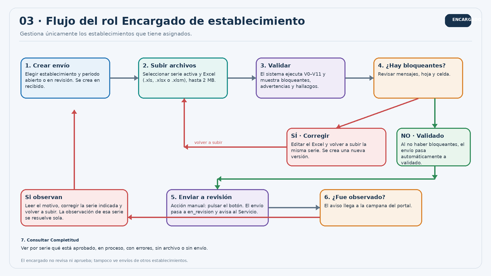

# Manual del encargado de establecimiento

> Para quien carga la estadística mensual en un hospital o una posta.
> Cubre el mes completo, de la creación del envío a la aprobación.
>
> En la demo hay **dos** usuarios con este rol: `encargado.hospital@ssosorno.cl` y
> `encargado.postas@ssosorno.cl`. La clave de ambos es `Portal2026!`.
>
> Antes de empezar: si el portal no te abre, mira
> [`levantar-el-servidor.md`](levantar-el-servidor.md).

---

## 0. Tu trabajo en una frase

**Cargar el archivo de cada serie que el Servicio te exige y avisar cuando están listos.**

No decides severidades, no apruebas nada y no tocas catálogos. Tu parte termina cuando
pulsas «Enviar a revisión».

---

## 1. Lo que ves al entrar

Arriba, siempre: el logo, el botón de tema (claro/oscuro), la **campana** de avisos y tu
cuenta.

A la izquierda, tu menú tiene estas secciones:

| Sección | Pantalla | Para qué |
|---|---|---|
| General | **Panel** | Tus cifras del mes y tus accesos |
| Operación | **Envíos** | Tu trabajo del mes |
| Operación | **Completitud** | Si quedaste al día, serie por serie |
| Plazos | **Pedir apertura** | Cargar un período que ya cerró |
| Calidad | **Validador** | Revisar tu Excel antes de subirlo |

**No verás «Equipo REM».** Esa bandeja es del equipo que revisa, no del establecimiento.

Tu panel muestra tus cifras (envíos del año, aprobados, atrasos y subidas por mes),
tus accesos y un recordatorio del flujo en cuatro pasos.

---

## 2. Tu mes, paso a paso

### Paso 1 — Crear el envío del período

1. Menú **Envíos**.
2. En la tarjeta «Nuevo envío», elige tu establecimiento.
3. Elige el período. Solo aparecen los períodos **abiertos o en revisión**; uno cerrado no
   acepta cargas y no está en la lista.
4. Pulsa **Crear envío**.

Queda creado en estado **recibido**, sin archivos.

> Un envío por establecimiento y por mes. Si ya existe, el sistema te lo dice: no crea dos.

**«Recibido» significa que existe, no que esté bien.** Todavía no subiste nada.

### Paso 2 — Subir una serie

En la pantalla del envío, tarjeta **«Subir o reemplazar un archivo»**:

1. **Serie**: el desplegable trae las series activas. Si una serie ya tiene archivo, dice la
   versión entre paréntesis: `A — SERIE A (v1)`.
2. **Archivo Excel**: `.xls`, `.xlsx` o `.xlsm`. Máximo **2048 KB** (2 MB).
3. Pulsa **Subir y validar**.

El sistema valida el archivo **antes de aceptarlo** y te muestra el resultado en el acto.

**Repite esto una vez por cada serie que tu establecimiento tenga exigida.** Para el Hospital
Base San José son cinco: **A, BS, BM, D, P**.

> Si subes una serie que no te corresponde, o una desactivada, el sistema la rechaza con un
> mensaje. No es un error tuyo de dedo: esa serie no se te exige.

### Paso 3 — Leer el resultado de la validación

Después de cada subida aparecen dos cosas:

**Los cuatro indicadores**

| Indicador | Qué mide |
|---|---|
| **Bloqueantes** | Errores que **impiden** enviar a revisión |
| **Advertencias** | Cosas que revisar pero que **no** impiden avanzar |
| **Series exigidas** | Cuántas te pide la matriz |
| **Series subidas** | Cuántas llevas |

**La tabla de hallazgos**

| Columna | Cómo leerla |
|---|---|
| Etapa | `V0`–`V11`. La etapa dice **qué se comprobó** |
| Código | `ENV-0xx`. Sirve para buscar el detalle exacto |
| Severidad | Bloqueante o advertencia |
| Hoja y Celda | **Dónde está el problema en tu Excel** |
| Mensaje | Qué pasa, en español |

Trabaja de arriba abajo: primero los **bloqueantes**, en el orden en que aparecen.

> La etapa **V11** es distinta a las demás. No habla de un archivo: dice que **falta una
> serie completa**. Por eso su columna «Hoja» está vacía.

### Paso 4 — Corregir y volver a subir

1. Abre tu Excel y corrige lo que dice el hallazgo.
2. Vuelve a la tarjeta de subida.
3. Elige **la misma serie** y sube el archivo corregido.

**Esto crea una versión nueva.** La anterior no se borra: queda en el historial. Es a
propósito, para poder demostrar qué se entregó y cuándo.

> Si subes **el mismo archivo dos veces seguidas**, el sistema lo rechaza: el contenido es
> idéntico. Corrige algo antes de subir.

### Paso 5 — Enviar a revisión

Cuando ya no queden bloqueantes, el estado del envío pasa solo a **validado**.

Entonces aparece el botón **«Enviar a revisión»** en la tarjeta «Acciones».

Púlsalo. El envío pasa a **en revisión**, y los revisores del Servicio reciben el aviso.

> **Este clic es tuyo y de nadie más.** El sistema no envía solo. Si no lo pulsas, el envío
> se queda en tu escritorio y el Servicio no se enterará.

### Paso 6 — Si te observan

El revisor puede **observar** una serie concreta o el envío completo. Te llega un aviso a la
campana.

Para resolverlo:

1. Abre el envío. Verás un bloque **Observaciones** con el texto exacto de lo que te
   pidieron corregir, quién lo pidió y cuándo. Si ya no queda ninguna pendiente, el bloque
   dice «todas resueltas».
2. Corrige esa serie y súbela de nuevo.
3. Al subirla, **la observación se resuelve sola** y el envío vuelve a `recibido`.
4. Vuelve a comprobar que no hay bloqueantes.
5. Pulsa otra vez **«Enviar a revisión»**.

No hay que marcar nada como «resuelto»: subir la corrección **es** la respuesta. La tarjeta
de Acciones te lo recuerda mientras el envío esté observado.

### Paso 7 — Comprobar que quedaste al día

Menú **Completitud**. Elige el año y el mes, y mira tu fila.

| Celda | Significa |
|---|---|
| Aprobado (verde) | El Servicio ya aprobó esa serie |
| En proceso (ámbar) | Llegó, está esperando revisión |
| Con errores (rojo) | Llegó con bloqueantes |
| Sin archivo (gris) | No la subiste |
| Sin envío (apagado) | No creaste el envío del mes |

La columna **Avance** te dice `aprobadas / exigidas`. El porcentaje de arriba es el del
Servicio completo, no el tuyo.

---

## 3. Lo que el sistema te dice y qué hacer

| Mensaje | Qué significa | Qué hacer |
|---|---|---|
| «Archivo guardado, pero la validación encontró N bloqueante(s)» | El archivo se guardó y **no sirve** todavía | Corregir el Excel y volver a subir |
| «El contenido es idéntico al de un archivo ya subido» | Subiste el mismo archivo | Corregir algo antes de subir |
| «La serie X no está disponible» | Serie desactivada | No deberías tenerla que subir. Avisa a la Unidad de Estadísticas |
| «El período está cerrado» | El mes ya se cerró | No se puede cargar. Habla con el Servicio |
| «El período está en revisión» | El mes pasó a revisión global | Solo el admin puede cargar |
| «Ya existe un envío para ese establecimiento y período» | Lo creaste antes | Abre el existente; no crees otro |
| «Hay archivos sin validar» | Subiste algo que no terminó de validar | Entra al envío y vuelve a subir esa serie |
| «El período está cerrado y no acepta cargas» | Ya cerró y no tienes apertura | Pide una apertura en **Pedir apertura** |

---

## 4. Cuando el período ya cerró: aperturas de plazo

Cargar fuera de plazo requiere una **apertura** aprobada por el administrador.

1. Abre **Pedir apertura** en el menú.
2. Elige el establecimiento y el período.
3. Escribe el motivo, con detalle: el administrador decide con esa información.
   Mínimo 15 caracteres.
4. Envía la solicitud. El administrador recibe el aviso.
5. Cuando la apruebe, podrás crear el envío y subir archivos **mientras la
   apertura esté vigente**. Si vence, el bloqueo vuelve.

La apertura vale para tu establecimiento. Si el administrador abre una para
todos, alcanza a los establecimientos del Servicio.

Tu envío cargado así queda como **Fuera de plazo** —es un hecho— y con la marca
**Con apertura**, que dice con qué autorización entró.

## 5. La serie P no es mensual

La serie **P** se informa dos veces al año:

- la estadística de **junio**, con el plazo de julio;
- la estadística de **diciembre**, con el plazo de enero.

En los demás meses **no aparece como faltante**. Si la subes, se acepta, pero no
cuenta para la completitud.

## 6. El Validador: revisa tu archivo antes de subirlo

**Calidad → Validador** te permite revisar un Excel con las reglas de la Unidad de
Estadísticas antes de subirlo al envío.

1. Sube el archivo.
2. Revisa los hallazgos: te dice hoja, celda y qué está mal.
3. Corrige el Excel y vuelve a subirlo al envío.

El Validador **no cambia nada del envío**: no lo crea, no lo aprueba y no lo
observa. Es una lupa.

## 7. Lo que no puedes hacer

- **Ver envíos de otro establecimiento.** Ni escribiendo la dirección a mano: el sistema
  filtra en la consulta.
- **Aprobar tu propio envío.** Aprobar es del Equipo REM.
- **Editar los catálogos** (series, establecimientos, matriz, períodos). Eso es del admin.
- **Borrar un envío o un archivo.** Nada se borra: queda el historial.
- **Cambiar la fecha límite.** La fija el calendario del Servicio.
- **Aprobarte una apertura.** Solo el administrador la resuelve.

---

## 8. Tu cuenta

Arriba a la derecha, tu nombre abre el menú de cuenta. Ahí está **Mi cuenta**, donde puedes
cambiar tu nombre y tu contraseña.

El correo **no se puede cambiar**: es tu identidad en el sistema.
