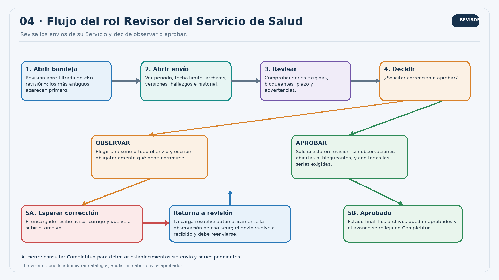

# Guía del Equipo REM

> Para quien revisa la estadística que entregan los establecimientos y la aprueba.
> En el portal el rol se llama **Equipo REM**; la clave interna sigue siendo `revisor`.
> Usuario de la demo: `revisor@ssosorno.cl`, clave `Portal2026!`.
>
> Antes de empezar: si el portal no te abre, mira
> [`levantar-el-servidor.md`](levantar-el-servidor.md).

---

## 0. Tu trabajo en una frase

**Decidir si la estadística de cada establecimiento se aprueba, se devuelve o se
vuelve a pedir.**

Puedes aprobar, observar, reabrir un envío ya aprobado y pedir una nueva
subida. No puedes cargar ni corregir archivos: eso es del establecimiento.

---

## 1. Lo que ves al entrar

| Sección | Pantalla | Para qué |
|---|---|---|
| General | **Panel** | Tus cifras: pendientes, aprobados, atrasos y tiempo de revisión |
| Operación | **Envíos** | El detalle de los envíos de tus establecimientos |
| Operación | **Equipo REM** | **Tu bandeja de trabajo** |
| Operación | **Completitud** | Quién ha entregado y quién no, en tus establecimientos |
| Plazos | **Aperturas de plazo** | Las que pidieron tus establecimientos |
| Calidad | **Validador** | Revisar un Excel con las reglas de la Unidad |

**Ves solo los establecimientos que el administrador te asignó** (R-ALC-01). Si no
tienes ninguno, la bandeja aparece vacía con un aviso: pídele al administrador
que te asigne en **Administración → Asignaciones**.

La **campana** de la cabecera te avisa cuando un establecimiento sube un archivo o
envía a revisión. El aviso distingue **serie suelta** de **envío completo**, y
las subidas seguidas se agrupan en un solo aviso. En **Notificaciones** tienes el
historial completo, con filtro por tipo.

---

## 2. Tu mes, paso a paso

### Paso 1 — Abrir la bandeja

**Equipo REM** muestra por defecto lo que está **en revisión**, del más antiguo al
más nuevo. Puedes filtrar por estado, establecimiento, año, antigüedad y plazo.

### Paso 2 — Revisar el envío

Abre el envío con **Ver**. Ahí están:

- las series exigidas y el archivo vigente de cada una;
- los hallazgos de la validación;
- las observaciones anteriores y su estado.

### Paso 3 — Decidir

| Situación | Acción |
|---|---|
| Todo está bien y no hay observaciones abiertas | **Aprobar** |
| Una serie tiene un problema | **Observar** y elegir la serie |
| El período completo está mal | **Observar** sin elegir serie |
| Ya estaba aprobado y hay un error | **Reabrir** con motivo, y después observar |

**Observar** devuelve el envío al establecimiento. La observación se resuelve sola
cuando el encargado sube la corrección.

### Paso 4 — Pedir una nueva subida

**Equipo REM → Pedir nueva subida**. Sirve cuando no basta con una observación
suelta o cuando el envío salió mal después de aprobado. Tres alcances:

1. **Una serie** de un envío.
2. **Todas las series** de un envío.
3. **Todos tus establecimientos** en un período (solo los que ya están en revisión,
   observados o aprobados).

La solicitud deja una observación por serie y, si el envío estaba aprobado, lo
reabre antes. El encargado recibe el aviso con el motivo.

### Paso 5 — Cerrar el período

Cuando ya no esperas nada, el administrador cierra el período. Tú no lo cierras.

---

## 3. El Validador

Es una **ayuda**, no una etapa del flujo. Sirve para revisar un Excel antes de
aprobar o para chequear la calidad de lo que llegó:

1. Abre **Validador** y sube el archivo.
2. El sistema aplica las reglas de calidad de la Unidad y muestra los hallazgos
   con hoja y celda.
3. Cada revisión queda registrada en **Mis revisiones**.

**No cambia el estado de ningún envío.** Si encuentras un problema real, se
resuelve con una observación o con una nueva subida, no desde el Validador.

---

## 4. Atrasos y aperturas

Un envío marcado **Fuera de plazo** llegó después de la fecha límite. Eso no se
corrige desde el portal: es un hecho y queda registrado.

Si un establecimiento necesita cargar un período cerrado, el encargado pide una
**apertura de plazo**. Tú la ves en **Aperturas de plazo**, pero **solo el
administrador la aprueba**.

---

## 5. Lo que no puedes hacer

| Acción | Quién |
|---|---|
| Cargar o corregir archivos | El encargado del establecimiento |
| Aprobar un envío de un establecimiento donde además eres encargado | Nadie: la separación de funciones lo impide (RN-ENV-7) |
| Aprobar con observaciones abiertas | Nadie: primero se resuelven |
| Aprobar con series faltantes o bloqueantes | Nadie: primero se corrigen |
| Aprobar una apertura de plazo | Solo el administrador |
| Cerrar un período | Solo el administrador |
| Ver establecimientos que no tienes asignados | Nadie: el alcance está en la consulta |

---

## 6. Problemas frecuentes

| Qué ves | Qué significa |
|---|---|
| «No hay establecimientos asignados» | El administrador no te repartió ninguno. Pídelo |
| «No hay envíos con ese filtro» | Prueba con otro estado o quita los filtros |
| El botón **Aprobar** no aparece | El envío no está en revisión, o falta resolver algo |
| «Falta(n) N serie(s) exigida(s)» | El envío está incompleto: obsérvalo |
| La serie P no aparece | La P se informa solo en junio y diciembre (RF-045) |
| El aviso no te llegó | Revisa que el establecimiento esté asignado a ti |
